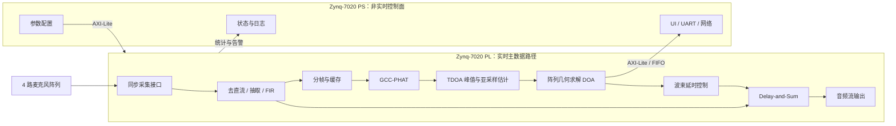

# Competition_fpga

嵌入式比赛作品

## SoundSight：基于 Zynq FPGA 的实时声源定位与波束形成系统

SoundSight 面向 AMD FPGA 自主设计比赛，目标是在 Zynq-7020 平台上完成四路同步声音采集、可靠声源方向估计（DOA）与自动指向的 Delay-and-Sum 波束形成，输出增强后的目标方向音频并展示方向、置信度和运行状态。自动声源跟踪转台保留为后续扩展，只有核心声学链路通过且存在明确的朝向载荷时才进入闭环集成。

当前仓库处于项目初始化阶段。文档中的数值是设计目标，不是已测结果；每个指标只有在 `results/` 中留下可复现实验记录后才能标记为通过。

### 设计原则

- 实时主数据路径放在 PL：采集、预处理、GCC-PHAT、TDOA/DOA、波束形成与流式输出。
- PS 只承担参数配置、状态读取、UI/通信、日志和非实时管理，不替代核心 FPGA 算法。
- 先完成四路同步采集最小闭环，再逐步加入定位和波束形成，避免在硬件基础未验证时堆功能。
- MATLAB 模型、RTL 和板上结果使用同一组测试向量与定点格式，逐级做位精确比对。
- 项目优先证明“可靠定位”和“可验证的音频改善”；错误方向必须能拒绝，音频收益必须绑定可复现的场景条件。

## 系统框图



完整的数据流、控制流、时钟域和模块边界见 [系统架构](docs/architecture.md)；各算法板块为什么存在、如何衔接以及怎样形成验证闭环，见 [原理流程](docs/principles-flow.md)；模块职责、接口交接、Vivado 集成与分阶段实现方法见 [工程实施流程](docs/engineering-flow.md)；定位与音频收益的实验矩阵、指标和算法升级门见 [声学性能验证计划](docs/acoustic-validation-plan.md)。

## 核心算法

### GCC-PHAT

对通道对 $i,j$ 的频域信号计算互功率谱并做相位变换：

$$
R_{ij}[k] = \frac{X_i[k]X_j^*[k]}{|X_i[k]X_j^*[k]|+\varepsilon}
$$

经 IFFT 得到广义互相关序列，相关峰位置对应两通道的到达时间差。硬件实现需要明确 FFT 帧长、重叠率、幅值保护、除法近似和定点位宽。

### TDOA

若峰值对应的采样延迟为 $\hat d_{ij}$，采样率为 $f_s$，则：

$$
\hat\tau_{ij}=\frac{\hat d_{ij}}{f_s}
$$

整数峰值只能达到一个采样周期的分辨率；后续用峰值邻域插值获得亚采样延迟。物理可行延迟由麦克风间距和声速共同限制，超界峰值必须拒绝。

### DOA

远场假设下，第 $i$ 个麦克风相对参考麦克风的时延满足：

$$
c\tau_{i1}=(\mathbf r_i-\mathbf r_1)^T\mathbf u
$$

其中 $c$ 为声速，$\mathbf r_i$ 为阵元坐标，$\mathbf u$ 为入射方向单位向量。使用多组 TDOA 做约束最小二乘并输出角度和置信度。阵列几何决定覆盖范围以及是否存在前后模糊，必须在硬件选型阶段冻结。

### Delay-and-Sum

根据 DOA 生成各通道补偿延时 $d_m$：

$$
y[n]=\frac{1}{M}\sum_{m=0}^{M-1}x_m[n-d_m]
$$

MVP 先实现整数延时；定位链路稳定后再评估分数延时滤波。四路不相关噪声下理论阵列增益上限约为 6 dB，实际指标以标定实验为准。

## PS / PL 分工

| 功能 | PL | PS |
|---|---|---|
| 四路采集、同步与通道对齐 | 主责 | 配置与状态读取 |
| 去直流、抽取、FIR、分帧 | 主责 | 系数下发 |
| FFT / 互功率谱 / PHAT / IFFT | 主责 | 参数选择 |
| 峰值搜索、TDOA、DOA | 主责 | 标定参数管理与显示 |
| Delay-and-Sum 与音频输出 | 主责 | 增益/模式控制 |
| UI、串口/网络、日志 | 仅提供寄存器/FIFO | 主责 |
| 离线分析和数据集管理 | 可导出原始帧 | 主责 |

## 阶段计划

| 阶段 | 交付物 | 通过条件 |
|---|---|---|
| M0 接口与阵列候选 | 采集方案、可调阵列候选、时钟/电平/引脚表 | 四路确认为同一采样时基，接口可接入目标板 |
| M1 四路采集闭环 | 接口 RTL、缓冲、原始录音导出、TB | 四路连续采集无丢样，固定延迟与增益差可重复测量 |
| M2 黄金模型与声学基线 | MATLAB 浮点模型、校准、波束图、手动真实方向波束 | 合成与实录 TDOA 可恢复，手动波束收益及阵列边界已量化 |
| M3 GCC-PHAT / TDOA | 位精确模型、资源/周期预算、RTL、自动化 TB | 逐级一致并满足 hop 内吞吐；异常输入不会伪造角度 |
| M4 DOA | 几何求解、置信度、异常拒绝 | P50/P95、有效输出比例和错误指向比例在冻结条件下达标 |
| M5 自动波束形成 | 整数/分数延时、求和、增益控制 | 同一录音的单麦/手动方向/自动方向三组结果完成对照 |
| M6 PS/UI 与整机 | 参数界面、方向显示、演示闭环 | 连续运行、时序、资源和演示用例全部通过 |
| M7 可选自动跟踪转台 | 明确载荷后的执行机构、位置反馈、跟踪控制与安全保护 | 核心声学系统不依赖转台且转动不会破坏采集与定位 |

详细里程碑与任务依赖见 [路线图](docs/roadmap.md) 和 [团队任务分解](docs/team-tasks.md)。

## 关键指标（目标值）

| 指标 | 初始目标 | 验证方式 |
|---|---:|---|
| 输入通道 | 4 路，共用采样时基 | 同源测试信号与计数器检查 |
| 基准音频格式 | 48 kHz，有效位宽按接口冻结 | 采集日志与频谱检查 |
| 连续采集稳定性 | 1 小时零丢样/乱序 | 帧号、FIFO 告警和统计计数 |
| 定位刷新周期 | 不高于 50 ms | PL 时间戳测量 |
| DOA 误差 | P50 不高于 5°为争取目标；P95 门槛由基线冻结 | 多角度、距离和房间条件重复测量 |
| 定位可靠性 | 有效输出比例与错误指向比例门槛由 M2 基线冻结 | 统计全部有效、拒绝和错误帧，不只报告成功样本 |
| 波束形成收益 | 冻结场景中输出 SNR 提升不低于 4 dB为争取目标 | 同一四通道录音比较单麦、手动真实方向和自动方向 |
| 实时性 | 数据链路无欠载/溢出 | ILA、硬件计数器与长稳测试 |
| 实现约束 | 目标时钟下 WNS ≥ 0 | Vivado 时序报告 |

以上目标会在 M0/M1 后根据真实麦克风、阵列尺寸、房间混响和器件资源修订，修订原因写入文档与提交记录。

## 仓库结构

```text
.
├─ docs/            系统架构、路线图、验证和任务文档
├─ hardware/        麦克风阵列、接口、电源、时钟、引脚与标定资料
├─ model/matlab/    浮点/定点黄金模型与测试向量生成
├─ rtl/             可综合 SystemVerilog/Verilog 源码
├─ tb/              自检测试平台与断言
├─ sim/             仿真配置、向量和批处理入口
├─ vivado/          可复现工程脚本、约束、IP 配置与 BD 脚本
├─ ps/              PS 端配置、UI、通信和日志程序
├─ scripts/         跨模块构建、检查与结果归档脚本
└─ results/         经过确认的测试报告、资源/时序摘要和图表
```

各目录 README 说明允许提交的内容和边界。协作流程见 [CONTRIBUTING.md](CONTRIBUTING.md)。

## 当前最优先任务

下一轮只交付四项：采集方案定稿、可重复分析的四通道原始录音、包含波束图和三路对照的浮点声学基线，以及 FFT/IFFT 周期、缓存、带宽、资源与定点格式预算。40 mm 正方形只作为可调首版候选，最终间距和“5°/4 dB”验收条件要由模型与实录共同冻结。在此之前不开始 GCC-PHAT RTL，也不采购转台执行机构。
