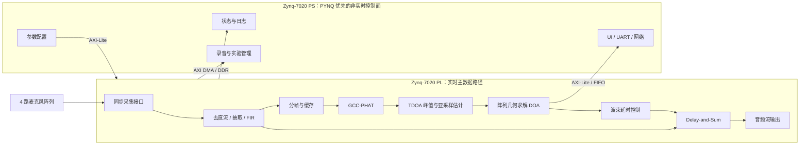

# Competition_fpga

2026-09-23 已迁移至 [fpga-team-workflow](document/team-workflow.md)。A/B/C 对等承担工程职责，任务与批准以 [GitHub Issues](https://github.com/TophBeifong1744/Competition_fpga/issues) / PR 为准；正式 V1 总验收 **2026-10-07**，此前检查为 9/25、9/29、10/3。

入口：[当前进展快照](document/current-status.md) · [验收日历](document/project-plan.md) · [三人分工](document/team-tasks.md) · [新聊天启动提示](document/chat-start-prompts.md) · [迁移与清理记录](docs/maintenance/workflow-migration-20260923.md)。

嵌入式比赛作品

## SoundSight：基于 Zynq FPGA 的实时声源定位与波束形成系统

SoundSight 面向 AMD FPGA 自主设计比赛，目标是在 Zynq-7020 平台上完成四路同步声音采集、可靠声源方向估计（DOA）与自动指向的 Delay-and-Sum 波束形成，输出增强后的目标方向音频并展示方向、置信度和运行状态。C 并行完成舵机/转台与摄像头驱动及实物效果；声学跟踪闭环仍须通过可信方向、坐标和安全控制验证，机械移动不替代声学收益。

当前A FFT29新增覆盖、C板实录及B reference25算法诊断均已获限定独立批准并入main，阶段进展检查通过；正式M1、完整H3、二维定位精度/音频收益和整机实板仍未通过。C001～003基础模块已接入[rtl](project/rtl/README.md)、[tb](simulation/tb/README.md)及[统一仿真入口](simulation/README.md)，原六组回归通过，不等于整机接通。本阶段新增材料仅获研究/诊断批准，保留可运行任务包，不强搬生产主链，见[本次归位与收尾](deliverables/phase-2026-09-14/CLOSEOUT.md)。最新入口：[文档目录](document/README.md)、[当前状态](document/current-status.md)、[工作包台账](document/work-packages.md)、[六麦独立材料包](deliverables/six-mic-acoustic-review-v1/README.md)。旧文档集中于[历史备份](archive/README.md)。

版本范围：2026-10-07 的 V1 用四麦先验收二维水平声源方向及音频改善；三维方向（方位角、俯仰角和单位向量，不含距离/位置）列为 V2。V2 六麦为首选候选、非共面四麦为低成本备选、八麦暂缓；当前已形成六麦指南和首轮软件基线，不扩大首版交付范围，不提前增加采集通道或采购。六麦须经过声学/资源评审和扩展采集准入，不能直接继承四麦验收结论。评估、阶段门与三人分工见[三维方向升级计划](document/three-dimensional-doa-plan.md)。

最新授权范围：麦克风沿用既定选择；仅执行六麦声学评审与离线软件模拟，不新增四麦模拟或四/六麦对比。第一轮2700帧合成浮点结果、波束图、同组六路数据的音频对照及失败边界见[六麦软件预评审](document/six-mic-acoustic-software-review.md)；不代表3D-G0整体或板测通过。

### 设计原则

- 实时主数据路径放在 PL：采集、预处理、GCC-PHAT、TDOA/DOA、波束形成与流式输出。
- PYNQ 作为首选 PS 开发、验证和演示控制层，承担参数配置、状态读取、UI/通信、日志和非实时管理；核心 FPGA 算法不依赖 Python 运行时。
- 团队工程版本固定为 Vivado `2025.2`；“版本已决定”不等于“工程已复现”，必须另外保存版本输出、脚本重建、仿真、综合、实现、资源、时序和板测证据。
- 先完成四路同步采集最小闭环，再逐步加入定位和波束形成，避免在硬件基础未验证时堆功能。
- MATLAB 模型、RTL 和板上结果使用同一组测试向量与定点格式，逐级做位精确比对。
- 项目优先证明“可靠定位”和“可验证的音频改善”；错误方向必须能拒绝，音频收益必须绑定可复现的场景条件。

## 系统框图



完整的数据流、控制流、时钟域和模块边界见 [系统架构](document/architecture.md)；各算法板块为什么存在、如何衔接以及怎样形成验证闭环，见 [原理流程](document/principles-flow.md)；模块职责、接口交接、Vivado 集成与分阶段实现方法见 [工程实施流程](document/engineering-flow.md)；PYNQ 的采用条件、接口和替换边界见 [PYNQ 集成与控制面指南](document/pynq-integration-guide.md)；定位与音频收益的实验矩阵、指标和算法升级门见 [声学性能验证计划](document/acoustic-validation-plan.md)；第三赛道初级组的逐项状态和两个 Skill 工作包见 [赛题验收台账](document/competition-acceptance.md)。

## 核心算法

### GCC-PHAT

对通道对 $i,j$ 的频域信号计算互功率谱并做相位变换：

$$
R_{ij}[k] = \frac{X_i[k]X_j^*[k]}{|X_i[k]X_j^*[k]|+\varepsilon}
$$

经 IFFT 得到广义互相关序列，相关峰位置对应两通道的到达时间差。硬件实现需要明确 FFT 帧长、重叠率、幅值保护、除法近似和定点位宽。

### TDOA

若峰值对应的采样延迟为 $\hat d_{ij}$，采样率为 $f_s$，则：

$$
\hat\tau_{ij}=\frac{\hat d_{ij}}{f_s}
$$

整数峰值只能达到一个采样周期的分辨率；后续用峰值邻域插值获得亚采样延迟。物理可行延迟由麦克风间距和声速共同限制，超界峰值必须拒绝。

### DOA

远场假设下，第 $i$ 个麦克风相对参考麦克风的时延满足：

$$
c\tau_{i1}=(\mathbf r_i-\mathbf r_1)^T\mathbf u
$$

其中 $c$ 为声速，$\mathbf r_i$ 为阵元坐标，$\mathbf u$ 为入射方向单位向量。使用多组 TDOA 做约束最小二乘并输出角度和置信度。阵列几何决定覆盖范围以及是否存在前后模糊，必须在硬件选型阶段冻结。

### Delay-and-Sum

根据 DOA 生成各通道补偿延时 $d_m$：

$$
y[n]=\frac{1}{M}\sum_{m=0}^{M-1}x_m[n-d_m]
$$

MVP 先实现整数延时；定位链路稳定后再评估分数延时滤波。四路不相关噪声下理论阵列增益上限约为 6 dB，实际指标以标定实验为准。

## PYNQ/PS 与 PL 分工

PYNQ 是首选控制层实现，但 AXI4-Lite 寄存器、AXI DMA 数据格式和中断语义必须独立于 Python。若 M0 证明实际板卡不适合 PYNQ，可替换为 Vitis 或 PetaLinux 后端而不修改核心 RTL。

| 功能 | PL | PYNQ/PS |
|---|---|---|
| 四路采集、同步与通道对齐 | 主责 | 配置与状态读取 |
| 去直流、抽取、FIR、分帧 | 主责 | 系数下发 |
| FFT / 互功率谱 / PHAT / IFFT | 主责 | 参数选择 |
| 峰值搜索、TDOA、DOA | 主责 | 标定参数管理与显示 |
| Delay-and-Sum 与音频输出 | 主责 | 增益/模式控制 |
| UI、串口/网络、日志 | 仅提供寄存器/FIFO | 主责 |
| 离线分析和数据集管理 | 可导出原始帧 | 主责 |

## 阶段计划

| 阶段 | 交付物 | 通过条件 |
|---|---|---|
| M0 接口与阵列候选 | 采集方案、已选C转接板实际布局、时钟/电平/引脚表、Vivado 2025.2 版本记录、PYNQ 准入核验 | 四路接口有实物证据；PYNQ 实板准入通过，或已冻结兼容相同 AXI/DMA 合同的替代后端 |
| M1 四路采集闭环 | 接口 RTL、TB、板级工程、运行脚本、AXI DMA/PYNQ 原始录音导出 | 四路连续采集无丢样，实测输出可与 golden reference 比对 |
| M2 黄金模型与声学基线 | MATLAB 浮点模型、校准、波束图、手动真实方向波束 | 合成与实录 TDOA 可恢复，手动波束收益及阵列边界已量化 |
| M3 GCC-PHAT / TDOA | 位精确模型、资源/周期预算、完整 RTL、自动化 TB、综合与实现报告 | 逐级 golden 比对一致，满足 hop 内吞吐，Vivado 2025.2 报告可追溯 |
| M4 DOA | 几何求解、置信度、异常拒绝 | P50/P95、有效输出比例和错误指向比例在冻结条件下达标 |
| M5 自动波束形成 | 整数/分数延时、求和、增益控制 | 同一录音的单麦/手动方向/自动方向三组结果完成对照 |
| M6 PYNQ/PS、UI 与整机 | 完整源码、PYNQ 首选控制程序、构建/运行脚本、报告、AI 可见协作记录和发布包 | 纯英文路径提交包可从零构建、部署、运行并复现实测结果 |
| M7 可选自动跟踪转台 | 明确载荷后的执行机构、位置反馈、跟踪控制与安全保护 | 核心声学系统不依赖转台且转动不会破坏采集与定位 |

详细里程碑与任务依赖见 [路线图](document/roadmap.md) 和 [团队任务分解](document/team-tasks.md)。

## 关键指标（目标值）

| 指标 | 初始目标 | 验证方式 |
|---|---:|---|
| 输入通道 | 4 路，共用采样时基 | 同源测试信号与计数器检查 |
| 基准音频格式 | 48 kHz，有效位宽按接口冻结 | 采集日志与频谱检查 |
| 连续采集稳定性 | 1 小时零丢样/乱序 | 帧号、FIFO 告警和统计计数 |
| 定位刷新周期 | 不高于 50 ms | PL 时间戳测量 |
| DOA 误差 | P50 不高于 5°为争取目标；P95 门槛由基线冻结 | 多角度、距离和房间条件重复测量 |
| 定位可靠性 | 有效输出比例与错误指向比例门槛由 M2 基线冻结 | 统计全部有效、拒绝和错误帧，不只报告成功样本 |
| 波束形成收益 | 冻结场景中输出 SNR 提升不低于 4 dB为争取目标 | 同一四通道录音比较单麦、手动真实方向和自动方向 |
| 实时性 | 数据链路无欠载/溢出 | ILA、硬件计数器与长稳测试 |
| 实现约束 | 目标时钟下 WNS ≥ 0 | Vivado 时序报告 |

以上目标会在 M0/M1 后根据真实麦克风、阵列尺寸、房间混响和器件资源修订，修订原因写入文档与提交记录。

## 仓库结构

```text
.
├─ document/        活动架构、接口、计划和验证说明
├─ project/
│  ├─ rtl/          唯一活动 RTL
│  └─ add_sources.tcl  向已打开工程添加三件基础模块的人工入口
├─ simulation/
│  ├─ tb/           唯一活动 TB
│  ├─ modules.json  模块来源、哈希与仿真清单
│  └─ run_*.ps1     现有 XSim 诊断入口
├─ models/          MATLAB/Python 模型与复现说明
├─ software/        PS 软件说明；当前实现仍按固定任务包定位
├─ data/fixtures/h1/  小型确定性 H1 数据
├─ hardware/        板卡、接口、电源、时钟、引脚与标定资料
├─ scripts/         仓库检查与适配脚本
├─ skill/           已批准的比赛 Skill 原件
├─ docs/            reviews/maintenance/phases/templates 等冻结历史区
├─ task-packages/、deliverables/、archive/、results/  原任务与证据保留区
└─ codex_out/、.local/  本机诊断与私有配置，运行时按需生成并忽略
```

各目录 README 说明允许提交的内容和边界。协作流程见 [CONTRIBUTING.md](CONTRIBUTING.md)，旧新映射和历史复现见[实体迁移说明](document/layout-migration.md)。这是 Issue #26 的候选布局；准确合入状态以 PR 为准。仓库没有已核定的正式 .xpr/BAT/ModelSim 入口，外部 one 工程不在本次迁移范围。

## 官方推荐提交目录映射

第三赛道推荐使用 `README.md`、`src/`、`sim/`、`build/`、`board/`、`data/`、`skill/` 和 `report/`。开发布局与提交包布局分别管理；最终发布授权后才按下表及真实工程依赖导出：

| 官方提交目录 | 当前仓库来源 | 发布包内容 |
|---|---|---|
| `README.md` | `README.md` | 项目简介、环境、构建、部署、运行、验证和从零复现入口 |
| `src/` | `project/rtl/`、获准 PS 源码及原生工程的 BD/IP 输入 | 完整 RTL、PS 源码、受控 Block Design/IP 源描述 |
| `sim/` | `simulation/` | 自检 TB、仿真脚本、输入、预期、实际和 PASS/FAIL 结果 |
| `build/` | `project/`、`scripts/`、审核后的 `results/` 及原生工程 recipe | Vivado 2025.2 重建脚本及综合、实现、资源、时序、时钟报告 |
| `board/` | `hardware/` 中已核验连接、原生工程约束、PS 部署脚本和板测结果 | 上板工程、运行脚本、硬件清单、实测输出和 golden 对比 |
| `data/` | `data/fixtures/`、`models/` 的导出、审核后的测试数据 | 小型测试数据、元数据、golden reference 和大文件外部清单 |
| `skill/` | `skill/` | 通过验收的 SKL-001、SKL-002 及各自 README、边界和验证结果 |
| `report/` | `document/` 中面向评审的定稿、`results/` 摘要 | 设计报告、指标证据、复现说明和用户可见的 AI 协作记录 |

最终提交包根目录使用纯英文项目名，例如 `soundsight/`；所有目录和文件名只使用小写英文字母、数字、下划线或连字符。`官方资源/` 下的官方 PDF、内部会议纪要、工作包草稿、未脱敏照片和无再分发许可的第三方资料只作内部证据，不直接进入提交包。发布前必须完成隐私/匿名信息、绝对路径、账号令牌、第三方许可和开源许可证检查；是否匿名按最终提交规则执行，不把内部姓名和机器路径无条件带入公开包。

AI 协作材料只保存用户可见提示、模型可见回答、人工纠正、采用/拒绝决定、文件修改和验证结果。官方所称“自我纠错轨迹”用可见的“错误或失败 → 人工/模型修正 → 重新验证”记录表达，不导出隐藏思维链、系统提示或内部推理。

## 当前最优先任务

A先处理 #13 加载入口与 #14 生产合同；B推进 #16 诊断复核及 #17 完整算法/定点包；C完成 #15 正确素材的新八段录音，继续 #19 舵机和 #20 摄像头。已发布的准备包与Skill候选直接增量交审，不重复旧FFT。详见[当前任务入口](document/work-packages.md)。
