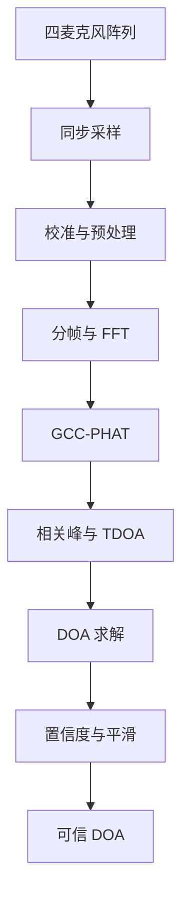
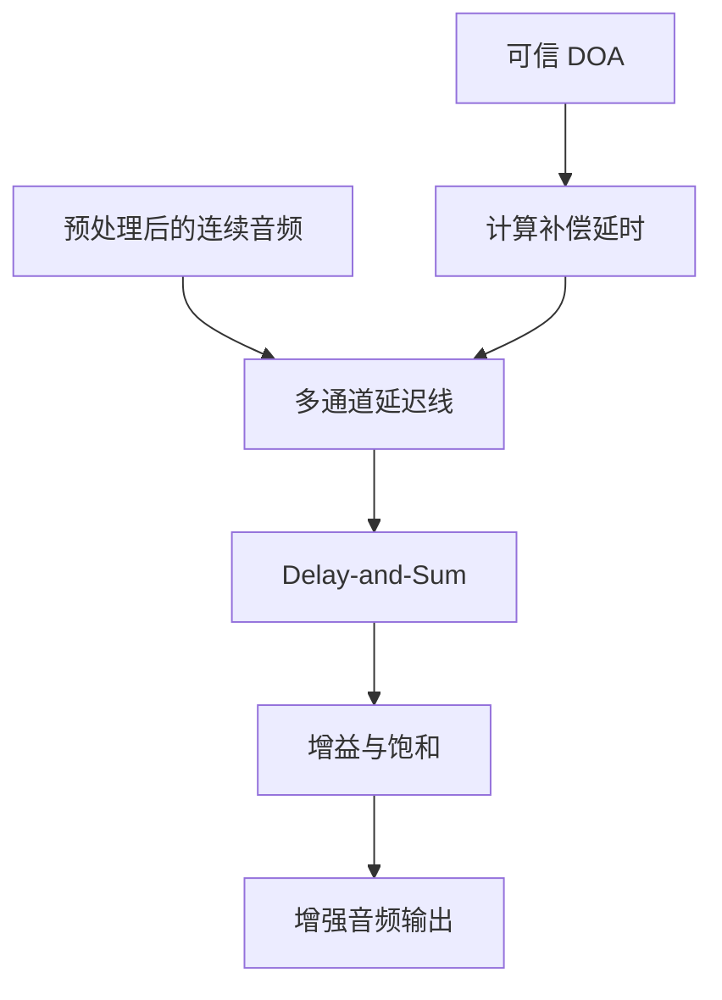
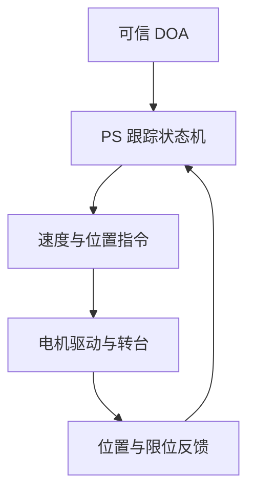

# SoundSight V1 四麦水平原理流程

更新：2026-09-07。本文是现行 V1 四麦二维主线，不是被六麦方案替代的旧文档；V1 仍按 M0～M6 推进，目标交付日期为 2026-10-07。V2 当前仅做六麦软件预研，不新增四麦模拟、四/六麦对照或六路抽四路实验。

项目入口：[当前状态](current-status.md)、[项目计划](project-plan.md)、[任务包](work-packages.md)、[比赛验收](competition-acceptance.md)。三维内容另见[六麦原理指南](three-dimensional-doa-principles-guide.md)、[六麦软件评审报告](six-mic-acoustic-software-review.md)及[独立材料包](../deliverables/six-mic-acoustic-review-v1/README.md)。历史快照由 `archive/` 保存；本文保留的四麦原理和待验收条件继续有效。

## 1. 真正要解决的问题

SoundSight 需要先完成两个相互衔接、但时间尺度不同的核心任务，并保留一个可选扩展：

1. 从四路同步声音中估计声源相对阵列的方向；
2. 根据该方向对四路声音做电子延时补偿，输出增强音频；
3. 可选：在核心声学收益已证明且存在明确朝向载荷时，驱动转台让该载荷逐渐对准声源。

因此，系统不是一条简单的串行流水线，而是在同步预处理后分成两条核心链路：按帧工作的定位链路和逐采样工作的音频增强链路。低速机械跟踪属于 M7 后续扩展，不参与核心声学收益证明。

### 1.1 真实应用问题

首版面向桌面会议、讲解演示或固定空间拾音：在近似同一水平面内存在一个主导声源，并可能伴随不同方向的背景噪声或竞争声源时，系统需要给出可拒绝的方位结果，并自动调整接收延时以改善目标方向音频。这里的“目标”由手动允许扇区或首次稳定方向锁定规则决定，不代表系统识别了说话人身份。

这个问题的困难不在于单独算出一个角度，而在于同时回答：角度什么时候可信、错误时如何拒绝、自动方向相对真实方向损失多少，以及这些处理能否在 Zynq-7020 的资源和 hop 周期内持续运行。

首版不承诺远场多说话人分离、声纹识别、任意三维定位，也不把转动全向麦克风阵列描述成声学增益来源。

### 1.2 可核验的差异与创新边界

GCC-PHAT、TDOA、DOA 和 Delay-and-Sum 都是已有方法，本项目不把算法名称本身声明为创新。可评价的工程差异是：

| 常见基线 | SoundSight 增加的可核验内容 | 验证方式 |
|---|---|---|
| 声源定位演示只输出角度 | 同时输出置信度、无效原因、合法 lag、通道对一致性和几何残差 | P50/P95、有效输出比例、错误指向比例 |
| 普通 Delay-and-Sum 直接使用已知方向 | 同时保留手动真实方向与自动估计方向，量化定位误差造成的收益损失 | 同一录音的 A/B/C 三路对照 |
| 算法优化只比较精度 | 将精度、有效率、错误率与周期、端到端延迟、DSP/BRAM/LUT 和时序共同评价 | 优化前后同数据、同参数、同工具版本比较 |
| 模型结果直接代替硬件结论 | 分离理想模型、合成仿真、真实录音、RTL 和板上证据 | 每项结论标注证据等级和复现入口 |

因此，本项目的创新主张应限定为“面向 FPGA 实时实现的可靠定位—自动波束—证据闭环协同设计”，而不是声称发明了新的定位或波束形成算法。

## 2. 总体原理流程

原来的单张总图横向节点过多，缩放后难以阅读。这里按时间尺度拆成三张图，并用“可信 DOA”作为共同接口。

### 2.1 定位链路：从声音得到方向



定位链路按帧工作。它把四路信号之间的传播时差转换为方向，并且只在结果可信时输出角度。

### 2.2 音频链路：从方向得到增强声音



音频链路逐采样工作。它不使用互相关序列作为音频，而是保留连续音频流，并用 DOA 产生的补偿延时控制延迟线。

### 2.3 可选机械链路：从方向得到设备朝向



机械链路低速工作，只有在 M5 已证明声学收益、进入 M7 且存在必须朝向声源的实际载荷时才接入。它只响应经过置信度门控和平滑的方向，并依靠位置或限位反馈形成安全闭环。

三条链路的衔接关系是：定位链路产生“可信 DOA”；电子波束形成用它计算补偿延时，机械转台用它计算设备的转向误差。

## 3. 声波传播如何变成通道间时延

远场单声源到达小型阵列时，可近似看成平面波。第 $m$ 个麦克风的离散信号可写成

$$
x_m[n] = a_m s\!\left(\frac{n}{f_s}-\tau_m\right)+v_m[n],
$$

其中：

- $s(t)$ 是声源信号；
- $f_s$ 是采样率；
- $\tau_m$ 是声波到达第 $m$ 个麦克风的时间；
- $a_m$ 表示通道增益和传播衰减；
- $v_m[n]$ 表示噪声、混响和干扰。

声源方向没有直接写在单通道幅值里，而是主要体现在不同通道的到达时间差

$$
\tau_{ij}=\tau_i-\tau_j.
$$

因此，下一板块必须保证四个通道使用同一个时间基准；否则采样系统自身的时钟差会与真实传播时延混在一起。

## 4. 为什么必须四路同步采样

同步采样的本质是：同一个离散时刻 $n$ 上的四个样本代表同一采样时间。只有这样，样本偏移量 $d_{ij}$ 才能转换为物理时延：

$$
\hat\tau_{ij}=\frac{d_{ij}}{f_s}.
$$

四路接口至少要冻结以下语义：

- 共用采样时钟或共用 BCLK/FS/PDM CLK；
- 固定的物理通道到数据索引映射；
- 统一的 `sample_valid`；
- 可测且可重复的固定通道延迟；
- 丢样、乱序和 FIFO 溢出的检测方式。

同步采样输出的是“时间可比较”的四路序列。下一板块通过校准与预处理，减少与方向无关的通道差异，并为定位与增强两条链路提供统一输入。

## 5. 通道校准与预处理

预处理的目的不是直接算方向，而是让后续算法看到尽可能一致、受控的信号。初步流程为：

```text
原始样本
  -> 固定延迟校准
  -> 通道增益校准
  -> 去直流
  -> 必要的抽取与带限滤波
  -> 统一格式输出
```

需要记录每一级的位宽、符号、小数位、增益和群时延。滤波器若给不同通道引入不同延迟，就会直接污染 TDOA，因此四路结构和系数必须一致。

预处理后的数据在这里分流：一份进入连续音频延迟线，等待波束形成；另一份进入分帧模块，为 GCC-PHAT 提供短时近似稳定的数据。

## 6. 分帧、加窗与重叠

GCC-PHAT 在有限长度的数据帧上工作。设帧长为 $N$，hop 为 $H$：

- 帧长越大，频率分辨率通常越高，但缓存、计算量和响应延迟也越大；
- hop 越小，方向更新越频繁，但相邻帧重复计算更多；
- 加窗用于减小有限截断造成的频谱泄漏；
- 重叠使方向更新周期可以小于整帧时长。

当前文档中的 48 kHz、1024 点帧、512 点 hop 只是初始基线：一帧约 21.3 ms，hop 约 10.7 ms。最终参数还要同时满足阵列尺寸、目标频段、混响、资源和实时吞吐约束。

每个完整帧进入 FFT 后，时域中的相对延迟会转化为频域中的相位差，为互功率谱计算提供条件。

## 7. GCC-PHAT：从相位差恢复互相关

对通道 $i,j$ 的一帧信号做 FFT：

$$
X_i[k]=\operatorname{FFT}\{x_i[n]\},\qquad
X_j[k]=\operatorname{FFT}\{x_j[n]\}.
$$

计算互功率谱：

$$
G_{ij}[k]=X_i[k]X_j^*[k].
$$

普通互相关会受到频谱幅值和窄带强分量影响。PHAT 用互功率谱幅值做归一化，主要保留相位关系：

$$
R_{ij}[k]
=\frac{G_{ij}[k]}{|G_{ij}[k]|+\varepsilon}.
$$

其中 $\varepsilon$ 防止除零，但它本身不能保证低能量频点可靠。模型和 RTL 还必须定义 FFT 缩放后的能量门、被屏蔽频点比例以及近似归一化误差，避免微弱频点在 PHAT 后与有效频点获得相同权重。再做 IFFT：

$$
r_{ij}[\ell]=\operatorname{IFFT}\{R_{ij}[k]\}.
$$

理想情况下，$r_{ij}[\ell]$ 会在真实相对延迟附近形成主峰。由此，下一板块不再比较整段波形，而是在物理允许的 lag 范围内寻找可信峰值。

四个麦克风共有六个无序通道对。使用三组参考通道对可以降低计算量，使用更多通道对可以增加几何冗余和异常检测能力；具体调度要结合阵列几何与 FPGA 资源决定。

## 8. 峰值搜索与 TDOA

麦克风间距为 $d_{ij}$，声速为 $c$ 时，两通道最大物理时延满足

$$
|\tau_{ij}|\leq \frac{d_{ij}}{c}.
$$

因此只应在合法范围

$$
|\ell|\leq
\left\lceil\frac{f_s d_{ij}}{c}\right\rceil
$$

内搜索相关峰，避免把循环相关的其他位置或混响峰当作真实传播时延。

实际采集链路可能存在固定通道延迟。设标定得到、以采样点为单位的固定偏置为 $b_{ij}$，设计覆盖的最低声速为 $c_{\min}$，则实际搜索窗口应围绕偏置设置；若校准模块已在进入 GCC-PHAT 前补偿该偏置，则这里取 $b_{ij}=0$：

$$
\ell\in
\left[
b_{ij}-\left\lceil\frac{f_s d_{ij}}{c_{\min}}\right\rceil,
b_{ij}+\left\lceil\frac{f_s d_{ij}}{c_{\min}}\right\rceil
\right].
$$

对 40 mm 边长的正方形候选阵列，在 $f_s=48\ \mathrm{kHz}$、$c=343\ \mathrm{m/s}$ 的参考条件下，四条边的最大时延约为 5.60 个采样点，整数界为 6；两条对角线长约 56.6 mm，最大时延约为 7.92 个采样点，整数界为 8。这里的 $\pm6$ 和 $\pm8$ 只适用于零偏置参考模型；实际实现必须按每个通道对的 $b_{ij}$、尺寸公差和温度范围重新计算。例如按 $c_{\min}=331\ \mathrm{m/s}$ 覆盖接近 0 ℃ 的空气时，对角线最大时延约为 8.20 个采样点，整数界应扩为 9。

40 mm 只是首版候选值，支架应允许在 35～50 mm 范围比较。该几何的物理能力边界如下：

- 四麦非共线方阵在声源近似同一水平面、通道编号和时延符号正确时，可以提供水平面内的二维方位信息；平面阵列本身不能唯一恢复未知俯仰。
- 最大几何孔径只有约 56.6 mm，低频波长远大于阵列，因而低频方向选择能力弱、波束较宽。
- 40 mm 相邻间距对应的无栅瓣参考频率约为 $c/(2d)=4.29\ \mathrm{kHz}$；这不是“高于该频率全部不可用”，但要求仿真检查高频空间混叠，并避免把单个高频相位当作唯一方向证据。
- 阵列尺寸增大可提高时延灵敏度和中低频方向性，但也会降低空间混叠起始频率；最终间距必须由定位与波束图共同选择。

整数峰值位置得到整数采样延迟。若峰值左右邻点分别为 $r[-1],r[0],r[1]$，可用抛物线插值获得初步亚采样偏移：

$$
\delta=
\frac{r[-1]-r[1]}
{2\left(r[-1]-2r[0]+r[1]\right)}.
$$

最终估计为

$$
\hat\tau_{ij}=\frac{\ell_{\max}+\delta}{f_s}.
$$

此式适用于固定通道偏置已前补偿的情况；若仍在带偏置窗口内搜索，应在分子中扣除 $b_{ij}$，避免把采集固定延迟当成传播时差。搜索端点是整数包络，亚采样结果仍需按实际基线、最低声速和声明公差检查物理范围。

在 40 mm 基线的零时延附近，也就是时延对角度最敏感的区域，一个采样点仍约对应 10.3°；5°方向变化只形成约 3.49 mm 路径差、10.16 µs 时差，即 0.49 个采样点。多通道联合估计可以降低随机误差，但不能消除固定延迟、阵元坐标、声速和亚采样估计误差。

因此，P50 角度误差不高于 5°只能作为待验证目标：整数峰值只用于首个数据流验证；最终算法必须采用亚采样估计，并在 D0 合成数据中把插值误差、通道固定偏置、阵元坐标误差和声速误差放入同一误差预算。固定延迟残差可先以明显小于 0.49 个采样点为原则，是否需要收紧到 0.1～0.2 个采样点量级，应由误差传播和实录标定结果决定，不能在无证据时写成已达指标。

这里不能只输出 TDOA 数值，还要输出峰值高度、主峰与旁瓣比、边界命中等质量信息。下一板块会把多组 TDOA 与阵列坐标结合，并检查这些时延能否由同一个空间方向解释。

## 9. 从多组 TDOA 求解 DOA

选择第一个麦克风为参考点。在远场平面波假设下：

$$
c\tau_{i1}=(\mathbf r_i-\mathbf r_1)^T\mathbf u,
$$

其中 $\mathbf r_i$ 是麦克风坐标，$\mathbf u$ 是入射方向单位向量。把多组方程写成

$$
A\mathbf u=\mathbf b,
$$

可用最小二乘获得方向向量，再归一化并换算角度。在二维情况下，可按约定使用

$$
\theta=\operatorname{atan2}(u_y,u_x).
$$

必须先冻结角度定义，例如“设备正前方为 $0^\circ$，逆时针为正”，否则算法角度、电机角度和实物方向无法衔接。

**TDOA 符号冻结仍是接入阻断项。**本节及第 10.3 节保留的正号方程对应声波传播方向；若对外输出“指向声源”，向量应与它相反。第 7 节的互谱顺序、第 8 节的 lag、这里的方向、第 11 节的补偿延时及 UI/控制输出必须作为同一合同联合冻结。六麦脚本使用指向声源的负号几何约定，其轴向自检通过不能证明 V1 接口也已冻结；须串联已知正负轴声源、GCC 峰符号、方向输出和波束对齐检查。本文不单独翻转某个公式或改写现有字段数值。

阵列几何决定方程是否可解以及是否存在前后模糊。线阵通常无法仅靠 TDOA 区分镜像方向；二维非共线阵列能提供更多约束，但仍要检查空间混叠、阵元误差和实际安装偏差。

DOA 求解输出方向和方程残差。下一板块综合相关峰质量、几何一致性和时间连续性，决定这个角度是否允许进入波束形成，以及是否可供 M7 的可选机械控制使用。

## 10. 置信度、跨通道一致性与目标选择

### 10.1 置信度与异常拒绝

“算出一个角度”不等于“这个角度可信”。置信度至少综合：

- 输入信号能量和有效频点比例；
- 主峰与次峰或旁瓣的比值；
- 峰形锐度、边界命中和多峰状态；
- 各通道对 TDOA 是否相互一致；
- 几何方程的残差；
- 角度是否在相邻帧之间连续。

低置信度时应输出“方向无效”，机械控制只能保持或进入安全状态，不能继续输出一个看似精确的随机角度。平滑只用于抑制通过物理和几何检查后的合理抖动，不能掩盖错误峰。

### 10.2 定位指标为什么必须成组报告

圆周角度误差定义为

$$
e_\theta=
\left|
\operatorname{wrap}_{[-180^\circ,180^\circ)}
(\hat\theta-\theta_{\mathrm{true}})
\right|.
$$

每个冻结测试条件至少报告：

- P50 角度误差：描述典型帧的精度；
- P95 角度误差：暴露少量跳角和长尾；
- 有效输出比例 $R_{\mathrm{valid}}=N_{\mathrm{valid}}/N_{\mathrm{total}}$：防止算法靠大量拒绝换取漂亮误差；
- 错误指向比例：统计有效输出中 $e_\theta>\theta_{\mathrm{wrong}}$ 的帧；建议同时报告它占全部帧和占有效帧的比例；
- 无效原因、最长连续跳角和方向更新延迟。

P50 不高于 5°保留为争取目标，但 P95、有效输出比例、$\theta_{\mathrm{wrong}}$ 和错误指向比例的数值门槛必须在 D2/D3 基线完成后、正式验收前冻结。P95 对使用体验重要，有效输出比例衡量可用性，而错误指向比例直接对应转台或电子波束被错误命令的风险，三者不能由中位误差替代。

具体数据分层、实验字段和验收记录要求见 [声学性能验证计划](acoustic-validation-plan.md)。

### 10.3 通道对一致性与 SRP-PHAT 升级门

实际房间中，不同通道对可能分别选中直达声、反射声或不同声源的峰。将这些独立峰直接送入最小二乘，仍可能得到一个数值上存在、物理上错误的角度。任意三只麦克风的 TDOA 应近似满足闭合关系：

$$
\hat\tau_{ij}+\hat\tau_{jk}+\hat\tau_{ki}\approx0.
$$

六组通道对应先在各自合法 lag 内找峰，再根据峰旁比、峰形、边界状态、有效频带和闭合误差形成质量权重。DOA 使用质量加权几何拟合：

$$
\hat{\mathbf u}=
\arg\min_{\mathbf u}
\sum_{i<j}w_{ij}
\left[
\hat\tau_{ij}-
\frac{(\mathbf r_i-\mathbf r_j)^T\mathbf u}{c}
\right]^2.
$$

低质量通道对应降权或剔除，拟合残差过大则整帧无效。不能只以 PHAT 峰的绝对高度作为权重，因为 PHAT 已弱化幅值信息，错误窄峰也可能很高。

首版仍采用“各通道对 GCC-PHAT、质量加权、闭合检查、几何拟合”。若完成频带限制、低能量屏蔽、峰值质量和几何残差检查后，D3/D4 的 P95、有效输出比例或错误指向比例仍达不到冻结目标，再使用同一批录音比较 SRP-PHAT：

$$
P(\theta)=
\sum_{i<j}w_{ij}\,
r_{ij}\!\left(\tau_{ij}(\theta)\right).
$$

SRP-PHAT 只有在实录指标明确改善、hop 周期内算力足够且资源预算可接受时才进入 RTL。整数 lag 的 SRP-PHAT 仍受 40 mm 阵列只有数个采样时延的限制；若要支撑 5°目标，还需验证插值 SRP、细网格或频域导向，不能把算法名称本身当作精度保证。

### 10.4 首版目标声源选择

TDOA/DOA 只能说明哪个方向存在较强且空间一致的声音，不能判断“用户想听谁”。首版采用单个主导声源假设，只实现以下一种或两种可解释策略：

1. 手动设置允许跟踪的方向扇区，扇区外候选不触发自动跟踪；
2. 锁定首次连续达到稳定帧数和置信度门槛的方向。

首次稳定方向锁定按以下状态执行：

```text
SEARCH
  -> 候选位于允许扇区内
  -> 连续 N_acq 帧通过能量、置信度和几何残差门
  -> 帧间角度离散不超过 delta_acq
  -> LOCKED

LOCKED
  -> 优先接受当前方向 delta_track 范围内的候选
  -> 短时无效进入 HOLD，不立即切换目标
  -> 新方向质量高出 Delta_Q 且持续 N_switch 帧才允许抢占

HOLD
  -> T_hold 内恢复原方向则返回 LOCKED
  -> 超时、离开允许扇区、连续几何失败或人工释放则返回 SEARCH
```

$N_{\mathrm{acq}}$、$\delta_{\mathrm{acq}}$、$\delta_{\mathrm{track}}$、$\Delta_Q$、$N_{\mathrm{switch}}$ 和 $T_{\mathrm{hold}}$ 都是必须记录的配置参数，数值由 D2/D3 基线冻结。两个候选质量接近或跨通道不一致时输出无效。手动扇区限定“允许跟踪哪里”，稳定锁定决定“当前跟踪哪个方向”；二者都不等于识别说话人身份。

经过门控的稳定 DOA 必须转换为声学补偿延时，控制电子波束；若 M7 启用转台，同一结果才同时进入 PS 的低速状态机。

## 11. 从 DOA 到电子波束指向

已知方向向量后，可根据阵元坐标计算各通道相对参考点的理论到达时延。为了让同一波前在求和前对齐，需要施加符号相反、并整体平移为非负值的补偿延时 $d_m$：

$$
y[n]=\frac{1}{M}\sum_{m=0}^{M-1}x_m[n-d_m].
$$

同方向的目标信号经对齐后相干叠加，不相关麦克风自噪声不会同样增强。四路不相关噪声下的理论阵列增益上限约为 6 dB，但另一个说话人的声音会相干地到达多个麦克风，不能套用这一数字。真实抑制取决于频率、方向差、混响、标定误差、阵列孔径和延时精度。

对理想 40 mm 四麦正方形，若波束指向 0°、干扰位于 90°，窄带干扰在 500 Hz、1 kHz、2 kHz 的理论衰减分别只有约 0.3 dB、1.2 dB、5.2 dB。这不是语音宽带平均收益或实测 SNR，而是提醒我们：低频音频改善可能受物理孔径限制。

MVP 先采用整数采样延时，证明数据流、方向符号和求和增益正确；分数延时滤波在定位链路稳定后再加入。方向更新应在受控边界生效，或对延时参数渐变，防止瞬间切换造成爆音。

波束形成读取的是预处理后保留的连续音频流，而不是 GCC-PHAT 的互相关结果。其输出经过增益调整、位宽缩减、舍入与饱和后进入音频接口。

评价时必须用同一组四通道录音、相同有效频带和相同输出增益规则产生三份输出：

| 组别 | 处理方式 | 回答的问题 |
|---|---|---|
| A：固定单麦 | 固定选择一个麦克风，不做空间处理 | 原始音频和 SNR 基线是什么 |
| B：手动真实方向 | 用角度夹具或可靠几何测量给出的真值控制 Delay-and-Sum | 阵列、标定、延迟线和求和本身是否有效 |
| C：自动估计方向 | 用 GCC-PHAT、TDOA、DOA 和置信度链路控制 Delay-and-Sum | 完整自动链路相对理论可用状态损失多少 |

B 相对 A 的改善用于判断阵列与波束形成是否有用；C 相对 B 的差距用于隔离定位误差造成的损失；C 相对 A 才是最终系统收益。若 B 相对 A 没有改善，先检查阵列孔径、频带、通道标定、延时符号和波束算法；只有 B 有效而 C 无效时，才优先检查 GCC-PHAT、峰值、DOA 和置信度链路。单麦不能提供 DOA，它只作为音频对照。

## 12. 可选扩展：从 DOA 到机械转向

机械转向与电子波束形成使用同一个可信 DOA，但目的不同：电子波束在不移动设备的情况下改变接收方向；机械转台只用于让明确的载荷改变朝向。若没有摄像头、定向扬声器等实际载荷，转动全向麦克风阵列不会自动增加降噪收益，因此转台只保留为 M7 后续扩展。

若 DOA 是相对设备正前方的角度，则它可以直接作为位置误差的来源：

$$
e_\theta=\theta_{\text{source}}-\theta_{\text{front}}.
$$

初步控制状态机为：

```text
IDLE
  -> ACQUIRE：连续若干帧发现可信声源
  -> TRACK：超过角度死区后限速转动
  -> HOLD：已对准或短时失去声源
  -> FAULT：限位、反馈异常或驱动故障时停止
```

PS 负责置信度门控、角度滤波、死区、目标位置、速度和加速度规划；位置反馈来自编码器、零位或限位传感器。若底层步进脉冲对时序要求高，可由 PL 产生脉冲，但高级控制策略仍属于 PS 控制面。

当麦克风阵列随转台旋转时，DOA 是相对产生该音频帧时设备坐标系的误差；必须将帧时间戳与当时转台位置配对，不能用当前姿态解释历史结果。设备接近声源方向后，理论上该误差趋近零。还必须限制转速并评估电机振动、电磁噪声和坐标变化对声学估计的影响。

## 13. PL 与 PS 的原则分工

| 功能 | 适合位置 | 原因 |
|---|---|---|
| 四路同步采集、预处理、分帧 | PL | 固定吞吐、严格时序、天然并行 |
| FFT、GCC-PHAT、峰值与 TDOA | PL | 数据量大、重复运算、实时性强 |
| DOA 与置信度基础计算 | PL | 保持核心声学链路闭环 |
| 参数配置、显示、日志 | PS | 低速、逻辑复杂、便于修改 |
| M7 可选的转台高级跟踪状态机 | PS | 机械带宽低，策略与安全条件多 |
| 可选转台所需的精确定时电机脉冲 | PL 或专用驱动器 | 取决于执行机构接口和时序要求 |

分工原则不是“能否用软件算”，而是核心实时数据是否需要确定吞吐，以及功能变化频率和安全逻辑复杂度。

## 14. 定点化如何贯穿整条链路

MATLAB 浮点算法正确后，不能直接假设 RTL 会得到同样结果。每一级都需要确定：

- 输入与输出范围；
- 有符号位、整数位和小数位；
- 乘法与累加后的位宽增长；
- FFT/IFFT 缩放策略；
- 归一化倒数或近似算法；
- 位宽缩减时的舍入与饱和；
- 量化误差对峰值、TDOA、角度和音频的最终影响。

建议形成逐级链路：

```text
MATLAB 浮点模型
  -> 记录每级动态范围
  -> MATLAB 位精确模型
  -> 导出确定性测试向量
  -> RTL 自检 TB 逐级比较
  -> Vivado 综合与时序检查
  -> 板上采集并与同一参考模型比较
```

定点验证不能只比较最终角度；如果最终结果失败，必须能定位到 FFT、PHAT、IFFT、峰值、TDOA 或几何求解中的第一处偏差。

## 15. 各板块的输入输出衔接

| 板块 | 输入 | 产生的关键输出 | 输出交给谁 |
|---|---|---|---|
| 声学传播与阵列 | 声源、阵元坐标、声速 | 带空间时延的四路声压 | 麦克风与采样接口 |
| 同步采样 | 四路电信号、共同采样时基 | 时间可比较的四路样本 | 校准与预处理 |
| 校准与预处理 | 原始样本、校准参数 | 格式统一的连续音频流 | 分帧模块和延迟线 |
| 分帧与 FFT | 连续音频流、帧长、hop、窗 | 各通道复频谱 | 互功率谱 |
| GCC-PHAT 与 IFFT | 通道频谱对 | 广义互相关序列 | 合法 lag 峰值搜索 |
| 峰值与 TDOA | 互相关、阵元间距、声速 | 时延、峰值质量 | DOA 求解与置信度 |
| DOA 求解 | 多组 TDOA、阵元坐标 | 方向、几何残差 | 置信度与平滑 |
| 置信度与平滑 | 方向、峰值质量、历史状态 | 可信 DOA 或无效标志 | 波束控制、PS、UI |
| 电子波束形成 | 连续音频流、补偿延时 | 增强音频 | 音频输出与评价 |
| 可选机械跟踪（M7） | 可信 DOA、帧时间戳、当时位置和安全状态 | 电机目标与设备朝向 | 转台和位置反馈闭环 |
| 验证链路 | 模型参数、测试向量、板上记录 | PASS/FAIL 与首个偏差 | 下一阶段门和结果归档 |

## 16. 证据边界与当前仍需冻结的问题

当前另有 V2 六麦浮点合成基线：2700 帧、21 项自检，独立复跑一致的记录见[软件评审报告](six-mic-acoustic-software-review.md)。它不替代本文 V1 四麦实录或板上验收。带内约 0 dB 时有效率只有 47%；等强竞争时有效率 26%，相对指定目标错误超过 30°占全部目标活动帧 17.33%、占有效帧 66.67%。当前六麦基线未实现目标锁定、质量加权或 SRP-PHAT，不能把本文拟议策略写成已有能力，也不能宣布完整 3D-G0 通过。

本文中的结论必须按证据层级解释：

| 层级 | 当前可以确认的内容 | 仍不能据此宣称的内容 |
|---|---|---|
| 已知物理关系 | 基线长度与最大时延、48 kHz 的采样周期、40 mm 下 5°约为 0.49 个采样点、四路不相关自噪声的 6 dB 理论上限 | 实际房间定位精度和对说话人干扰的固定抑制量 |
| 需要仿真验证 | 35～50 mm 间距、处理频带、亚采样方法、质量权重、WLS 与 SRP-PHAT 的比较、门限敏感性 | 板上定点实现与真实麦克风一定达到同样结果 |
| 需要实测验证 | 通道固定延迟、声学相位中心、阵元坐标、P50/P95、有效与错误指向比例、A/B/C 音频收益、电机噪声 | 未进入 `results/` 的任何通过结论 |

以下问题不能仅靠原理文档决定，需要在对应阶段用硬件、仿真或实验记录冻结：

1. M0：具体 Zynq-7020 板卡、器件和可用 PL IO；
2. M0：沿用已选 IM73D122V01/PDM 路线，核验实际模块、电平、共享时钟、通道映射与同步；本轮不重新选型或切换接口，具体证据见[板卡接口审查](../hardware/m0-board-interface-audit.md)；
3. M0～M2：麦克风坐标、35～50 mm 候选间距、阵列形状和目标频段；
4. M0～M1：采样有效位宽、预处理采样率和音频输出接口；
5. M2～M3：每通道每帧一次 FFT 的频谱复用、通道对数量、周期/缓存/资源预算和最终定点格式；
6. D2/D3 后：首版目标方向采用手动扇区、首次稳定方向锁定或二者组合，以及保持、抢占和重新捕获条件；
7. M7：是否存在必须朝向声源的实际载荷；只有答案为是，才冻结转台负载、转角、速度、精度、位置反馈和转台零位。

另须由主流程联合冻结前述 TDOA/方向/补偿符号合同；三维软件自检、材料整理和历史备份均不能解除该阻断项。

在这些事实冻结前，本文给出的是可验证的原理主线，而不是已经完成的硬件实现方案。
