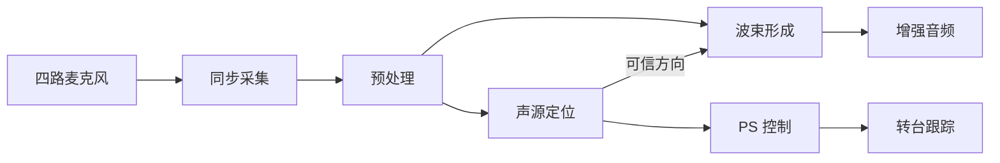
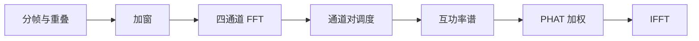
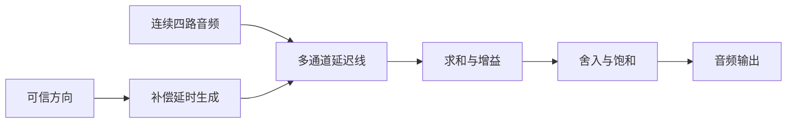
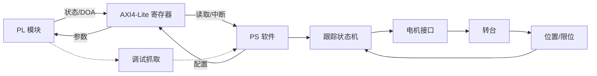

# SoundSight 工程实施流程（初稿）

## 1. 文档定位

本文回答“SoundSight 在工程上怎样从硬件输入逐步实现为可验证系统”。重点是模块职责、接口衔接、数据流、控制流、开发顺序和阶段验收，不重复推导 GCC-PHAT、TDOA、DOA 与 Delay-and-Sum 的数学原理；算法原理见 [原理流程](principles-flow.md)。

当前仍处于 M0，目标板具体版本、四路采集接口、有效位宽、阵列几何、Vivado 版本和 PS 运行环境尚未全部冻结。因此本文中的模块划分和接口语义可以先作为工程骨架，具体端口宽度、时钟频率、IP 参数和 XDC 引脚只能在真实硬件证据确认后填写。

工程实施遵守四条主线：

1. 先证明四路样本同步且可追踪，再实现定位算法。
2. 连续音频流、按帧定位流和低速机械控制流分开设计。
3. 每个 RTL 模块先冻结接口与数值格式，再写实现和自检测试。
4. MATLAB 模型、RTL 仿真、Vivado 时序和板上实测是四种不同证据，必须分别通过。

## 2. 系统工程分图

为保证在 Markdown 预览中可以直接看清，本节只用一张简化总览表达分支关系，再分别展开采集、定位、波束形成和控制链路。具体模块职责和接口仍以后续表格为准。

### 2.1 系统级总览



总览只表达两个关键分支：预处理后的连续音频直接进入波束形成；定位链路产生的可信方向同时控制电子波束和机械转台。

### 2.2 四路采集与预处理


这一链路的最终交付物是同一采样时刻的四通道样本组。任何通道错位、丢样或 FIFO 溢出都必须留下状态和计数。

### 2.3 频域定位前半段



该链路把四通道时域帧转换为每个通道对的广义互相关。共享 FFT/IFFT 时，`frame_id`、通道号和 `pair_id` 必须伴随数据传递。

### 2.4 TDOA、DOA 与可信方向


这部分不保证每帧都输出角度。输入能量不足、峰值冲突、几何残差过大或方向跳变时，应输出无效状态或保持策略所允许的上一稳定状态。

### 2.5 电子波束形成



音频数据不经过 GCC-PHAT 结果流，而是保留连续样本；定位链路只向延迟控制模块提供低速更新的方向参数。

### 2.6 PS 控制、观测与转台



PS 负责参数管理、状态读取、日志和低速机械策略。转台反馈形成独立闭环，但不能反向阻塞逐采样音频链路。

上述分图对应三种时间尺度：逐采样音频流持续运行，按帧定位链每个 hop 更新一次，PS 与机械跟踪按更低速率工作。

## 3. 模块间统一接口规则

### 3.1 四路样本必须作为同一采样时刻交接

采集前端的核心交付物不是四条互不相关的数据线，而是一个“四通道样本组”。建议在处理域内部使用参数化的 packed 数据：

```text
audio_sample_bundle = {mic3_sample, mic2_sample, mic1_sample, mic0_sample}
```

一次成功传输表示同一采样序号下的四个样本同时有效。`W_SAMPLE`、补码格式和通道排列在 M0/M1 接口冻结时确定。禁止让四通道各自独立握手后再假设它们仍然对齐。

### 3.2 流式握手语义

模块边界优先采用 AXI4-Stream 风格的 `valid/ready` 语义：

- 只有 `valid && ready` 时数据才完成一次传输。
- `valid=1 && ready=0` 时，发送端必须保持数据和伴随元数据不变。
- 帧数据用明确的帧起点/终点或 `last` 标志，不依赖接收端自行猜测长度。
- 帧号、采样计数和错误标志属于数据语义的一部分，不能只存在于波形观察中。

物理麦克风输入不能因为下游拉低 `ready` 而暂停。因此采集边界必须设置 FIFO 或确定的丢弃策略；一旦容量不足，记录黏滞溢出标志和累计计数，而不是静默丢样。

### 3.3 配置与状态语义

低速配置使用 AXI4-Lite。会同时影响多个模块的参数，例如采样率、阵列坐标、声速、帧长和阈值，应采用“影子寄存器 + 提交”机制：

1. PS 写入完整的一组影子参数。
2. PS 写 `config_commit`。
3. PL 在安全边界一次性切换参数并更新 `config_version`。
4. PS 读取版本号确认生效。

跨时钟域的单比特控制使用同步器，脉冲使用握手或 toggle，同组多比特配置使用握手快照或异步 FIFO。不能只给数据总线加两级寄存器。

### 3.4 数值与单位

每个数据接口必须记录：

- 总位宽、符号位、整数位和小数位；
- 单位，例如 sample、second、degree、radian、Hz；
- 本级最大增益和可能范围；
- 舍入、饱和和溢出策略；
- 固定流水延迟或最大延迟；
- 无效数据与异常状态的表示方式。

## 4. 数据面模块职责与衔接

### 4.1 采集与同步层

| 模块 | 上游输入 | 核心职责 | 关键输出 | 下游模块 | 初步验收 |
|---|---|---|---|---|---|
| `mic_clock_gen` | 板级参考时钟、采样配置 | 产生 PDM CLK、BCLK/FS 或 ADC 所需时钟 | 共同采样时基、锁定状态 | 麦克风/ADC、`mic_phy_rx` | 频率与占空比正确，复位和启停可重复 |
| `mic_phy_rx` | PDM、TDM/I2S 或 ADC 引脚 | 按真实外设时序接收原始数据，完成采样或解串 | 原始通道数据、位/帧有效 | `acquisition_frontend` | 单通道位序、边沿、符号和帧边界正确 |
| `acquisition_frontend` | 原始位流或 ADC 字 | PDM 抽取，或 TDM/I2S 槽位解析；统一采样率和补码格式 | 各通道候选样本 | `channel_align` | 已知输入能还原为正确样本，抽取增益受控 |
| `channel_align` | 四路候选样本 | 按固定通道映射组成同一采样时刻的四路 bundle，维护采样计数 | 四路同步样本、`sample_valid`、计数与错误 | `audio_cdc_fifo`、调试抓取 | 四路无错位、无乱序；错误能被计数 |
| `audio_cdc_fifo` | 采集时钟域样本组 | 跨入 PL 处理时钟域，吸收相位和短时背压差异 | 处理域音频流、满空状态 | `audio_preprocess` | CDC 结构正确；满、空、复位和异常均有测试 |

`mic_clock_gen` 和 `mic_phy_rx` 必须依据最终器件数据手册实现。若外设直接提供与 PL 同源且满足时序的样本域，可简化 CDC，但必须由时钟树和时序约束证明，不能凭感觉删除。

### 4.2 预处理与受控分流层

| 模块 | 上游输入 | 核心职责 | 关键输出 | 下游模块 | 初步验收 |
|---|---|---|---|---|---|
| `channel_calibration` | 四路同步样本、校准参数 | 补偿固定通道延迟和增益差 | 校准后四路流 | `dc_blocker` | 同源输入的固定 offset 和增益差收敛到目标范围 |
| `dc_blocker` | 校准后音频 | 去除直流偏置，保持四路完全同构 | 去直流音频 | `bandlimit_filter` | 直流衰减符合模型，四路群时延一致 |
| `bandlimit_filter` | 去直流音频、系数 | 带限、必要时抽取，并控制带外混叠 | 统一采样率音频 | `stream_fanout` | 频响、群时延、缩放和饱和与模型一致 |
| `stream_fanout` | 预处理音频 | 将同一连续流送往定位帧缓存和波束延迟线 | 两条同步逻辑流 | `frame_buffer`、`sample_delay_bank` | 任一支路背压不会造成未记录的数据失配 |

预处理可以在实现时合并成 `audio_preprocess` 子系统，但测试时应保留逐级可观察点。四路滤波结构、系数和有效时序必须一致，否则预处理本身会制造伪 TDOA。

### 4.3 分帧与频域调度层

| 模块 | 上游输入 | 核心职责 | 关键输出 | 下游模块 | 初步验收 |
|---|---|---|---|---|---|
| `frame_buffer` | 连续四路流、帧长、hop | 缓存重叠帧，标记 frame ID 和帧边界 | 按帧四路时域数据 | `window_mul` | 帧长、重叠、起止和丢帧行为正确 |
| `window_mul` | 时域帧、窗系数 | 对四通道施加完全一致的窗函数和缩放 | 加窗帧 | `fft_scheduler` | 窗系数索引、乘法位宽和缩放与模型一致 |
| `fft_scheduler` | 四通道加窗帧、FFT IP 状态 | 调度共享或并行 FFT，保存通道与 frame ID | 复频谱流 | `spectrum_store` | 在一个 hop 预算内完成四通道 FFT，无通道串帧 |
| `spectrum_store` | 复频谱流 | 按通道、频点和 frame ID 缓存频谱 | 可寻址频谱 | `pair_scheduler` | 读写冲突、覆盖时机和帧一致性受控 |
| `pair_scheduler` | 频谱缓存、通道对配置 | 枚举所需通道对并调度后续计算 | 成对复频谱 | `cross_power` | 所有配置通道对恰好处理一次，标签不丢失 |

当前 48 kHz、1024 点帧和 512 点 hop 只是预算基线。最终必须根据 FFT IP 延迟、通道对数量、复用倍数和目标处理时钟证明：一轮定位计算能在下一个可用 hop 到来前完成。

### 4.4 GCC-PHAT 与 TDOA 层

| 模块 | 上游输入 | 核心职责 | 关键输出 | 下游模块 | 初步验收 |
|---|---|---|---|---|---|
| `cross_power` | 通道对复频谱 | 计算 `Xi * conj(Xj)` 并管理复乘位宽 | 复互功率谱 | `phat_weight` | 实部、虚部、共轭符号和位宽增长正确 |
| `phat_weight` | 复互功率谱、能量阈值 | 进行 PHAT 幅值归一化或冻结后的近似，保护低能量频点 | PHAT 频谱、低能量标志 | `ifft_scheduler` | 零输入不异常；近似误差和噪声放大受控 |
| `ifft_scheduler` | 各通道对 PHAT 频谱 | 调度 IFFT 并恢复 lag 序列的索引关系 | 广义互相关序列 | `lag_peak_search` | 正负 lag 映射、缩放和 frame/pair 标签正确 |
| `lag_peak_search` | 互相关、合法 lag 上限 | 只在物理可行范围内搜索主峰与次峰 | 整数 lag、峰值、旁瓣质量、边界标志 | `tdoa_estimator` | 正负延迟、边界和竞争峰用例均正确 |
| `tdoa_estimator` | 峰值邻域、采样率、pair ID | 计算整数/亚采样 TDOA，并汇总单通道对质量 | TDOA、质量、有效标志 | `doa_solver` | 与位精确模型逐帧一致，非法分母和超界可拒绝 |

这一层必须保留 `frame_id` 和 `pair_id`，否则共享 FFT/IFFT 时很容易把不同帧或通道对的结果错误组合。

### 4.5 DOA、置信度与电子波束层

| 模块 | 上游输入 | 核心职责 | 关键输出 | 下游模块 | 初步验收 |
|---|---|---|---|---|---|
| `doa_solver` | 同一 frame 的多组 TDOA、阵列坐标、声速 | 求解方向并计算几何残差，拒绝不一致组合 | 原始 DOA、残差、有效标志 | `confidence_filter` | 合成角度、边界角度和矛盾 TDOA 用例正确 |
| `confidence_filter` | DOA、峰值质量、残差、历史状态 | 生成置信度，完成异常拒绝和有限平滑 | 可信 DOA、置信度、时间戳、无效原因 | `steering_delay_ctrl`、PS、UI | 低能量、跳变、双峰和丢帧不会输出伪稳定角度 |
| `steering_delay_ctrl` | 可信 DOA、阵列坐标、模式配置 | 将方向转换为各通道补偿延时，在安全边界更新 | 每通道延时与版本号 | `sample_delay_bank` | 角度符号、通道顺序和延时范围正确；更新无撕裂 |
| `sample_delay_bank` | 连续预处理流、延时参数 | 保存历史样本并读取整数或后续分数延时样本 | 已对齐四路音频 | `delay_sum` | 最大/最小延时、参数切换和缓存回卷正确 |
| `delay_sum` | 已对齐音频、增益配置 | 多通道累加、归一化、舍入和饱和 | 增强音频 | `audio_tx` | 满幅、相消、相干叠加和溢出用例正确 |
| `audio_tx` | 增强音频 | 格式化为实际 DAC、I2S 或其他输出接口 | 板级音频信号 | DAC/Codec/调试输出 | 采样率、位序、时钟关系和欠载处理正确 |

定位链路输出更新较慢，音频链路逐样本运行。`steering_delay_ctrl` 必须把低速参数安全地带入连续流，不能在一个样本组中只更新部分通道。MVP 先做整数延时；分数延时应在整数延时闭环通过后单独增加。

## 5. 控制面、观测与转台模块

| 模块 | 运行位置 | 核心职责 | 与 PL/外设的衔接 | 初步验收 |
|---|---|---|---|---|
| `control_status_regs` | PL | AXI4-Lite 寄存器、参数提交、版本、状态快照和中断 | PS 写配置；各 PL 模块返回状态 | 地址、复位值、读写权限和原子提交正确 |
| `health_counters` | PL | 统计溢出、欠载、丢帧、非法 TDOA、低置信度和超时 | 汇总到寄存器和 ILA | 故障注入后计数准确，清除策略明确 |
| `debug_capture` | PL + PS | 选择性抓取原始样本、中间结果或结果帧 | FIFO/BRAM；必要时再引入 DMA | 抓取不会改变实时链路时序和结果 |
| `ps_driver` | PS | 检查硬件版本，完成寄存器读写、配置提交和状态读取 | AXI4-Lite、中断 | 错误版本拒绝运行，超时和异常可报告 |
| `ps_ui_logger` | PS | 显示 DOA/置信度/状态，保存实验元数据与小规模记录 | UART、屏幕或网络待冻结 | 日志包含参数、版本、时间和错误状态 |
| `tracking_controller` | PS | `IDLE/ACQUIRE/TRACK/HOLD/FAULT` 状态机，完成门控、死区和速度规划 | 读取可信 DOA 与位置，输出电机目标 | 声源消失、角度跳变和限位时安全停止 |
| `motor_if` | PS、PL 或专用驱动器 | 输出 PWM、STEP/DIR 或位置命令；必要时 PL 只负责精确定时脉冲 | 电机驱动器 | 方向、速率、使能和急停优先级正确 |
| `position_if` | PS 或 PL | 读取零位、限位、编码器与驱动故障 | 反馈给跟踪状态机 | 断线、越界和反馈停滞可检测 |

转台不是实时音频数据路径的一部分。机械闭环不应阻塞采集，也不应让电机控制中断破坏音频时序。电机电源、地回流、振动和电磁噪声需要通过静止、保持和转动三种状态的对照实验验证。

## 6. 时钟、复位与跨时钟域规划

在 M0 完成前只定义时钟域角色，不预填具体频率：

| 时钟域 | 典型来源 | 承载模块 | 关键约束 |
|---|---|---|---|
| `clk_acq` | 麦克风/ADC 时钟或其同步派生 | `mic_phy_rx`、`acquisition_frontend`、`channel_align` | 与外设输入/输出延迟匹配 |
| `clk_pl` | PS FCLK 或板级时钟经 MMCM/PLL | 预处理、FFT、GCC-PHAT、DOA、波束形成 | 必须满足一 hop 内的最坏吞吐 |
| `clk_axi` | PS FCLK | AXI4-Lite、互联与寄存器 | 与 Zynq PS/AXI 配置一致 |
| `clk_audio_out` | DAC/Codec 输出时钟 | `audio_tx` | 若与输入异步，必须有速率匹配策略 |
| `clk_motor` | PL 时钟或专用驱动时基 | 可选脉冲发生器、位置采样 | 与音频域隔离，不制造不受控 CDC |

每个时钟域使用独立的同步释放复位。系统级复位顺序初步为：时钟稳定 → FIFO/状态清零 → 采集接口锁定 → 处理链允许接收 → 音频输出解除静音 → PS 提交有效配置。转台驱动默认保持禁止，完成零位和安全状态检查后才能使能。

XDC 至少需要包含：主/生成时钟、外部接口输入输出延迟、异步时钟组或经过论证的时序例外、IO 引脚和 IOSTANDARD。禁止用大范围 `set_false_path` 掩盖未设计的 CDC；所有例外都要能对应到明确的同步结构。

## 7. Vivado 与 PS/PL 集成流程

目标是从干净检出通过脚本重建工程，而不是把本机生成的 `.xpr`、runs 和 cache 当作源码。

```text
受控 RTL / XDC / IP 配置 / BD Tcl
  -> create_project.tcl 创建临时工程
  -> add_sources.tcl 加入 RTL、约束和仿真源
  -> create_bd.tcl 创建 Zynq-7000 PS、AXI、复位与自定义模块连接
  -> validate_bd_design + HDL elaboration
  -> 模块仿真与系统仿真
  -> synthesis
  -> implementation
  -> timing / CDC / utilization / power reports
  -> bitstream
  -> XSA 交给 PS 软件工程
  -> 板上测试与 results 归档
```

本项目是 Zynq-7000，Block Design 应使用与实际器件和 Vivado 版本匹配的 Processing System 7 IP；不能照搬 Zynq UltraScale+ 的 `zynq_ultra_ps_e` 配置。具体 Tcl 属性名、PS preset 和导出命令在 Vivado 版本冻结后再根据该版本验证。

建议最终由以下受控入口组成：

```text
vivado/
  create_project.tcl       创建临时工程并设置实际 part/board
  add_sources.tcl          加入 rtl、tb、XDC 与 IP 配置
  create_bd.tcl            生成 PS7、AXI、复位和系统连接
  build.tcl                综合、实现、比特流与 XSA
  reports.tcl              导出时序、资源、功耗、时钟和 CDC 报告
  constraints/
    board_io.xdc           真实板卡引脚和电平
    timing.xdc             时钟、IO delay 和已论证时序例外
  bd/                      受控 BD Tcl
  ip/                      可审计的 IP 配置
```

首次建工程时按以下顺序推进：

1. 冻结完整器件型号、板卡版本和 Vivado 版本。
2. 先建立只有 PS7、PL 时钟、复位和最小 AXI 寄存器的骨架。
3. 接入 `mic_phy_rx` 和原始抓取路径，完成 M1，不接 GCC-PHAT。
4. 每增加一个 RTL 子系统，同时加入对应仿真源、ILA 观测点和状态计数。
5. 综合后检查 latch、多驱动、未连接端口和 CDC；实现后要求 WNS、TNS、WHS 满足目标。
6. 生成 bitstream 与 XSA 后，PS 软件只通过冻结的寄存器接口操作硬件。

## 8. 仓库文件如何落位

```text
rtl/
  common/                  FIFO、同步器、舍入/饱和等可复用模块
  acquisition/             mic_phy_rx、抽取、解串与通道对齐
  preprocess/              校准、去直流、滤波与分流
  localization/            分帧、FFT 调度、GCC-PHAT、TDOA、DOA
  beamforming/             延迟控制、延迟线、求和与输出格式
  control/                 AXI 寄存器、状态、计数和可选电机脉冲
tb/
  common/                  公共事务、驱动、monitor、scoreboard、断言
  unit/                    单模块自检 TB
  subsystem/               采集、定位、波束等子系统 TB
sim/
  filelists/               仿真文件列表
  vectors/                 小型、版本化、确定性测试向量
  scripts/                 仿真器入口与回归配置
model/matlab/
  floating/                浮点算法与场景生成
  fixed/                   位精确参考模型
  export/                  测试向量导出工具
ps/
  driver/                  寄存器驱动和硬件版本检查
  app/                     UI、日志、参数管理和转台状态机
vivado/                    可复现工程、BD、XDC 与 IP 配置
results/                   经过复核的小型结果摘要
```

以上子目录在有第一份真实内容时再创建，不生成空模块树。大体积录音、波形、Vivado 构建目录、bitstream 和 XSA 不进入 Git。

## 9. 验证闭环

### 9.1 单模块验证

每个模块至少覆盖：复位、连续输入、间断 `valid`、背压、边界值、非法配置、溢出/饱和和状态计数。TB 必须自动输出 PASS/FAIL、首个错误位置、frame/sample ID 和关键参数。

### 9.2 子系统验证

| 子系统 | 必测内容 |
|---|---|
| 采集链 | 位序、通道映射、固定延迟、FIFO 满空、丢样和复位重对齐 |
| 定位链 | 帧边界、FFT 调度、通道对标签、正负 lag、低能量、双峰和非法 TDOA |
| 波束链 | 连续流不丢样、延时更新原子性、增益、舍入、饱和和爆音风险 |
| AXI 控制 | 地址、读写权限、影子配置、提交握手、状态快照和中断 |
| 转台控制 | 零位、限位、反馈异常、低置信度、声源消失和急停 |

### 9.3 模型到板上的证据链

```text
MATLAB 浮点模型通过
  -> MATLAB 位精确模型通过
  -> RTL 逐级向量比对通过
  -> RTL 子系统回归通过
  -> Vivado 综合无未解释关键警告
  -> 实现时序与 CDC 检查通过
  -> 板上同源采集与计数器检查通过
  -> 板上算法结果与模型对比通过
  -> 长稳、角度、SNR 和转台闭环测试通过
```

最终结果不只比较一个 DOA 数字。应在采集、预处理、FFT、PHAT、IFFT、峰值、TDOA、DOA 和波束输出保留可选择的检查点，以便定位第一处偏差。

## 10. 分阶段实施顺序

| 阶段 | 本阶段只做什么 | 允许进入下一阶段的证据 |
|---|---|---|
| M0 硬件与接口冻结 | 核对板卡、接口、电平、时钟、阵列坐标；冻结 `mic_phy_rx` 契约 | 原理图/手册/测量证据、时钟树、引脚表和接口记录 |
| M1 四路采集闭环 | 实现采集、成组、CDC、计数和原始抓取 | 四路同源连续采集，无未记录丢样，固定差异可重复 |
| M2 模型与校准 | 建立浮点场景、校准流程和确定性测试向量 | 已知 TDOA 在规定场景可恢复，参数和随机种子完整 |
| M3 GCC-PHAT/TDOA | 定点化并逐模块实现频域链路 | RTL 与位精确模型逐帧一致，吞吐和时序满足预算 |
| M4 DOA 与置信度 | 实现几何求解、质量门控、异常拒绝和平滑 | 多角度重复测量达到目标，失败边界被记录 |
| M5 波束形成 | 接入连续延迟线、求和、增益与输出 | 无溢出/爆音，模型一致，受控实验有 SNR 改善 |
| M6 PS/UI 与整机 | 冻结寄存器、UI、日志、构建脚本和长稳流程 | 干净检出可重建，完整演示和报告可复现 |
| M7 转台扩展 | 独立验证机构后接入可信 DOA 闭环 | 转向准确、无持续振荡，异常和限位均安全 |

阶段可以有准备性并行，但不能跳过依赖。例如 M0 可以并行准备 MATLAB 合成模型和 TB 公共事务；转台机械件可独立做命令角度测试；这些都不能替代 M1 采集或 M4 DOA 阶段门。

## 11. 当前应执行的第一轮工作

现阶段工程分支应聚焦以下内容：

1. 从实际板卡原理图和外设数据手册完成时钟、电平、引脚与复位表。
2. 冻结四路样本组的通道顺序、采样格式、`valid/ready`、计数和错误语义。
3. 确认采集域、处理域、AXI 域和音频输出域的时钟关系。
4. 为 `mic_phy_rx`、`channel_align` 和 `audio_cdc_fifo` 写接口说明与测试清单。
5. 在 `model/matlab/` 准备不依赖实际采集接口的四路合成向量。
6. 在 `tb/` 设计公共音频事务、driver、monitor 和 scoreboard 契约。
7. 硬件接口冻结后，只先实现 M1 最小采集闭环；验证通过后再进入下游 RTL。

在上述事实未冻结前，不应创建带猜测端口的 `mic_phy_rx`，也不应开始 FFT、GCC-PHAT 或 DOA RTL。

## 12. 单个模块的完成定义

一个模块只有同时满足以下条件才算工程完成：

- 模块职责单一，上下游和时钟域明确。
- 端口、握手、帧边界、复位行为和异常策略已记录。
- 位宽、Q 格式、单位、舍入、饱和和延迟已记录。
- 正常、边界、错误和背压用例有自检 TB。
- 算法模块与同版本位精确模型一致。
- 综合无未解释的 latch、多驱动、截断和 CDC 警告。
- 实现后相关时钟域 WNS/WHS 不为负，未约束路径为零或有书面解释。
- 结果摘要记录提交、工具版本、参数、执行命令和 PASS/FAIL。
- 接口变化已同步更新本文、架构文档和下游消费者。

本文是初步工程契约。M0 冻结后，应把所有“待确定”参数替换为项目实值，并在每个模块进入实现前补充独立的接口说明。
