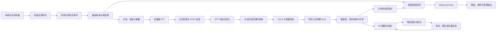

# SoundSight 原理流程（初稿）

## 1. 真正要解决的问题

SoundSight 需要完成三个相互衔接、但时间尺度不同的任务：

1. 从四路同步声音中估计声源相对阵列的方向；
2. 根据该方向对四路声音做电子延时补偿，输出增强音频；
3. 在方向结果可信且稳定时，驱动转台让设备正面逐渐对准声源。

因此，系统不是一条简单的串行流水线，而是在同步预处理后分成三条链路：按帧工作的定位链路、逐采样工作的音频增强链路，以及低速工作的机械跟踪链路。

## 2. 总体原理流程



关键连接关系：定位链路使用预处理后的短时数据帧来估计方向；音频增强链路保留连续采样流，只接收定位链路产生的补偿延时；机械链路只接收经过置信度门控和平滑的方向，不直接响应每一帧的原始峰值。

## 3. 声波传播如何变成通道间时延

远场单声源到达小型阵列时，可近似看成平面波。第 (m) 个麦克风的离散信号可写成

\[
x_m[n] = a_m s\!\left(\frac{n}{f_s}-\tau_m\right)+v_m[n],
\]

其中：

- (s(t)) 是声源信号；
- (f_s) 是采样率；
- \(\tau_m\) 是声波到达第 (m) 个麦克风的时间；
- \(a_m\) 表示通道增益和传播衰减；
- \(v_m[n]\) 表示噪声、混响和干扰。

声源方向没有直接写在单通道幅值里，而是主要体现在不同通道的到达时间差

\[
\tau_{ij}=\tau_i-\tau_j.
\]

因此，下一板块必须保证四个通道使用同一个时间基准；否则采样系统自身的时钟差会与真实传播时延混在一起。

## 4. 为什么必须四路同步采样

同步采样的本质是：同一个离散时刻 (n) 上的四个样本代表同一采样时间。只有这样，样本偏移量 (d_{ij}) 才能转换为物理时延：

\[
\hat\tau_{ij}=\frac{d_{ij}}{f_s}.
\]

四路接口至少要冻结以下语义：

- 共用采样时钟或共用 BCLK/FS/PDM CLK；
- 固定的物理通道到数据索引映射；
- 统一的 `sample_valid`；
- 可测且可重复的固定通道延迟；
- 丢样、乱序和 FIFO 溢出的检测方式。

同步采样输出的是“时间可比较”的四路序列。下一板块通过校准与预处理，减少与方向无关的通道差异，并为定位与增强两条链路提供统一输入。

## 5. 通道校准与预处理

预处理的目的不是直接算方向，而是让后续算法看到尽可能一致、受控的信号。初步流程为：

```text
原始样本
  -> 固定延迟校准
  -> 通道增益校准
  -> 去直流
  -> 必要的抽取与带限滤波
  -> 统一格式输出
```

需要记录每一级的位宽、符号、小数位、增益和群时延。滤波器若给不同通道引入不同延迟，就会直接污染 TDOA，因此四路结构和系数必须一致。

预处理后的数据在这里分流：一份进入连续音频延迟线，等待波束形成；另一份进入分帧模块，为 GCC-PHAT 提供短时近似稳定的数据。

## 6. 分帧、加窗与重叠

GCC-PHAT 在有限长度的数据帧上工作。设帧长为 (N)，hop 为 (H)：

- 帧长越大，频率分辨率通常越高，但缓存、计算量和响应延迟也越大；
- hop 越小，方向更新越频繁，但相邻帧重复计算更多；
- 加窗用于减小有限截断造成的频谱泄漏；
- 重叠使方向更新周期可以小于整帧时长。

当前文档中的 48 kHz、1024 点帧、512 点 hop 只是初始基线：一帧约 21.3 ms，hop 约 10.7 ms。最终参数还要同时满足阵列尺寸、目标频段、混响、资源和实时吞吐约束。

每个完整帧进入 FFT 后，时域中的相对延迟会转化为频域中的相位差，为互功率谱计算提供条件。

## 7. GCC-PHAT：从相位差恢复互相关

对通道 (i,j) 的一帧信号做 FFT：

\[
X_i[k]=\operatorname{FFT}\{x_i[n]\},\qquad
X_j[k]=\operatorname{FFT}\{x_j[n]\}.
\]

计算互功率谱：

\[
G_{ij}[k]=X_i[k]X_j^*[k].
\]

普通互相关会受到频谱幅值和窄带强分量影响。PHAT 用互功率谱幅值做归一化，主要保留相位关系：

\[
R_{ij}[k]
=\frac{G_{ij}[k]}{|G_{ij}[k]|+\varepsilon}.
\]

其中 \(\varepsilon\) 防止低能量频点除零或过度放大噪声。再做 IFFT：

\[
r_{ij}[\ell]=\operatorname{IFFT}\{R_{ij}[k]\}.
\]

理想情况下，(r_{ij}[\ell]) 会在真实相对延迟附近形成主峰。由此，下一板块不再比较整段波形，而是在物理允许的 lag 范围内寻找可信峰值。

四个麦克风共有六个无序通道对。使用三组参考通道对可以降低计算量，使用更多通道对可以增加几何冗余和异常检测能力；具体调度要结合阵列几何与 FPGA 资源决定。

## 8. 峰值搜索与 TDOA

麦克风间距为 (d_{ij})，声速为 (c) 时，两通道最大物理时延满足

\[
|\tau_{ij}|\leq \frac{d_{ij}}{c}.
\]

因此只应在合法范围

\[
|\ell|\leq
\left\lceil\frac{f_s d_{ij}}{c}\right\rceil
\]

内搜索相关峰，避免把循环相关的其他位置或混响峰当作真实传播时延。

整数峰值位置得到整数采样延迟。若峰值左右邻点分别为 (r[-1],r[0],r[1])，可用抛物线插值获得初步亚采样偏移：

\[
\delta=
\frac{r[-1]-r[1]}
{2\left(r[-1]-2r[0]+r[1]\right)}.
\]

最终估计为

\[
\hat\tau_{ij}=\frac{\ell_{\max}+\delta}{f_s}.
\]

这里不能只输出 TDOA 数值，还要输出峰值高度、主峰与旁瓣比、边界命中等质量信息。下一板块会把多组 TDOA 与阵列坐标结合，并检查这些时延能否由同一个空间方向解释。

## 9. 从多组 TDOA 求解 DOA

选择第一个麦克风为参考点。在远场平面波假设下：

\[
c\tau_{i1}=(\mathbf r_i-\mathbf r_1)^T\mathbf u,
\]

其中 \(\mathbf r_i\) 是麦克风坐标，\(\mathbf u\) 是入射方向单位向量。把多组方程写成

\[
A\mathbf u=\mathbf b,
\]

可用最小二乘获得方向向量，再归一化并换算角度。在二维情况下，可按约定使用

\[
\theta=\operatorname{atan2}(u_y,u_x).
\]

必须先冻结角度定义，例如“设备正前方为 (0^\circ)，逆时针为正”，否则算法角度、电机角度和实物方向无法衔接。

阵列几何决定方程是否可解以及是否存在前后模糊。线阵通常无法仅靠 TDOA 区分镜像方向；二维非共线阵列能提供更多约束，但仍要检查空间混叠、阵元误差和实际安装偏差。

DOA 求解输出方向和方程残差。下一板块综合相关峰质量、几何一致性和时间连续性，决定这个角度是否允许进入波束形成和机械控制。

## 10. 置信度、异常拒绝与平滑

“算出一个角度”不等于“这个角度可信”。置信度可以综合：

- 输入信号能量是否足够；
- 主峰与次峰或旁瓣的比值；
- 各通道对 TDOA 是否相互一致；
- 几何方程的最小二乘残差；
- 角度是否在相邻帧之间连续；
- TDOA 是否触及物理边界；
- 是否存在多个竞争峰或疑似双声源。

低置信度时应输出“方向无效”或保持上一稳定状态，不能继续输出一个看似精确的随机角度。平滑只用于抑制合理范围内的帧间抖动，不能掩盖错误峰值。

经过门控的稳定 DOA 会分给两个消费者：一条转换为声学补偿延时，控制电子波束；另一条进入 PS 的低速状态机，控制机械转台。

## 11. 从 DOA 到电子波束指向

已知方向向量后，可根据阵元坐标计算各通道相对参考点的理论到达时延。为了让同一波前在求和前对齐，需要施加符号相反、并整体平移为非负值的补偿延时 (d_m)：

\[
y[n]=\frac{1}{M}\sum_{m=0}^{M-1}x_m[n-d_m].
\]

同方向的目标信号经对齐后相干叠加，不相关噪声不会同样增强。四路不相关噪声下的理论阵列增益上限约为 6 dB，真实结果还受混响、标定误差、阵列孔径和延时精度影响。

MVP 先采用整数采样延时，证明数据流、方向符号和求和增益正确；分数延时滤波在定位链路稳定后再加入。方向更新应在受控边界生效，或对延时参数渐变，防止瞬间切换造成爆音。

波束形成读取的是预处理后保留的连续音频流，而不是 GCC-PHAT 的互相关结果。其输出经过增益调整、位宽缩减、舍入与饱和后进入音频接口。

## 12. 从 DOA 到机械转向

机械转向与电子波束形成使用同一个可信 DOA，但目的不同：电子波束在不移动设备的情况下改变接收方向；机械转台改变设备本身的朝向。

若 DOA 是相对设备正前方的角度，则它可以直接作为位置误差的来源：

\[
e_\theta=\theta_{\text{source}}-\theta_{\text{front}}.
\]

初步控制状态机为：

```text
IDLE
  -> ACQUIRE：连续若干帧发现可信声源
  -> TRACK：超过角度死区后限速转动
  -> HOLD：已对准或短时失去声源
  -> FAULT：限位、反馈异常或驱动故障时停止
```

PS 负责置信度门控、角度滤波、死区、目标位置、速度和加速度规划；位置反馈来自编码器、零位或限位传感器。若底层步进脉冲对时序要求高，可由 PL 产生脉冲，但高级控制策略仍属于 PS 控制面。

当麦克风阵列随转台旋转时，DOA 始终是相对当前设备坐标系的误差；设备接近声源方向后，理论上该误差趋近零。必须限制转速并评估电机振动、电磁噪声和坐标变化对声学估计的影响。

## 13. PL 与 PS 的原则分工

| 功能 | 适合位置 | 原因 |
|---|---|---|
| 四路同步采集、预处理、分帧 | PL | 固定吞吐、严格时序、天然并行 |
| FFT、GCC-PHAT、峰值与 TDOA | PL | 数据量大、重复运算、实时性强 |
| DOA 与置信度基础计算 | PL | 保持核心声学链路闭环 |
| 参数配置、显示、日志 | PS | 低速、逻辑复杂、便于修改 |
| 转台高级跟踪状态机 | PS | 机械带宽低，策略与安全条件多 |
| 必要的精确定时电机脉冲 | PL 或专用驱动器 | 取决于执行机构接口和时序要求 |

分工原则不是“能否用软件算”，而是核心实时数据是否需要确定吞吐，以及功能变化频率和安全逻辑复杂度。

## 14. 定点化如何贯穿整条链路

MATLAB 浮点算法正确后，不能直接假设 RTL 会得到同样结果。每一级都需要确定：

- 输入与输出范围；
- 有符号位、整数位和小数位；
- 乘法与累加后的位宽增长；
- FFT/IFFT 缩放策略；
- 归一化倒数或近似算法；
- 位宽缩减时的舍入与饱和；
- 量化误差对峰值、TDOA、角度和音频的最终影响。

建议形成逐级链路：

```text
MATLAB 浮点模型
  -> 记录每级动态范围
  -> MATLAB 位精确模型
  -> 导出确定性测试向量
  -> RTL 自检 TB 逐级比较
  -> Vivado 综合与时序检查
  -> 板上采集并与同一参考模型比较
```

定点验证不能只比较最终角度；如果最终结果失败，必须能定位到 FFT、PHAT、IFFT、峰值、TDOA 或几何求解中的第一处偏差。

## 15. 各板块的输入输出衔接

| 板块 | 输入 | 产生的关键输出 | 输出交给谁 |
|---|---|---|---|
| 声学传播与阵列 | 声源、阵元坐标、声速 | 带空间时延的四路声压 | 麦克风与采样接口 |
| 同步采样 | 四路电信号、共同采样时基 | 时间可比较的四路样本 | 校准与预处理 |
| 校准与预处理 | 原始样本、校准参数 | 格式统一的连续音频流 | 分帧模块和延迟线 |
| 分帧与 FFT | 连续音频流、帧长、hop、窗 | 各通道复频谱 | 互功率谱 |
| GCC-PHAT 与 IFFT | 通道频谱对 | 广义互相关序列 | 合法 lag 峰值搜索 |
| 峰值与 TDOA | 互相关、阵元间距、声速 | 时延、峰值质量 | DOA 求解与置信度 |
| DOA 求解 | 多组 TDOA、阵元坐标 | 方向、几何残差 | 置信度与平滑 |
| 置信度与平滑 | 方向、峰值质量、历史状态 | 可信 DOA 或无效标志 | 波束控制、PS、UI |
| 电子波束形成 | 连续音频流、补偿延时 | 增强音频 | 音频输出与评价 |
| 机械跟踪 | 可信 DOA、当前位置、安全状态 | 电机目标与设备朝向 | 转台和位置反馈闭环 |
| 验证链路 | 模型参数、测试向量、板上记录 | PASS/FAIL 与首个偏差 | 下一阶段门和结果归档 |

## 16. 当前仍需冻结的关键问题

以下问题不能仅靠原理文档决定，需要 M0 的真实硬件证据：

1. 具体 Zynq-7020 板卡、器件和可用 PL IO；
2. PDM、TDM/I2S ADC 或其他四路同步采集接口；
3. 麦克风坐标、间距、阵列形状和目标频段；
4. 采样有效位宽、预处理采样率和音频输出接口；
5. 转台实际承载对象、负载、转角、速度、精度和位置反馈；
6. 声学阵列坐标、设备正前方和转台零位的统一约定；
7. FPGA 内 FFT 复用方案、通道对数量和最终定点格式。

在这些事实冻结前，本文给出的是可验证的原理主线，而不是已经完成的硬件实现方案。

