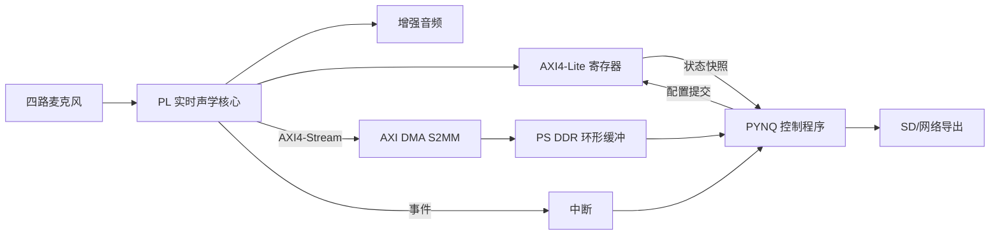

# PYNQ 集成与控制面指南

执行规则更新（2026-09-08）：成员间仅 [H1 最小接口 → H2 首批诊断数据 → H3 算法包集成评审](three-handoff-workflow.md)。暂定接口可版本化用于工程框架、读取器、逻辑/TB和离线算法开发；短实录不等一小时长稳，但只作诊断。A/B 负责技术开发和判断，C 只[按操作单](member-c-operation-sheet.md)执行。以下冻结/阶段门用于对应接板、正式集成或验收声明，不禁止独立离线工作；完整包交付而非逐小动作审批。

状态：架构角色与 Vivado `2025.2` 基线已确定；领航者板卡的 PYNQ 镜像、板级支持、Overlay 与 DMA 可用性仍待 M0 实证冻结。版本决策不是工程复现结果。

适用范围：本指南的四路接口和 M0～M6 流程仍服务于 2026-10-07 四麦二维 V1，属于现行文档。六麦当前只做软件预研，沿用原 IM73D122V01/PDM 路线，不新增四麦模拟或重新选型；实际模块、六路扩展和 PYNQ 板级支持仍须核验。状态与证据分别见[当前状态](current-status.md)、[板级接口审计](../hardware/m0-board-interface-audit.md)和[竞赛验收台账](competition-acceptance.md)。

## 1. 架构决定

SoundSight 将 PYNQ 作为首选的开发、验证和演示控制层。PL 独立承担四通道同步采集、连续音频、实时定位与波束形成；PYNQ 运行在 Zynq PS 上，负责配置、状态、日志、原始录音导出、实验编排、界面和低速控制。

这项决定不等于把项目绑定到 Python。PL 与 PS 只通过冻结的 AXI 寄存器、DMA 数据格式和中断事件交接。若实际板卡无法可靠运行 PYNQ，同一硬件接口可以由 Vitis 裸机程序或 PetaLinux 应用接管，核心 RTL 不重写。

## 2. 设计边界

### PL 必须独立完成

- 共享采样时基的四通道接收、通道对齐、CDC 和错误计数；
- 预处理、分帧、FFT 复用、GCC-PHAT、TDOA/DOA 和置信度；
- 连续延迟线、Delay-and-Sum、增益、饱和和音频输出；
- 不依赖 Linux 调度的状态机、超时和安全默认值；
- PYNQ 退出、重启或暂时不读数据时，仍按冻结策略继续运行或安全停止，并留下可读取的错误状态。

### PYNQ/PS 负责

- 识别硬件与接口版本，加载匹配的 Overlay；
- 通过 AXI4-Lite 写影子配置、提交版本并读取一致的状态快照；
- 管理 AXI DMA 缓冲区，把四通道原始录音和受控调试数据写入文件；
- 管理 A/B/C 模式、实验元数据、参数扫描、结果显示和日志；
- M7 中执行低速跟踪状态机；若需要精确定时脉冲，由 PL 或专用驱动器完成底层输出。

### 明确禁止

- Python 逐样本轮询麦克风或波束输出；
- 用 Notebook 循环替代 PL 中的 FFT、GCC-PHAT、延迟线或采集状态机；
- PL 通过 Python 对象名、Notebook 顺序或特定文件路径决定功能；
- 只因界面能显示角度，就把采集连续性、RTL 仿真或时序实现判为通过。

## 3. PS/PL 交接结构



接口用途必须保持单一：

| 接口 | 用途 | 不允许承担的工作 |
|---|---|---|
| AXI4-Lite | 低速配置、版本、状态和计数 | 连续四通道音频搬运 |
| AXI4-Stream | PL 内部流和送入 DMA 的数据流 | 软件直接逐拍控制 |
| AXI DMA S2MM | 原始录音和批量调试数据进入 DDR | 用反压暂停物理采集 |
| AXI DMA MM2S（可选） | 回放冻结测试向量、硬件回归 | 代替真实采集验收 |
| 中断 | 完成、阈值或异常事件通知 | 每个样本触发一次中断 |

## 4. AXI4-Lite 最小合同

正式地址表在实现前独立冻结，但至少包含以下语义：

| 类别 | 最小字段 | 要求 |
|---|---|---|
| 身份 | `hardware_id`、`interface_version`、`build_id` | PYNQ 启动后先核对，不匹配则拒绝控制 |
| 控制 | `enable`、`soft_reset`、`mode` | 复位值和安全状态明确 |
| 原子配置 | 影子参数、`config_commit`、`config_version` | PL 只在安全边界成组生效 |
| 状态 | `running`、`locked`、`frame_id`、`sample_id` | 多字段状态使用快照或一致性协议 |
| 定位 | DOA、置信度、时间戳、无效原因 | 数值格式、单位和无效语义固定 |
| 健康度 | FIFO/DMA 溢出、丢样、超时、非法 TDOA 计数 | 错误不可静默清除 |
| 抓取 | DMA 启停、块长度、序号、完成/中止原因 | 不允许反压采集主链 |

Python 封装只能解释这份合同，不能把寄存器偏移、Q 格式和状态位散落在多个 Notebook 中。寄存器定义应由一份可版本化的单一来源生成或共同引用。

## 5. DMA 与录音合同

M1 主路径为：

```text
channel_align
  -> 非阻塞抓取 FIFO
  -> AXI DMA S2MM
  -> DDR 环形缓冲
  -> PYNQ 分块读取
  -> SD 文件或网络导出
```

每个数据块必须能恢复：格式版本、采样率、有效/存储位宽、通道顺序、抓取点、首个 `sample_id`、样本组数、`config_version`、时间戳和丢失/溢出计数。PYNQ 或存储端跟不上时，按冻结策略中止本次录音或标记丢失区间，不能把压力传回麦克风采集口。

DMA 验收同时包含：

- 数据正确：通道顺序、符号、块边界和 ID 连续；
- 实时隔离：启动、停止、超时或 Python 异常不改变采集主链时序；
- 可恢复：超时后能够受控复位 DMA 通路，不要求复位整个声学核心；
- 可追溯：录音文件能关联 Overlay 构建、寄存器配置和实验条件。

## 6. Overlay 交付合同

每个可运行 Overlay 至少由同一次 Vivado 构建产生：

- `.bit`：PL 配置比特流；
- `.hwh`：供 PYNQ 识别 IP、地址和中断的硬件元数据；
- 构建清单：Git 提交、目标 part/board、Vivado 版本、构建时间、接口版本和文件哈希；
- 对应的寄存器/DMA 数据格式说明。

本项目只接受 Vivado `2025.2` 生成的候选 Overlay；每次构建必须同时保存实际版本输出、Git 提交、完整 part、脚本入口、日志、退出码和文件哈希。完成这些记录仍不代表实板可用，Overlay 加载、寄存器、DMA 和异常恢复必须另行板测。

`.bit` 与 `.hwh` 不得混用不同构建。XSA 继续保留为 Vitis/PetaLinux 后端或板级复现所需的硬件平台交付物。生成物不直接提交 Git；发布位置和归档方式在 M6 前冻结。

推荐在出现第一份真实程序时采用：

```text
ps/
  pynq/
    soundsight/            可复用 Python 包，封装 Overlay、寄存器和 DMA
    notebooks/             教学和受控实验入口，不承载唯一实现
    tests/                 PS/PL 合同、DMA 和异常恢复测试
    requirements.txt       冻结 Python 依赖
```

核心寄存器和 DMA 驱动放在可测试的 Python 模块中，Notebook 只调用模块，不复制底层访问逻辑。

## 7. 分阶段引入

| 阶段 | PYNQ 工作 | 允许通过的证据 |
|---|---|---|
| M0 | 核实板型、镜像/板级支持、DDR、SD、网络、启动方式和 Vivado 兼容性 | 实板启动、连接和基础 Overlay 加载记录；否则明确切换后端 |
| M1 | 最小 Overlay、版本读取、AXI-Lite 冒烟测试、DMA 四通道录音 | ID 连续、文件可解析、异常不反压采集 |
| M2 | 驱动离线录音和 A/B 实验，不承担实时算法 | 同一录音与配置可重复生成评价输入 |
| M3～M4 | 显示中间状态、性能计数和 DOA，不改变 RTL 验收口径 | Python 显示与寄存器/抓取证据一致 |
| M5 | 管理 A/B/C 模式、输出录音和实验元数据 | 三路对照可复现，模式切换有版本记录 |
| M6 | 固化启动、演示、日志、依赖和故障恢复流程 | 从干净环境可部署，演示不依赖手工修改 Notebook |
| M7 | 可选低速转台策略和状态显示 | 声学核心不依赖 PYNQ 调度，故障时安全停止 |

## 8. M0 准入与替换条件

采用 PYNQ 进入 M1 前必须回答：

1. 实际板卡的完整型号、Zynq part 和硬件版本是什么？
2. 是否有与该板 DDR、MIO、启动介质匹配且能复现的 PYNQ 镜像或板级支持包？
3. 板上 SD、DDR、以太网或 USB 网络是否实测可用？
4. PYNQ、板级支持文件与项目 Vivado 版本怎样匹配？
5. 基础 Overlay 能否加载，并正确访问 AXI4-Lite 与中断？
6. DMA 路径的缓存一致性、连续内存和最大安全块长是否实测？

任一关键项无法在项目期限内闭环时，PS 后端切换到 Vitis 裸机或 PetaLinux。切换只改变 `ps/` 的实现与部署流程，不改变 PL 数据面、寄存器语义、DMA 数据格式和验证向量。

## 9. SKL-002 验证接入

`SKL-002 pynq-overlay-dma-validation` 是独立工作包，本指南只规定它与 SoundSight 的交接，不替代其实现。SoundSight 向其提供版本化的 Overlay/寄存器/DMA合同、离线缓冲样例、golden reference 和性能口径；交付后用它检查 Overlay 加载、register map、DMA、缓存一致性、超时、loopback、golden 比对和性能记录。

PYNQ 准入前只能接受并标记离线 v0 的静态与隔离样例结果。M0 准入后，必须在当前领航者板卡、当前 Overlay 和当前 Vivado 2025.2 构建上重新执行实板验证；通用 Skill 的成功记录不能替代 SoundSight 的 M1 板测。SKL-002 不是 PS 程序的运行时依赖，缺失或失败时不得改变 PL 核心接口。

## 10. 六麦软件材料与 PYNQ 验收的区别

[六麦软件报告](six-mic-acoustic-software-review.md)记录了 2700 帧合成数据、21 个自检通过及独立复跑产物一致；同频带 0 dB 噪声与等强竞争声源用例有效率分别为 47% 和 26%，完整 3D-G0 未通过。复现入口集中在[六麦材料包](../deliverables/six-mic-acoustic-review-v1/README.md)。这些是 PC 浮点/合成证据，不是 PYNQ 安装、Overlay 加载、DMA 连续性、PL 周期或实板性能记录；材料包也不能标为可部署 Overlay 包。

主流程获授权的离线软件模型可以继续改进。PYNQ 后续只通过版本化 AXI4-Lite、AXI DMA 和中断消费 PL 结果，Vitis/PetaLinux 备选边界保持不变。六路扩展必须先评审新格式；V1 四路客户端对六路/未知版本/错误长度明确拒绝，通道数与 2D/3D 维度独立声明，不能靠改 Python reshape 自动升级合同。

六路完整预算及 3D-GA 尚未完成。V1 保底门与 3D-G0 通过后，GA 仍需验证新采集配置、DMA 缓冲所有权、全六路映射、复位/重锁定、超时恢复及一小时全路长录音；Python 停止不得反压物理采集。四路 V1 板测、离线 mock 或六麦声学软件自检均不能替代上述六路实测，细项见[三维工程指南](three-dimensional-doa-engineering-guide.md)。

## 11. 完成定义

PYNQ 集成只有同时满足以下条件才算完成：

- PYNQ 镜像、Python 包、Overlay 和 Vivado 版本可追溯；
- `.bit`、`.hwh`、寄存器定义和 Python 封装版本一致；
- AXI4-Lite 原子配置、状态快照和错误读取有自动化测试；
- DMA 长录音能证明数据连续，并覆盖停止、超时、溢出和恢复；
- 停止或杀死 Python 程序不会让 PL 产生未定义行为；
- Notebook 不是底层驱动的唯一副本；
- 替换为其他 PS 后端时不需要修改核心 RTL；
- PYNQ 演示通过不被用来替代 RTL、时序、CDC 和板上测量证据。
- 发布证据包含用户可见提示、回答、人工纠正和验证结果，不包含隐藏思维链；路径、隐私与许可检查已完成。
