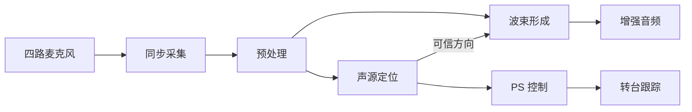
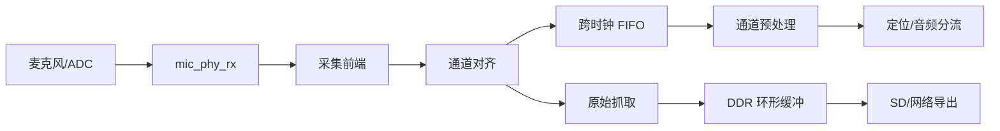
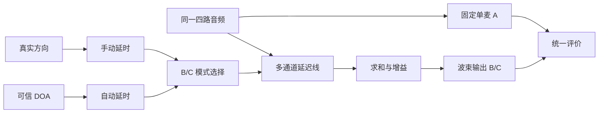
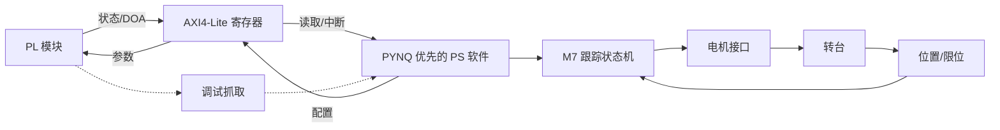

# SoundSight 工程实施流程（现行 V1）

2026-09-23：按 [fpga-team-workflow 协作约定](team-workflow.md)执行，V1 总验收改为 **2026-10-07**；任务及状态以 GitHub Issue/PR 为准，见[日历](project-plan.md)与[任务入口](work-packages.md)。A/B/C 均可承担工程开发和独立复核；旧聊天已删除。本文技术合同保留，历史证据不自动批准后续版本。

执行与发布统一在成员工作执行任务内完成；独立复核另开任务，真人成员在 GitHub 对准确 SHA 签署结论。无需为每个动作另建聊天或工作树，见[当前协作规则](team-workflow.md)。

执行规则更新（2026-09-08）：成员间仅 [H1 最小接口 → H2 首批诊断数据 → H3 算法包集成评审](three-handoff-workflow.md)。暂定接口可版本化用于工程框架、读取器、逻辑/TB和离线算法开发；短实录不等一小时长稳，但只作诊断。A/B/C 共同承担技术开发和判断，按任务负责人及复核人划分权限。以下冻结/阶段门用于对应接板、正式集成或验收声明，不禁止独立离线工作；完整包交付而非逐小动作审批。

## 1. 文档定位

本文回答“SoundSight 在工程上怎样从硬件输入逐步实现为可验证系统”。重点是模块职责、接口衔接、数据流、控制流、开发顺序和阶段验收，不重复推导 GCC-PHAT、TDOA、DOA 与 Delay-and-Sum 的数学原理；算法原理见 [原理流程](principles-flow.md)，真实录音分层、指标口径和算法升级门见 [声学性能验证计划](acoustic-validation-plan.md)。

本文仍是有效的四麦二维 V1 工程指南，目标 2026-10-07，不因新增六麦预研而废弃。M0 尚未整体通过，具体未满足项与证据见[当前状态](current-status.md)和[板级接口审计](../hardware/m0-board-interface-audit.md)。Vivado `2025.2` 是固定版本基线；版本输出、脚本重建、综合实现、资源/时序和实板测试必须分别提供记录，不能由版本决定推定工程已复现。

麦克风沿用用户已选 IM73D122V01/PDM 路线，本轮不重新比较型号或更换接口；具体模块、时钟负载、电平、引脚和固定差异仍须实物证据。现有[四路样本合同](../hardware/four-channel-sample-interface-contract.md)保持原义，六麦不会自动扩大 V1 的 bundle、寄存器或 DMA 格式。

当前工作分派以[项目计划](project-plan.md)、[工作包](work-packages.md)、[团队分工](team-tasks.md)和[竞赛验收台账](competition-acceptance.md)为入口。整理前版本集中保存在[归档说明](../archive/2026-09-07-before-materials-cleanup/README-ARCHIVE.md)所列快照；历史原文只用于追溯，当前阶段状态按现行台账判断。

### 1.1 六麦软件预研与本工程的交接

六麦当前只做声学软件预研，没有新增四麦模拟或四/六麦比较任务。主流程已完成[第一轮六麦软件评审](six-mic-acoustic-software-review.md)：2700 帧合成用例、21 个自检通过，独立复跑的 15 个产物哈希一致；同频带 0 dB 噪声下有效率 47%，等强竞争声源下有效率 26%，因此完整 3D-G0 尚未通过。材料统一从[六麦评审材料包](../deliverables/six-mic-acoustic-review-v1/README.md)进入。

该模型使用理想麦克风传递函数，未覆盖实际 PDM 抽取、定点、PL 或 PYNQ 板测。六麦 6 次 FFT＋15 次 IFFT 仅是全 pair 运算计数；完整采集/抽取、缓存、PHAT、求解、搬运、资源和时序预算尚未完成。六麦采集须在 V1 保底门及 3D-G0 通过后再进入 3D-GA，详见[三维工程迁移指南](three-dimensional-doa-engineering-guide.md)。主流程已授权的离线模拟可继续进行，不受“先硬件后 RTL”的实现门限制。

工程实施遵守五条主线：

RTL 语言选择和 BD 接入统一按 [RTL 语言与 Block Design 接入约定](../task-packages/PKG-A-H3-INTEGRATION/references/policy/rtl-language-and-bd-integration.md)执行：简单模块优先 `.v`，复杂 `.sv` 核心使用 `.v` 包装层接入 Module Reference；不改既有数据接口和验收边界。

1. 先证明四路样本同步且可追踪，再实现定位算法。
2. 连续音频流、按帧定位流和低速机械控制流分开设计。
3. 每个 RTL 模块先冻结接口与数值格式，再写实现和自检测试。
4. MATLAB 模型、RTL 仿真、Vivado 时序和板上实测是四种不同证据，必须分别通过。
5. 原始四通道录音、手动真实方向波束和自动方向波束尽早进入同一评价链路，用对照实验定位问题属于阵列、定位还是实现。

## 2. 系统工程分图

为保证在 Markdown 预览中可以直接看清，本节只用一张简化总览表达分支关系，再分别展开采集、定位、波束形成和控制链路。具体模块职责和接口仍以后续表格为准。

### 2.1 系统级总览



总览表达两个核心分支：预处理后的连续音频直接进入波束形成，定位链路产生的可信方向控制电子波束。图中的机械转台是 M5 以后、存在明确朝向载荷时才启用的可选消费者。

### 2.2 四路采集与预处理



这一链路的最终交付物是同一采样时刻的四通道样本组。M1 同时建立不反压采集主链的原始录音支路；任何通道错位、丢样、FIFO 溢出或导出不连续都必须留下状态和计数。

### 2.3 频域定位前半段


该链路把四通道时域帧转换为每个通道对的广义互相关。每通道每帧只做一次 FFT，频谱存储后再复用给所有通道对；共享 FFT/IFFT 时，`frame_id`、通道号和 `pair_id` 必须伴随数据传递。

### 2.4 TDOA、DOA 与可信方向


这部分不保证每帧都输出角度。输入能量不足、峰值冲突、几何残差过大或方向跳变时，应输出无效状态或保持策略所允许的上一稳定状态。

### 2.5 电子波束形成



音频数据不经过 GCC-PHAT 结果流，而是保留连续样本。M2 先用真实方向产生手动波束 B，M5 再接入自动方向产生波束 C；A/B/C 必须来自同一输入、采用相同增益和有效频带。

### 2.6 PS 控制、观测与转台



PYNQ 是首选 PS 开发、验证和演示控制层，负责参数管理、状态读取、日志、录音导出和低速机械策略；其全部功能只能通过版本化的 AXI4-Lite、AXI DMA 和中断合同访问 PL。转台反馈形成独立闭环，但不能反向阻塞逐采样音频链路；M0～M5 只预留接口，不采购或实现转台。

上述分图对应三种时间尺度：逐采样音频流持续运行，按帧定位链每个 hop 更新一次，PS 与机械跟踪按更低速率工作。

## 3. 模块间统一接口规则

### 3.1 四路样本必须作为同一采样时刻交接

采集前端的核心交付物不是四条互不相关的数据线，而是一个“四通道样本组”。建议在处理域内部使用参数化的 packed 数据：

```text
audio_sample_bundle = {mic3_sample, mic2_sample, mic1_sample, mic0_sample}
```

一次成功传输表示同一采样序号下的四个样本同时有效。`W_SAMPLE`、补码格式和通道排列在 M0/M1 接口冻结时确定。禁止让四通道各自独立握手后再假设它们仍然对齐。

### 3.2 流式握手语义

模块边界优先采用 AXI4-Stream 风格的 `valid/ready` 语义：

- 只有 `valid && ready` 时数据才完成一次传输。
- `valid=1 && ready=0` 时，发送端必须保持数据和伴随元数据不变。
- 帧数据用明确的帧起点/终点或 `last` 标志，不依赖接收端自行猜测长度。
- 帧号、采样计数和错误标志属于数据语义的一部分，不能只存在于波形观察中。

物理麦克风输入不能因为下游拉低 `ready` 而暂停。因此采集边界必须设置 FIFO 或确定的丢弃策略；一旦容量不足，记录黏滞溢出标志和累计计数，而不是静默丢样。

### 3.3 配置与状态语义

低速配置使用 AXI4-Lite。会同时影响多个模块的参数，例如采样率、阵列坐标、声速、帧长和阈值，应采用“影子寄存器 + 提交”机制：

1. PS 写入完整的一组影子参数。
2. PS 写 `config_commit`。
3. PL 在安全边界一次性切换参数并更新 `config_version`。
4. PS 读取版本号确认生效。

跨时钟域的单比特控制使用同步器，脉冲使用握手或 toggle，同组多比特配置使用握手快照或异步 FIFO。不能只给数据总线加两级寄存器。

### 3.4 数值与单位

每个数据接口必须记录：

- 总位宽、符号位、整数位和小数位；
- 单位，例如 sample、second、degree、radian、Hz；
- 本级最大增益和可能范围；
- 舍入、饱和和溢出策略；
- 固定流水延迟或最大延迟；
- 无效数据与异常状态的表示方式。

## 4. 数据面模块职责与衔接

### 4.1 采集与同步层

下表保留通用前端职责以解释模块边界；当前执行路线是已选的 PDM。I2S/TDM/ADC 等列举不构成重新选型任务，端口与采样边沿仍按真实模块资料冻结。

| 模块 | 上游输入 | 核心职责 | 关键输出 | 下游模块 | 初步验收 |
|---|---|---|---|---|---|
| `mic_clock_gen` | 板级参考时钟、采样配置 | 产生 PDM CLK、BCLK/FS 或 ADC 所需时钟 | 共同采样时基、锁定状态 | 麦克风/ADC、`mic_phy_rx` | 频率与占空比正确，复位和启停可重复 |
| `mic_phy_rx` | PDM、TDM/I2S 或 ADC 引脚 | 按真实外设时序接收原始数据，完成采样或解串 | 原始通道数据、位/帧有效 | `acquisition_frontend` | 单通道位序、边沿、符号和帧边界正确 |
| `acquisition_frontend` | 原始位流或 ADC 字 | PDM 抽取，或 TDM/I2S 槽位解析；统一采样率和补码格式 | 各通道候选样本 | `channel_align` | 已知输入能还原为正确样本，抽取增益受控 |
| `channel_align` | 四路候选样本 | 按固定通道映射组成同一采样时刻的四路 bundle，维护采样计数 | 四路同步样本、`sample_valid`、计数与错误 | `audio_cdc_fifo`、调试抓取 | 四路无错位、无乱序；错误能被计数 |
| `audio_cdc_fifo` | 采集时钟域样本组 | 跨入 PL 处理时钟域，吸收相位和短时背压差异 | 处理域音频流、满空状态 | `audio_preprocess` | CDC 结构正确；满、空、复位和异常均有测试 |

`mic_clock_gen` 和 `mic_phy_rx` 必须依据最终器件数据手册实现。若外设直接提供与 PL 同源且满足时序的样本域，可简化 CDC，但必须由时钟树和时序约束证明，不能凭感觉删除。

### 4.2 预处理与受控分流层

| 模块 | 上游输入 | 核心职责 | 关键输出 | 下游模块 | 初步验收 |
|---|---|---|---|---|---|
| `channel_calibration` | 四路同步样本、校准参数 | 补偿固定通道延迟和增益差 | 校准后四路流 | `dc_blocker` | 同源输入的固定 offset 和增益差收敛到目标范围 |
| `dc_blocker` | 校准后音频 | 去除直流偏置，保持四路完全同构 | 去直流音频 | `bandlimit_filter` | 直流衰减符合模型，四路群时延一致 |
| `bandlimit_filter` | 去直流音频、系数 | 带限、必要时抽取，并控制带外混叠 | 统一采样率音频 | `stream_fanout` | 频响、群时延、缩放和饱和与模型一致 |
| `stream_fanout` | 预处理音频 | 将同一连续流送往定位帧缓存和波束延迟线 | 两条同步逻辑流 | `frame_buffer`、`sample_delay_bank` | 任一支路背压不会造成未记录的数据失配 |

预处理可以在实现时合并成 `audio_preprocess` 子系统，但测试时应保留逐级可观察点。四路滤波结构、系数和有效时序必须一致，否则预处理本身会制造伪 TDOA。

### 4.3 分帧与频域调度层

| 模块 | 上游输入 | 核心职责 | 关键输出 | 下游模块 | 初步验收 |
|---|---|---|---|---|---|
| `frame_buffer` | 连续四路流、帧长、hop | 缓存重叠帧，标记 frame ID 和帧边界 | 按帧四路时域数据 | `window_mul` | 帧长、重叠、起止和丢帧行为正确 |
| `window_mul` | 时域帧、窗系数 | 对四通道施加完全一致的窗函数和缩放 | 加窗帧 | `fft_scheduler` | 窗系数索引、乘法位宽和缩放与模型一致 |
| `fft_scheduler` | 四通道加窗帧、FFT IP 状态 | 每通道每帧恰好执行一次前向 FFT；调度共享或并行 FFT，保存通道与 frame ID | 四份复频谱流 | `spectrum_store` | 在一个 hop 预算内完成四次 FFT，无重复计算、通道串帧或事件丢失 |
| `spectrum_store` | 四份复频谱流 | 按通道、频点和 frame ID 保存可复用频谱；按调度需要采用 ping-pong | 可寻址的 `X0`～`X3` | `pair_scheduler` | 多端口访问、读写冲突、覆盖时机和帧一致性受控 |
| `pair_scheduler` | 四通道频谱、通道对配置 | 从同一帧频谱枚举 3 个基础参考对或 6 个无序对 | 成对复频谱 | `cross_power` | 所有配置通道对恰好处理一次，输入 FFT 不按 pair 重算，标签不丢失 |

当前 48 kHz、1024 点帧和 512 点 hop 只是预算基线。最终必须根据 FFT IP 延迟、通道对数量、复用倍数和目标处理时钟证明：一轮定位计算能在下一个可用 hop 到来前完成。

进入实现前必须形成周期表：四次输入 FFT、所用通道对的互功率谱/PHAT、各通道对 IFFT、峰值与 DOA 各占多少周期，是否可重叠，以及最坏情况下距 hop 截止还剩多少余量。同时给出频谱、重叠帧、相关序列和音频延迟线的 BRAM 预算。

#### 4.3.1 周期预算

设采样率为 `fs`、hop 为 `H`、处理时钟为 `f_pl`，每个 hop 可用周期为：

$$
C_{hop}=f_{pl}\frac{H}{f_s}.
$$

设通道对数量为 $P$，则每帧包含 4 次前向 FFT 和 $P$ 次 IFFT。没有并行重叠时，可用以下保守式核算：

$$
C_{frame}=4C_{FFT}+P(C_{pair}+C_{PHAT}+C_{IFFT}+C_{peak})+C_{DOA}+C_{control}.
$$

实际设计若让缓存读写、PHAT 与 FFT/IFFT 重叠，必须提交逐周期甘特表或等价调度表，而不是简单从总和中口头扣除。准入条件写成：

$$
C_{frame,worst}\leq U_{max}C_{hop},\qquad U_{max}<1,
$$

其中 `Umax` 是实现前冻结的最高占用率，用于给 AXI 停顿、IP 配置间隙、时钟容差和调试逻辑保留余量。周期表至少记录 IP 架构、配置开销、首结果延迟、稳态吞吐、帧间空隙和最坏背压。

#### 4.3.2 缓存与资源预算

预算不能只写总 BRAM 数，应列出每块存储的深度、宽度、份数、端口需求和映射方式。最低项目如下：

| 存储 | 容量下界或计算式 | 需要说明的工程问题 |
|---|---|---|
| 重叠帧缓存 | `4 × N × Wsample × 缓冲份数` | hop 重叠、读写并发、是否 ping-pong |
| 四通道频谱 | `4 × N × 2 × Wfft × 缓冲份数` | 复数实虚部、FFT 顺序、pair 读取端口冲突 |
| 相关序列 | `P × N × Wcorr` 或流式峰值搜索所需最小窗口 | 是否必须整帧存储，能否边输出边找峰 |
| 连续延迟线 | `4 × Dmax × Waudio` | 最大几何延迟、地址回卷和参数切换 |
| 原始录音环形缓冲 | 由最坏 PS/SD/网络服务间隔和音频数据率决定 | DMA descriptor、缓存一致性、满时策略 |

资源表至少分别列出 LUT、FF、DSP、BRAM、时钟资源以及 FFT IP、PHAT、缓存、DOA、波束、AXI/DMA 和 ILA 的占用。不得把器件总资源全部分配给算法；PS/PL 互联、CDC、观测逻辑和后续集成余量必须单独保留。

#### 4.3.3 位宽台账

位宽台账必须逐级记录输入范围、完整精度宽度、实际保留宽度、二进制点、缩放、舍入、饱和和溢出计数。重点检查：

- 窗乘后的完整乘积与首次缩位位置；
- FFT/IFFT 的逐级缩放或 block exponent，以及 frame/channel 标签的对应关系；
- 复互功率谱中两个乘积相加后的额外保护位；
- 模值、倒数和 PHAT 输出的小数位及饱和范围；
- 相关峰、插值分母、TDOA、常系数 DOA 乘加的内部累加宽度；
- 四路 Delay-and-Sum 求和至少需要的增长位，以及最终输出的统一增益规则。

M3 不能仅凭功能仿真进入实现；周期、缓存、资源和位宽四张表必须与同一 FFT 配置及同一测试向量版本对应。

### 4.4 GCC-PHAT 与 TDOA 层

| 模块 | 上游输入 | 核心职责 | 关键输出 | 下游模块 | 初步验收 |
|---|---|---|---|---|---|
| `cross_power` | 通道对复频谱 | 计算 `Xi * conj(Xj)` 并管理复乘位宽 | 复互功率谱 | `phat_weight` | 实部、虚部、共轭符号和位宽增长正确 |
| `phat_weight` | 复互功率谱、通道能量与阈值 | 先屏蔽低能量频点，再进行冻结的 PHAT 幅值归一化或近似 | PHAT 频谱、屏蔽标志与比例 | `ifft_scheduler` | 零/低能量不放大量化噪声；屏蔽、近似与饱和行为和位精确模型一致 |
| `ifft_scheduler` | 各通道对 PHAT 频谱 | 调度 IFFT 并恢复 lag 序列的索引关系 | 广义互相关序列 | `lag_peak_search` | 正负 lag 映射、缩放和 frame/pair 标签正确 |
| `lag_peak_search` | 互相关、合法 lag 上限 | 只在物理可行范围内搜索主峰与次峰 | 整数 lag、峰值、旁瓣质量、边界标志 | `tdoa_estimator` | 正负延迟、边界和竞争峰用例均正确 |
| `tdoa_estimator` | 峰值邻域、采样率、pair ID | 计算整数/亚采样 TDOA，并汇总单通道对质量 | TDOA、质量、有效标志 | `doa_solver` | 与位精确模型逐帧一致，非法分母和超界可拒绝 |

这一层必须保留 `frame_id` 和 `pair_id`，否则共享 FFT/IFFT 时很容易把不同帧或通道对的结果错误组合。

#### 4.4.1 PHAT 低能量与定点准入门

固定的 `epsilon` 不能单独解决低能量问题：FFT 量化噪声在归一化后仍可能被放大成单位幅值并制造假峰。首版必须先根据两个输入通道的频点能量或互功率谱幅值执行低能量判定；被屏蔽频点向 IFFT 输出零贡献，并按 frame/pair 记录 `masked_bin_count` 和屏蔽比例。

阈值必须绑定 FFT 缩放和定点格式，不能沿用无单位的浮点常数。若使用幅值平方比较，应在完整精度域比较后再缩位；模值近似、倒数 LUT/迭代、零保护、饱和和舍入方案都必须在位精确模型中逐项复现。

PHAT 准入测试至少覆盖：零输入、静音底噪、极低幅值、满幅、单音、宽带噪声、不同 SNR、竞争峰和混响。验收不只比较 PHAT 频谱误差，还要比较浮点与定点的主峰位置、TDOA、屏蔽比例、边界命中、有效/无效判决以及最终错误指向比例。定点实现若频繁改变主峰或靠大量拒绝隐藏错误，不得进入 RTL 冻结。

### 4.5 DOA、置信度与电子波束层

| 模块 | 上游输入 | 核心职责 | 关键输出 | 下游模块 | 初步验收 |
|---|---|---|---|---|---|
| `doa_solver` | 同一 frame 的多组 TDOA、预计算几何系数、声速 | 用固定几何常系数求解方向并计算残差，拒绝不一致组合 | 原始 DOA、残差、有效标志 | `confidence_filter` | 合成角度、边界角度和矛盾 TDOA 用例正确；PL 无通用矩阵求逆 |
| `confidence_filter` | DOA、峰值质量、残差、历史状态 | 生成置信度，完成异常拒绝和有限平滑 | 可信 DOA、置信度、时间戳、无效原因 | `beam_mode_select`、PS、UI | 低能量、跳变、双峰和丢帧不会输出伪稳定角度 |
| `beam_mode_select` | A/B/C 模式、固定麦克风号、手动真实方向、可信 DOA | 明确选择固定单麦旁路、手动方向或自动方向；隔离未选输入 | 模式、选定方向、有效标志与配置版本 | `steering_delay_ctrl`、输出选择 | A/B/C 来源唯一；自动方向无效时按冻结策略保持、静音或退回 A，不伪装成 B |
| `steering_delay_ctrl` | B/C 选定方向、阵列坐标、模式配置 | 将方向转换为各通道补偿延时，在安全边界原子更新 | 每通道延时与版本号 | `sample_delay_bank` | 角度符号、通道顺序和延时范围正确；更新无撕裂 |
| `sample_delay_bank` | 连续预处理流、延时参数 | 保存历史样本并读取整数或后续分数延时样本 | 已对齐四路音频 | `delay_sum` | 最大/最小延时、参数切换和缓存回卷正确 |
| `delay_sum` | 已对齐音频、增益配置 | 多通道累加、归一化、舍入和饱和 | 增强音频 | `audio_tx` | 满幅、相消、相干叠加和溢出用例正确 |
| `audio_tx` | 增强音频 | 格式化为实际 DAC、I2S 或其他输出接口 | 板级音频信号 | DAC/Codec/调试输出 | 采样率、位序、时钟关系和欠载处理正确 |

定位链路输出更新较慢，音频链路逐样本运行。`steering_delay_ctrl` 必须把低速参数安全地带入连续流，不能在一个样本组中只更新部分通道。MVP 先做整数延时；分数延时应在整数延时闭环通过后单独增加。

#### 4.5.1 固定几何系数与动态质量的边界

阵列坐标、参考麦克风和基础通道对集合冻结后，基础最小二乘映射可离线预计算：

$$
P=(A^TA)^{-1}A^T,\qquad \mathbf u=P\mathbf b.
$$

PL 只保存带版本号的常系数并执行乘加、归一化和角度转换，不实现通用矩阵求逆。系数生成物必须同时记录阵列坐标、坐标轴、正方向、声速处理方式、通道对顺序、定点 Q 格式和量化误差。

若通道对质量权重 $W$ 随帧变化，则 $(A^TWA)^{-1}A^TW$ 不能被一组固定系数完全替代。首版应在以下方案中冻结一种：固定权重基线、按有效通道对掩码选择预计算系数组，或由 PS 离线/低速更新成组系数。无论选择哪种方案，单帧内的系数和 TDOA 必须属于同一 `geometry_version`，且几何残差仍需由实际输入重新计算。

#### 4.5.2 A/B/C 模式切换点

M2 的 A/B 基线首先在 MATLAB 中对同一四通道实录离线产生；采集接口冻结后，可以并行验证 PL 整数延迟线，但它不是进入 M3 的替代条件。M5 才把自动方向 C 接入正式连续音频链。

模式切换必须发生在统一的 `beam_mode_select`，并随 `config_version` 在帧边界或冻结的安全样本边界原子生效：A 固定选择同一物理麦克风且走与 B/C 相同的输出增益与削顶规则；B 只读取实验真值或 PS 手动角度；C 只读取通过置信度门的自动 DOA。自动方向无效时的保持、静音或退回 A 策略必须预先冻结，并在结果中标记，禁止静默使用手动真值替代 C。

## 5. 控制面、原始录音与转台模块

| 模块 | 运行位置 | 核心职责 | 与 PL/外设的衔接 | 初步验收 |
|---|---|---|---|---|
| `control_status_regs` | PL | AXI4-Lite 寄存器、参数提交、版本、状态快照和中断 | PS 写配置；各 PL 模块返回状态 | 地址、复位值、读写权限和原子提交正确 |
| `health_counters` | PL | 统计溢出、欠载、丢帧、非法 TDOA、低置信度和超时 | 汇总到寄存器和 ILA | 故障注入后计数准确，清除策略明确 |
| `debug_capture` | PL + PS | 选择性抓取带 sample/frame ID 的原始样本、中间结果或结果帧 | 短抓取用 FIFO/BRAM；长录音用 DMA→DDR→SD/网络 | 抓取不会改变实时链路时序和结果 |
| `pynq_overlay_manager` | PYNQ/PS | 核对 `.bit`、`.hwh`、硬件接口和构建版本，加载匹配 Overlay | PL 配置接口、构建清单 | 版本不匹配时拒绝运行，加载过程可重复 |
| `ps_driver` | PYNQ/PS | 检查硬件版本，完成寄存器读写、配置提交和状态读取 | AXI4-Lite、中断 | 错误版本拒绝运行，超时和异常可报告；不依赖 Notebook 顺序 |
| `pynq_capture` | PYNQ/PS | 管理 DMA 缓冲、块序号、超时、文件写入和异常恢复 | AXI DMA、DDR、SD/网络 | 数据连续可解析；Python 异常不反压采集主链 |
| `ps_ui_logger` | PYNQ/PS | 显示 DOA/置信度/状态，保存实验元数据与小规模记录 | UART、屏幕或网络待冻结 | 日志包含参数、版本、时间和错误状态 |
| `tracking_controller` | PS（M7） | `IDLE/ACQUIRE/TRACK/HOLD/FAULT` 状态机，完成门控、死区和速度规划 | 读取可信 DOA 与位置，输出电机目标 | 声源消失、角度跳变和限位时安全停止 |
| `motor_if` | PS、PL 或专用驱动器（M7） | 输出 PWM、STEP/DIR 或位置命令；必要时 PL 只负责精确定时脉冲 | 电机驱动器 | 方向、速率、使能和急停优先级正确 |
| `position_if` | PS 或 PL（M7） | 读取零位、限位、编码器与驱动故障 | 反馈给跟踪状态机 | 断线、越界和反馈停滞可检测 |

四路 48 kHz、24 bit 的原始净数据率为 4.608 Mbit/s；若按 32 bit 对齐则为 6.144 Mbit/s，尚未计协议开销。低速 UART 只承载状态和短调试，不能作为长录音导出的主路径。

### 5.1 PYNQ 控制层合同

PYNQ 是首选实现，不是 PL 的功能依赖。核心 RTL 不得读取 Python 运行状态，也不得要求 Notebook 按特定顺序执行才能保持采集、定位或音频输出正确。所有控制通过 AXI4-Lite 影子寄存器与 `config_commit/config_version` 完成；大批量数据只通过 AXI DMA；中断只通知事件，不逐样本搬运数据。

M0 必须实板核验 PYNQ 镜像或板级支持、DDR、SD、网络、Overlay 加载与 Vivado 版本兼容性。若不满足，PS 后端改用 Vitis 或 PetaLinux，保持相同寄存器、DMA 数据格式和测试向量。具体准入、Overlay 和异常恢复要求见 [PYNQ 集成与控制面指南](pynq-integration-guide.md)。

### 5.2 M1 原始录音导出契约

```text
channel_align
  -> 非阻塞抓取 FIFO
  -> AXI DMA S2MM
  -> DDR 环形缓冲
  -> PYNQ/PS 分块读取
  -> SD 文件或网络导出
```

短片段可以停留在 BRAM/FIFO 中，长录音必须先进入 DDR 消除 SD 写入或网络发送的服务抖动。PS、SD 或网络暂时跟不上时，不允许反压物理采集链；系统应继续采集并明确执行“停止本次录音”或“标记丢失区间”的冻结策略，同时累加 FIFO/DMA/环形缓冲溢出计数。

每个录音块至少携带：格式版本、采样率、有效位宽与存储位宽、通道顺序、抓取点、首个 `sample_id`、样本组数量、硬件配置版本、溢出/丢失计数和可关联的时间戳。原始流以 `sample_id` 判断连续性；只有经过分帧后的抓取才使用 `frame_id`。文件长度、块序号和 ID 增量必须能互相校验。

M1 的导出验收包含两类独立证据：

- 采集稳定性：长稳期间样本计数连续，采集 FIFO 无未解释溢出或乱序；
- 录音可用性：D1～D3 所需片段能完整导出、重复解析，并恢复正确通道映射、样本数量和实验元数据。

SD 更适合作为首版可重复实验的持久化路径；网络适合在线观察和远程抓取，但必须记录传输丢包或重传，不能把网络接收长度当成采集连续性的唯一证据。最终选择仍取决于实际板卡接口和 PS 软件环境。

### 5.3 转台启用边界

转台不是实时音频数据路径的一部分，也不是修补阵列或电子波束效果不足的手段。M0～M5 只允许预留控制 IO、供电、安装空间、坐标和时间戳接口；只有 M5 的 A/B/C 三路对照证明核心声学收益，并明确存在摄像头、定向扬声器等必须朝向声源的载荷后，才启动采购和实现。

机械闭环不应阻塞采集，也不应让电机控制中断破坏音频时序。电机电源、地回流、振动和电磁噪声需要通过静止、保持和转动三种状态的对照实验验证。若阵列随转台旋转，DOA、置信度和转台姿态必须按时间戳对齐，不能用当前姿态解释历史音频帧。

## 6. 时钟、复位与跨时钟域规划

在 M0 完成前只定义时钟域角色，不预填具体频率：

| 时钟域 | 典型来源 | 承载模块 | 关键约束 |
|---|---|---|---|
| `clk_acq` | 麦克风/ADC 时钟或其同步派生 | `mic_phy_rx`、`acquisition_frontend`、`channel_align` | 与外设输入/输出延迟匹配 |
| `clk_pl` | PS FCLK 或板级时钟经 MMCM/PLL | 预处理、FFT、GCC-PHAT、DOA、波束形成 | 必须满足一 hop 内的最坏吞吐 |
| `clk_axi` | PS FCLK | AXI4-Lite、互联与寄存器 | 与 Zynq PS/AXI 配置一致 |
| `clk_audio_out` | DAC/Codec 输出时钟 | `audio_tx` | 若与输入异步，必须有速率匹配策略 |
| `clk_motor` | PL 时钟或专用驱动时基 | 可选脉冲发生器、位置采样 | 与音频域隔离，不制造不受控 CDC |

每个时钟域使用独立的同步释放复位。系统级复位顺序初步为：时钟稳定 → FIFO/状态清零 → 采集接口锁定 → 处理链允许接收 → 音频输出解除静音 → PS 提交有效配置。转台驱动默认保持禁止，完成零位和安全状态检查后才能使能。

XDC 至少需要包含：主/生成时钟、外部接口输入输出延迟、异步时钟组或经过论证的时序例外、IO 引脚和 IOSTANDARD。禁止用大范围 `set_false_path` 掩盖未设计的 CDC；所有例外都要能对应到明确的同步结构。

## 7. Vivado 与 PS/PL 集成流程

团队统一使用 Vivado `2025.2`。这只是版本决策，不表示当前工程已经在该版本完成仿真、综合、实现或从零重建。每台实际构建环境都必须保存 `version -short` 等可核对的版本输出，目标是从干净检出通过脚本重建工程，而不是把本机生成的 `.xpr`、runs 和 cache 当作源码。

```text
受控 RTL / XDC / IP 配置 / BD Tcl
  -> 保存 Vivado 2025.2 版本输出与构建清单
  -> create_project.tcl 创建临时工程
  -> add_sources.tcl 加入 RTL、约束和仿真源
  -> create_bd.tcl 创建 Zynq-7000 PS、AXI、复位与自定义模块连接
  -> validate_bd_design + HDL elaboration
  -> 模块仿真与系统仿真
  -> synthesis
  -> implementation
  -> timing / CDC / utilization / clock / power reports
  -> 同构建 bitstream + HWH 交给 PYNQ Overlay
  -> XSA 保留给 Vitis/PetaLinux 后端和硬件平台复现
  -> 板上测试与 results 归档
```

本项目是 Zynq-7000，Block Design 应使用与实际器件和 Vivado 版本匹配的 Processing System 7 IP；不能照搬 Zynq UltraScale+ 的 `zynq_ultra_ps_e` 配置。具体 Tcl 属性名、PS preset 和导出命令需在已选 Vivado 2025.2 与实际板卡配置上验证。

建议最终由以下受控入口组成：

```text
vivado/
  create_project.tcl       创建临时工程并设置实际 part/board
  add_sources.tcl          加入 rtl、tb、XDC 与 IP 配置
  create_bd.tcl            生成 PS7、AXI、复位和系统连接
  build.tcl                综合、实现、比特流、HWH 与 XSA
  reports.tcl              导出时序、资源、功耗、时钟和 CDC 报告
  constraints/
    board_io.xdc           真实板卡引脚和电平
    timing.xdc             时钟、IO delay 和已论证时序例外
  bd/                      受控 BD Tcl
  ip/                      可审计的 IP 配置
```

首次建工程时按以下顺序推进：

1. 冻结完整器件型号和板卡版本；使用已决定的 Vivado `2025.2`，把实际版本输出保存到本次构建记录。
2. 先建立只有 PS7、PL 时钟、复位和最小 AXI 寄存器的骨架。
3. 接入 `mic_phy_rx` 和原始抓取路径，完成 M1，不接 GCC-PHAT。
4. 每增加一个 RTL 子系统，同时加入对应仿真源、ILA 观测点和状态计数。
5. 综合后检查 latch、多驱动、未连接端口和 CDC；实现后要求 WNS、TNS、WHS 满足目标。
6. 同一次构建生成匹配的 `.bit` 与 `.hwh`，并记录接口版本、Git 提交、目标器件、Vivado 版本和文件哈希。
7. PYNQ、Vitis 或 PetaLinux 后端都只通过冻结的寄存器、DMA 和中断合同操作硬件；切换后端不修改核心 RTL。
8. 在另一干净目录或第二台已核对版本的环境执行同一脚本，保存命令、退出码、日志和产物哈希；未完成前只能写“版本已决定/工程待复现”。

## 8. 仓库文件如何落位

2026-09-23 Issue #26 已形成实体迁移候选，当前路径以[仓库树](../README.md#仓库结构)和[逐文件映射](layout-migration-map.json)为准。本节及上节的目录树保留早期工程规划背景，不表示这些旧路径或规划中的 .xpr/Tcl 现在存在；实际 one、BD、IP、约束均未搬迁。

```text
rtl/
  common/                  FIFO、同步器、舍入/饱和等可复用模块
  acquisition/             mic_phy_rx、抽取、解串与通道对齐
  preprocess/              校准、去直流、滤波与分流
  localization/            分帧、FFT 调度、GCC-PHAT、TDOA、DOA
  beamforming/             延迟控制、延迟线、求和与输出格式
  control/                 AXI 寄存器、状态、计数和可选电机脉冲
tb/
  common/                  公共事务、驱动、monitor、scoreboard、断言
  unit/                    单模块自检 TB
  subsystem/               采集、定位、波束等子系统 TB
sim/
  filelists/               仿真文件列表
  vectors/                 小型、版本化、确定性测试向量
  scripts/                 仿真器入口与回归配置
model/matlab/
  floating/                浮点算法与场景生成
  fixed/                   位精确参考模型
  export/                  测试向量导出工具
ps/
  pynq/                    首选 Overlay、寄存器/DMA 封装、测试与 Notebook
  driver/                  后端无关的寄存器合同和硬件版本检查
  app/                     UI、日志、参数管理和转台状态机
vivado/                    可复现工程、BD、XDC 与 IP 配置
results/                   经过复核的小型结果摘要
```

以上子目录在有第一份真实内容时再创建，不生成空模块树。大体积录音、波形、Vivado 构建目录、bitstream 和 XSA 不进入 Git。

### 8.1 官方推荐目录与发布导出

当前候选开发入口为 `project/rtl/`、`simulation/`、`models/`、`software/` 与 `data/fixtures/`；`hardware/`、`results/` 和 `skill/` 保留。最终提交包仍映射为官方推荐的 `src/`、`sim/`、`build/`、`board/`、`data/`、`skill/` 和 `report/`；逐项目映射见仓库根 [README](../README.md#官方推荐提交目录映射)。发布导出另行授权，不把本次目录迁移当成发布或工程重建通过。

发布导出必须满足：

- 包根目录及其全部路径只使用小写英文、数字、下划线或连字符；在纯英文绝对路径中完成一次从零复现；
- 完整源码、仿真、构建和板测所需输入都进入包，不能依赖未声明的本机工程状态；
- 官方 PDF、内部会议材料、工作包草稿、未脱敏证据照片和许可不明的第三方资料不直接打包；必要事实改写为可追溯说明或外部引用；
- 发布前检查姓名/学号/联系方式等隐私或匿名要求、本机绝对路径、账号令牌、第三方许可证、仓库许可证主体和依赖再分发条件；
- 大体积录音不能直接包含时，提交小型代表数据、哈希、下载/生成说明和 golden reference，不得只留失效的本机路径。

## 9. 验证闭环

### 9.1 单模块验证

每个模块至少覆盖：复位、连续输入、间断 `valid`、背压、边界值、非法配置、溢出/饱和和状态计数。TB 必须自动输出 PASS/FAIL、首个错误位置、frame/sample ID 和关键参数。

### 9.2 子系统验证

| 子系统 | 必测内容 |
|---|---|
| 采集链 | 位序、通道映射、固定延迟、FIFO 满空、丢样和复位重对齐 |
| 录音导出 | sample/block ID 连续性、DMA/DDR 回卷、缓存一致性、文件长度、SD 抖动、网络丢包和过载标记 |
| 定位链 | 帧边界、FFT 调度、通道对标签、正负 lag、低能量、双峰和非法 TDOA |
| 波束链 | 连续流不丢样、延时更新原子性、增益、舍入、饱和和爆音风险 |
| AXI 控制 | 地址、读写权限、影子配置、提交握手、状态快照和中断 |
| 转台控制 | 零位、限位、反馈异常、低置信度、声源消失和急停 |

### 9.3 模型到板上的证据链

```text
完整 RTL / TB / PS 源码与接口合同进入版本管理
  -> Vivado 2025.2 版本输出和脚本重建入口归档
  -> 理想阵列波束图与四路实录基线完成
  -> 单麦/手动真实方向/自动方向三路评价可复现
  -> MATLAB 浮点模型通过
  -> MATLAB 位精确模型通过
  -> RTL 逐级向量比对通过
  -> RTL 子系统回归通过
  -> Vivado 2025.2 综合无未解释关键警告并保存资源报告
  -> Vivado 2025.2 实现时序、时钟与 CDC 检查通过
  -> 上板工程和运行脚本从已声明环境启动
  -> 板上同源采集、计数器与实测输出检查通过
  -> 板上结果与冻结 golden reference 比对通过
  -> 长稳、P50/P95/有效率/错误率和三路音频对照通过
  -> 纯英文路径发布包在干净环境从零复现
  -> 可选转台在不破坏声学链路的条件下通过
```

最终结果不只比较一个 DOA 数字。应在采集、预处理、FFT、PHAT、IFFT、峰值、TDOA、DOA 和波束输出保留可选择的检查点，以便定位第一处偏差。

声学验收还必须统计全部帧，包括被拒绝帧和错误方向帧；具体实验矩阵和指标见 [声学性能验证计划](acoustic-validation-plan.md)。

### 9.4 声学指标与三路对照口径

定位指标必须按冻结的角度、距离、高度、频带、SNR 和房间条件分别报告，不能只汇总最优场景。对通过置信度门的有效帧计算环形角度误差，并至少给出 P50 与 P95；同时报告：

- 有效输出比例 `N_valid / N_total`；
- 错误指向比例 `N_wrong / N_total`；
- 有效输出中的条件错误率 `N_wrong / N_valid`；
- 各无效原因数量、最长连续跳角和方向更新延迟。

其中 `N_wrong` 表示角度误差超过预先冻结的 `theta_wrong` 且仍被系统判为有效的帧。P50/P95 只看有效帧，因此绝不能脱离有效输出比例单独宣称定位准确；正式门槛应在 D2/D3 基线完成后冻结。

同一四通道录音必须产生三路可比输出：

| 输出 | 控制方式 | 主要回答的问题 | 所属阶段 |
|---|---|---|---|
| A 固定单麦 | 固定选择同一物理麦克风 | 不使用阵列时的基线是什么 | M2 起 |
| B 手动真实方向 | 使用实验记录的真实角度生成补偿延时 | 阵列、标定和 Delay-and-Sum 本身是否有效 | M2 起 |
| C 自动估计方向 | 使用 GCC-PHAT/TDOA/DOA 输出生成补偿延时 | 自动定位相对理想手动控制损失多少 | M5 |

A/B/C 必须使用同一输入片段、相同输出增益规则、相同有效频带和相同削顶处理。B 相对 A 无改善时，先检查阵列孔径、频带、通道标定和波束实现；只有 B 有改善而 C 明显退化时，才优先归因于定位链路。每次评价同时保存三路音频、逐帧方向、置信度、无效原因和配置版本。

### 9.5 竞赛工程交付门

| 证据类 | 必须交付 | 通过条件 |
|---|---|---|
| 完整源码 | RTL、TB、PS/PYNQ、接口合同、受控 BD/IP 描述 | 干净检出后无缺失源文件，不依赖本机生成目录 |
| 仿真验证 | 输入、golden、实际输出、比较规则、日志和 PASS/FAIL | 自动化执行；首个差异可定位；失败不得删除 |
| 综合与实现 | Vivado 2025.2 版本输出、脚本、日志、utilization、timing、clock、CDC/DRC 摘要 | 目标器件和提交一致，关键警告有结论，时序状态明确 |
| 板级工程 | 核验后的 XDC/BD、Overlay或XSA、部署和运行脚本、硬件清单 | 实际板型/part/接口可追溯，脚本能启动正确构建 |
| 实测与对比 | 原始板测输出、元数据、golden reference、误差/性能比较 | 仿真结果不冒充板测；输入、配置、实际和参考可关联 |
| 从零复现 | 纯英文路径提交包、环境说明、逐步命令、退出码和产物哈希 | 干净目录或第二台环境完成构建、部署、运行和结果复核 |
| 发布合规 | 目录映射、隐私/匿名检查、许可证清单和排除清单 | 无官方 PDF/内部材料直拷、无秘密信息、第三方内容可再分发 |

### 9.6 AI 协作记录边界

比赛提交的 AI 协作记录只保留用户可见提示、模型向用户显示的回答、人工纠正、采用或否决的决定、实际文件变化和验证结果。可见的自我纠错记录应呈现“失败或错误现象 → 修正内容 → 复验结果”，不得包含隐藏思维链、系统/开发者提示、内部工具推理、账号令牌或与作品无关的私人对话。

每条重要记录至少关联日期、工作包、输入版本、受影响文件、执行者/复核者和证据路径。整理记录不能替代人工复核，也不能把没有执行的建议写成已经完成。

### 9.7 SKL-001 与 SKL-002 接入

本工程只消费和验收两个独立 Skill 工作包的产出，不在本流程文档中替它们编写实现：

| 工作包 | 本工程提供的输入 | 本工程消费的输出 | 接入门 |
|---|---|---|---|
| `SKL-001 fpga-module-verification` | 模块接口/数值合同、已有RTL和独立golden、失败输入 | RTL/TB开发方法、实际XSim运行器、首错定位与修复复测、可复用模块案例；协作规则作辅助 | 正常/边界/故障/恢复实跑、B陌生模块前向使用、准确版本及许可/导出验证；只批仿真范围，不等于正式算法接入或M6整机通过，见[Skill计划](skills-delivery-plan.md) |
| `SKL-002 pynq-overlay-dma-validation` | Overlay/寄存器/DMA合同、离线缓冲样例、golden 数据和性能口径 | 通用 Overlay、寄存器、DMA、缓存、超时、loopback、golden 与性能验证流程 | PYNQ 准入前只接受“离线 v0”；接板相关安全与基础运行条件满足后可做实板诊断，正式通过仍须完整证据并单独标记，不能替代 SoundSight 板测 |

两个 Skill 的源码和验证由各自任务负责人交付。本工程集成者只核对版本、适用边界、测试结果和发布包路径；任何“通过”都必须指向实际产物和日志。

## 10. 分阶段实施顺序

| 阶段 | 本阶段只做什么 | 允许进入下一阶段的证据 |
|---|---|---|
| M0 硬件、接口与阵列候选 | 核对板卡、接口、电平、时钟、可调阵列和 PYNQ 板级支持；固定 Vivado 2025.2 并保存实际版本输出 | 原理图/手册/测量证据、完整 part/速度等级、时钟树、引脚表和 PS 后端决定；版本决策不冒充工程复现 |
| M1 四路采集闭环 | 实现采集完整 RTL/TB、板级工程、运行脚本、最小 Overlay 和 DMA 原始录音导出 | 仿真与实测分别通过；四路无未记录丢样，Python/DMA 异常不反压采集，板测输出可与 golden 比对 |
| M2 模型与声学基线 | 建立浮点场景、校准、手动真实方向波束、统一评价和冻结 golden 数据 | 已知 TDOA 可恢复；输入、预期、实际、比较规则和元数据齐全，手动波束收益与验收条件已冻结 |
| M3 GCC-PHAT/TDOA | 冻结频谱复用和四类预算，完成位精确模型、完整 RTL、自检仿真、综合与实现 | RTL 逐级 golden 比对一致；Vivado 2025.2 资源/时序/时钟报告可追溯，最坏吞吐在 hop 内有余量 |
| M4 DOA 与置信度 | 固定系数求解、质量加权、异常拒绝、仿真和板测抓取 | P50/P95、有效率和错误率达标；板测与模型差异、失败边界和构建版本被记录 |
| M5 自动波束形成 | 接入自动方向、连续延迟线、求和、增益、板级运行脚本和三路输出 | A/B/C 使用同一实录完成板测与 golden 对比，无溢出/爆音且收益满足冻结条件 |
| M6 PYNQ/PS、UI 与整机 | 完整源码、两项 Skill 验收产物、PYNQ首选控制程序、构建/运行脚本、报告、AI可见记录和发布包 | 纯英文路径包在干净环境从零构建、部署、运行和复核；匿名/隐私与许可检查通过，PL 不依赖 Python |
| M7 可选转台扩展 | 明确实际朝向载荷后独立验证机构，再接入可信 DOA 闭环 | 核心声学系统不依赖转台；转向安全且不破坏采集与定位 |

M0～M6 表示验收成熟度，不再作为串行开工队列。成员间只用 H1 最小接口、H2 首批可解析诊断数据、H3 算法完整包集成评审：A/B 并行建工程、写采集/解析/算法/TB，C本轮不新增派工。H3 后按 A 批准范围进入正式算法 FPGA 实现；M7 仍后置。

允许的准备性并行包括：

- M0 同时进行硬件证据核对、PYNQ 准入核验、合成模型、理想波束图、TB 公共事务和预算模板；
- M1 同时实现采集 RTL、最小 Overlay、短抓取、DMA/DDR/SD 或网络导出，以及 D1～D3 实验脚本；
- M2 同时完成通道校准、A/B 离线对照、定点范围统计、FFT 配置探索和 PHAT 低能量方案比较；
- M3 在接口与预算冻结后，并行开发 FFT/频谱缓存、pair/PHAT/IFFT、峰值搜索和位精确 TB；
- M4 同时开发固定系数 DOA、置信度、UI/日志，但均依赖 M3 的稳定 TDOA 契约；
- M5 可并行处理自动延时控制、音频输出和 A/B/C 评价，最终门必须联合通过；
- M6 的 PYNQ 包结构、构建脚本、报告模板和长稳框架可提前准备，但不能提前宣称整机完成。
- SKL-001/002 可以与主链并行产出离线版本；只有各自静态/隔离测试、人类复核和适用边界齐全后，结果才能进入 M6 发布包，实板声明仍受 M0/M1 阶段门约束。

转台在 M0～M5 只做 IO、电源、空间、坐标和时间戳接口预留，不在 M5 通过前采购、实现或把它纳入核心 MVP。

## 11. 当前应执行的第一轮工作

现阶段工程分支应聚焦以下内容：

1. 从实际板卡原理图和外设数据手册完成时钟、电平、引脚与复位表。
2. 冻结四路样本组的通道顺序、采样格式、`valid/ready`、计数和错误语义。
3. 确认采集域、处理域、AXI 域和音频输出域的时钟关系。
4. 为 `mic_phy_rx`、`channel_align` 和 `audio_cdc_fifo` 写接口说明与测试清单。
5. 模型位于 `models/matlab/`；下列是历史阶段规划，本次不新增或重跑四麦模拟。
6. 在 `simulation/tb/` 设计公共音频事务、driver、monitor 和 scoreboard 契约。
7. 冻结原始录音导出路径，明确短抓取与 DDR/SD/网络长录音方案。
8. 建立单麦、手动真实方向、自动估计方向的统一离线评价入口。
9. 建立 FFT/IFFT 周期、帧/频谱/相关/延迟线缓存、DSP/BRAM/LUT 和逐级位宽预算表。
10. 在浮点与位精确模型中冻结 PHAT 低能量屏蔽、阈值尺度、近似和饱和行为。
11. 冻结固定几何系数生成物、`geometry_version` 与动态通道对质量处理边界。
12. 立即建立已核实 part 的独立工程与基础逻辑/TB；电气和接线确认后接板，首批诊断数据按 H2 交 B。算法完整包经 H3 评审进入指定 FPGA 模块，不再等待四项证据全部齐备才开展独立工作。
13. 核实目标板 PYNQ 镜像/板级支持、DDR、SD、网络、Vivado兼容性和基础 Overlay；失败时按同一接口合同切换 PS 后端。
14. 保存三名成员 Vivado `2025.2` 的实际版本输出，建立英文路径发布映射和从零重建记录模板；当前不得填写为已复现。

不得创建含猜测物理端口/电平的板级设计并接板；但可以按暂定版本写采集逻辑、数据框架、读取器与 TB。FFT/GCC/DOA 离线研究不等全硬件冻结，正式算法 RTL 由 H3 包级集成评审确定准入。

## 12. 单个模块的完成定义

一个模块只有同时满足以下条件才算工程完成：

- 模块职责单一，上下游和时钟域明确。
- 端口、握手、帧边界、复位行为和异常策略已记录。
- 位宽、Q 格式、单位、舍入、饱和和延迟已记录。
- 周期、吞吐、缓存端口和资源预算已记录，并与实际 IP 配置对应。
- 正常、边界、错误和背压用例有自检 TB。
- 算法模块与同版本位精确模型一致。
- 涉及声学结论时已使用冻结数据集报告 P50/P95、有效率、错误率或 A/B/C 对照中的适用项。
- 综合无未解释的 latch、多驱动、截断和 CDC 警告。
- 实现后相关时钟域 WNS/WHS 不为负，未约束路径为零或有书面解释。
- 结果摘要记录提交、工具版本、参数、执行命令和 PASS/FAIL。
- 接口变化已同步更新本文、架构文档和下游消费者。
- 对外宣称的证据等级、发布目录、AI记录和许可状态与实际产物一致。

本文是初步工程契约。M0 冻结后，应把所有“待确定”参数替换为项目实值，并在每个模块进入实现前补充独立的接口说明。
