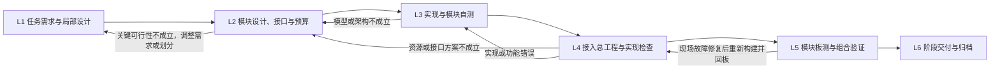

# 模块实施方法

状态：活动指导，2026-10-13 经用户明确授权统一启用。用于后续任务和安全断点接续；不倒填历史验收，不热换在途候选。

本页与[项目开发流程](project-development-flow.md)共同设计项目总体方案分解后的子系统/模块实施方法；局部步骤以L1至L6标识，项目阶段以S1至S6标识。既有M0至M7节点仅用于引用仍适用的历史合同，不作为新任务结构的前提。局部技术结果汇入所属项目阶段，不能由模块完成推定整机验收通过。阶段产出与完成标准不随参与人数改变。

本页的技术方法配合[AGENTS.md](../AGENTS.md)、[团队工作流](team-workflow.md)和既有技术合同使用。任务在原GitHub Issue/PR关联所支撑系统目标和项目阶段，局部步骤仅便于定位工作，不另建阶段签字、Milestone或状态台账。方法更新不表示任何模块、资源预算、时序或整机指标已经通过。

重新组织时，模块边界由新总体方案、接口和可验证成果决定，承担者依据能力、依赖及工作量选择；不按旧成员归属、专业标签或历史节点预设模块。复用仍适用的成果及踩坑教训，按[工作人员与AI协作指导](team-workflow.md#human-ai-collaboration)配置实现、自测、接合和独立判断，不为洗牌重做有效工作或保留多余审批。

## 项目主线内的局部步骤

新增模块或重要功能增量按需要落实这些局部步骤，已确认且未变的结果直接复用，产出并入项目主线。不同模块在依赖满足时并行；明确接口且两端可运行即可接入，首条独立可测链路完成必要实现、时序和安全检查后即可有界上板。无需等其他模块齐全，也不能把最小链路通过写成整机验收。

## 局部步骤、产出和完成条件

| 阶段 | 主要角色 | 最小技术产出 | 进入下一阶段的条件 |
|---|---|---|---|
| L1 任务需求与局部设计 | 需求负责人、系统设计角色 | 引用所支撑系统目标和指标分配；用途、场景/输入范围、正常与异常行为、模块边界、测量口径及局部关键风险 | 本批目标和适用指标可检查；必要事实和关键取舍明确，没有已知相互矛盾的必要要求 |
| L2 模块设计、接口与资源预算 | 模块设计角色、总工程负责人 | 算法/精度/实时性/资源联合探索及关键可行性依据；模块指标和分配依据；接口、数制、调度、时钟/复位、缓存/所有权及恢复设计；独立验证预期和观测方案 | 本批方案具有可实现依据，适用指标和检查方法已确定；接口与关键方案已选定，资源可容纳模块和公共底座，剩余不确定性有对应验证节点 |
| L3 实现与模块自测 | 实现角色、验证角色 | RTL/IP配置/固件与必要约束；实现与模型/接口对应关系；正常、边界及相关故障/恢复自测原件；可取得的综合资源初核 | 实现符合本批功能、接口和数值要求，必要自测通过，候选及未测范围明确，无已知重大阻断；可用候选直接交集成 |
| L4 接入总工程与实现检查 | 本任务集成/构建责任环节、合格非作者 | 接入后的组合功能、共享资源及并行干扰检查；同候选层级/全板资源和预算差异；约束覆盖、CDC/RDC、DRC及实现时序；所需观测和匹配的加载产物 | 新链路功能正确；实际资源容纳，受影响约束/时序/安全检查满足，相关兼容和运行边界成立；上板入口、输入、观察与停止条件明确。重要模块非作者判断结合本步骤结果完成 |
| L5 模块板测与组合验证 | 现场操作角色、分析/验证角色、合格非作者 | 准确加载候选、实际场景与原始波形/日志/样本；正常、停止/重启和相关故障恢复结果；本批范围的精度、延迟、连续运行及失败统计 | 本次声明范围的板上判据真实满足，结果汇入项目S5，未测项如实保留；完整系统验收依项目主线检查；算法、工程及现场问题返回对应设计或实现角色 |
| L6 阶段交付与归档 | 发布角色 | 节点阶段的完整可搬移Vivado/Vitis工程ZIP、必要依赖及配套产物；配置/接口版本、源码/产物/报告对应关系；已测/未测、打开入口和适用恢复步骤 | 候选、阶段交付范围、有效非作者结论及适用权限明确；完整性和兼容关系已核，实际打开过才能声称“解压即用”；项目发布仍依项目S6及真实授权 |

这里的完成条件是工程技术条件，不是六轮额外签字。具体验证深度由功能与风险决定，不能由人数决定；不强制所有模块使用UVM、独立OOC工程或同一覆盖率百分比。仿真、综合、实现时序和板测分别证明各自范围，彼此不能替代。

## 从系统目标形成模块指标

L1先说明模块在什么条件下、对什么输入、产生什么正确输出，异常时采取什么行为。适用指标必须写清单位、上限/下限或容差、测量起止点、测试场景和数据范围，以及检查方法。区分必须满足的验收条件和达标后可选的优化目标；“效果好”“尽量快”“资源少”不能直接作为完成条件。既有验收目标直接引用，本文不新增未经选择的数值或放宽目标。

L2根据系统数据流和控制流分配模块指标。资源按各类分别核总和；串行链路计入等待、缓存、PS处理和执行器响应等适用延迟，并行链路按实际关键路径和依赖计算。共享存储、互连和运算单元要核争用，不仅记录各模块独立值。误差分配要考虑单位、传播、相关性及场景，用端到端模型或实验验证，不能直接把各模块误差简单相加当成系统精度证明。

每项关键指标沿原任务记录“目标及条件 → 设计依据/预测 → 检查方法 → 同候选结果 → 差异和下一动作”。已测结果附原件入口；估算、复用、未测分别标明。未知项不能成为保证值，必要事实缺失时先做有界可行性检查。

模块上限由系统需求、方案可行性与组合余量共同确定，不凭空均分器件或任意规定占用率。实际超过已分配上限时，提出优化或有依据的重分配；核对其他模块与全板组合影响，并按现有关键取舍权限选定后才能更新。保留原分配与变更依据，不能直接把上限改成当前实耗以记为达标。满足容量和安全条件的限定集成试验可以用于获取反馈，但不能据此宣称模块或整机已验收。

## L2前期联合探索与达标闭环

新增数值算法模块，或实质改变算法、位宽、缩放、FFT/IP架构、缓存或并行/共享方案时，实现前必须完成本批相关的联合探索；已确认且未变的方案直接复用。FFT、PHAT、TDOA/DOA、滤波等优先用MATLAB建立浮点基线和与目标实现对应的定点模型；现有等效模型可复用，使用其他工具应保留相同的输入、数值规则和比较能力。不强制引入HDL Coder、Simulink或新增工具箱。

1. **先建立可比较的正确性基线。** 固定适用输入、真值或独立预期、场景和评价口径。真实录音、合成输入、边界向量分别说明用途；不能把合成结果当作真实声学结论，也不能只在用于调参的数据上声明适用精度。
2. **联合比较方案。** 需要选择时比较算法、帧长/步长、位宽/小数位、缩放、舍入/饱和、低能量保护及并行/共享调度，记录精度、动态范围/溢出、存储与运算需求、最坏处理周期和资源依据。已有可行方案不为满足“比较数量”重做研究。
3. **先验证最可能推翻方案的关键假设。** 对未知采集标度、关键近似、实际IP语义、缓存端口、截止时间等，选择离线模型、局部原型或准确IP配置做有界检查。验证深度由风险决定，不要求所有模块另建原型工程。
4. **形成模块的明确指标和设计选择。** 精度、吞吐/延迟、缓存、资源上限及异常行为必须同时有依据；记录所选配置、允许误差、关键输入范围、余量和验证节点。关键算法、接口、精度、时钟及资源取舍仍由人选择，普通等价修复沿既定方案继续。
5. **用实现反馈校正。** MATLAB运行时间不代表FPGA周期，运算次数不代表硬件份数；LUT/FF/DSP/BRAM估算需结合目标器件、实际IP和映射，由可取得的综合/实现报告校正。RTL逐级对齐同配置数值模型，同时检查握手、延迟对齐和实际吞吐。
6. **针对差异优化并复验受影响指标。** 缩位要重核精度和溢出，共享要重核调度和吞吐，加流水要重核接口延迟与控制对齐，改缓存要重核容量/端口/背压。适用指标同时达标且有必要余量就结束本轮；可选进一步优化另列目标。持续无进展或指标组合不可行时返回架构、模块划分或预算分配，不无限局部返修，不自动放宽验收值。

控制、采集、DMA、CSR和外设接口模块根据用途，以状态机、协议时序、数据所有权、边界分析及故障/恢复用例完成同等深度的前期设计，不要求一律建立MATLAB数值模型。混合模块分别验证数值路径和控制路径。

前期检查聚焦本批路径，不把完整声学矩阵、全部性能优化或无关文稿变成首次接入/有界上板的前置。最小闭环可按本批限定判据推进，最终精度、延迟和耐久仍在L5完整验收；已知必要容量、实时性或安全条件不成立的路径先返回设计。适用的原模型和报告直接引用，不另建六套证明材料。

## 全过程适用的技术要求

以下内容按模块用途在原任务/合同中合并记录；不适用项简述原因，普通小修只核变化影响，不逐行增设审批。

| 方面与阶段 | 设计时要明确什么 | 用什么检查 |
|---|---|---|
| 功能与适用范围，L1～L5 | 正常输入输出、边界/非法输入、有效条件、拒绝/降级行为；需求对应到可检查的用例 | 独立预期、关键用例和系统场景；有效输出与拒绝/失败分别统计 |
| 数据与接口，L2～L4 | 单位、符号/位宽/端序、通道及帧顺序、ID/时间戳、valid/ready或其他握手；配置何时生效 | 两端使用同一权威接口定义，检查字段、事务顺序、稳定性和数据/控制对齐；跨语言结构或寄存器定义按需同源生成 |
| 缓存、所有权与持续流，L2～L5 | 生产/消费速率、端口冲突、背压上界、buffer/DMA所有权和交还时点；不能暂停的采集源容量不足时的明确策略 | 调度/容量分析及连续、突发、暂停消费等适用检查；不得静默覆盖、丢样或重复消费 |
| 时钟、复位与约束，L2～L4 | 主/生成时钟、跨域结构、各目的域复位释放和启动顺序、外部IO时序；必要约束随设计进入实现 | CDC/RDC结构与协议检查、约束覆盖和受影响实现setup/hold报告；例外有结构依据，不能靠大范围false path掩盖错误，仿真或CDC报告均不能单独证明整项正确 |
| 模型与实现一致性，L2～L3 | 定点规则和每级范围、实际IP参数/缩放/延迟、RAM模式/初始化、控制与数据流水对齐 | 同输入同配置逐级比较；解释可接受差异和容差，最终输出与中间溢出均核，不能改golden迁就错误实现 |
| 验证有效性，L2～L4 | 先由目标和接口列关键预期，再编写实现；正常、边界、连续、背压及相关故障/恢复用例 | 测试确实施加输入并检查输出、状态和截止时间；参考独立于被测实现，关键检查器首次使用或变化时确认能检出代表性错误。退出码0/PASS字样不能覆盖Fatal、漏刺激或无效比较 |
| 故障、停止与恢复，L2～L5 | 超时、非法配置、输入丢失/低质量、满空、busy、部分完成事务、重复/陈旧命令的处理；适用执行器禁止/停止条件 | 针对相关故障检查有界退出、已接收事务和buffer收尾、状态计数、停止后无不允许输出、重启不混旧数据；不能只清busy或扩大超时隐藏问题 |
| 集成组合与实时性，L4～L5 | 模块同时工作时的共享带宽/仲裁、IRQ/DMA/PS影响、时基与延迟测点、最坏允许输入和服务停顿 | 同候选总工程接合、并行负载和相关连续运行检查；设计上界、仿真周期、实测最大值分别记录，实测最大值不能自动成为最坏情况保证 |
| 可观测性，L2～L5 | 首错定位所需状态/计数、frame/sample或事务ID、适用ILA信号/采样域/触发/窗口及正确错误判据 | 优先复用已有计数与观察点，按需加入ILA并计预算；调试数据本身不反压主链，采样率、窗口与时间单位能支持所声明结论 |
| 配置、兼容与变更，L2～L6 | 硬件/固件接口及布局的权威定义、适用版本/能力识别、默认值和参数原子提交；变更影响的模型/接口/约束/软件/加载产物 | 核准确组合、配置生效边界和不兼容行为；已有版本读回可复用，不凭工具版本不同预设失败。未具备识别机制时如实记录并在相关工程任务实现 |
| 板测口径与真实性，L5 | 实际输入/环境、真值来源、输入到输出测量点、样本数/时长与失败口径；bit/LTX、应用和配置对应关系 | 保存原始样本/日志/波形及加载身份，按冻结口径统计错误、拒绝、超时和缺失，不挑成功片段。模块局部通过与整机范围分开 |
| 交付与维护，L6 | 工程入口、必要源/IP/BD/约束/平台/BSP、依赖、配置和匹配产物；简短运行/恢复步骤和已测边界 | 节点交付完整可搬移ZIP，核依赖与完整性，实际打开/运行才声明对应验证；已有稳定结果复用，失败按[总结与必要原件](git-workflow.md#failure-retention)留档，不为包装重复构建 |

功耗、温升、环境适应性、EMC或特定可靠性等级在确有任务指标、装配/运行风险或发布要求时纳入相应设计和实测，注明活动率、负载、环境等依据；没有相关要求时不自动增加全套分析。已知电源、电平、针脚冲突、短路和实际装配风险仍按现行安全边界处理。

## 变更与不达标时的动作

每次重要变更先检查它影响哪些功能、数值格式/模型、接口、延迟、时钟/约束、缓存/资源、PS软件和观察点，选择必要的回归范围；未变且仍适用的结果直接复用。保留原有效候选及真实失败记录，按[总结为主、必要原件为辅](git-workflow.md#failure-retention)选择留档材料，记录本次主要变化、同条件对比与实际差异；不通过删除失败事实、热换冻结输入或改比较规则消除问题。

数值或调度方案不成立返回L2，必要要求互相矛盾返回L1；实现/接合错误回对应实现；板上算法效果不足回数值设计，板上具体工程故障沿现行返修例外优先回板。暂停只影响具体受阻路径，其他独立工程继续。达到本批技术条件后直接交下一角色，不增加“复核复核”的关卡；同一问题保留原ID，遵守最多三轮自动返修、连续两轮无进展停止等现行累计规则。

## 资源与性能检查必须进入实际工程

L2在新增或实质扩展逻辑之前形成预算；L3取得可用模块综合信息就用于校正。单独OOC只是可选方法；没有独立模块报告时，由总工程负责人在首次接入综合中取得实耗，不凭此阻止可用候选交接，也不将资源估算标为实测通过。

L4每接入重要模块或改变FFT/IP架构、缓存、位宽、复制份数、时钟或ILA配置后，核对准确配置的层级及全板综合资源报告，随后按受影响范围检查实现资源、拥塞与时序。普通等价小修复用未变预算与适用结果，不逐行重做全套构建。

资源记录沿原模块任务或已有预算材料保存，下表可直接作为其一部分，不另建状态数据库：

| 对象 | 设计预算及依据 | 同候选实际结果及原件 | 差异、余量与下一动作 | 负责人 |
|---|---|---|---|---|
| LUT、FF、BRAM/URAM、DSP、时钟资源 | 器件容量；模块份数、位宽/深度/端口；实际IP配置 | 模块/总工程层级资源及实现报告 | 超出分配或容量的项目、原因和方案 | 模块设计角色；总工程负责人汇总 |
| 公共底座与调试 | PS接口、互连、公共IP、ILA采样宽度/深度和预留 | 真实顶层报告及实际实例 | 与业务模块合计后的可用余量 | 总工程负责人 |
| 吞吐、帧周期和延迟 | 输入速率、每帧工作量、共享单元调度、最坏处理周期和阶段延迟 | 对应配置的仿真周期、实现时钟和板上测量 | 到截止时间的余量；背压/排队的影响 | 设计与验证角色 |
| 缓存、DDR/DMA及PS处理 | 每块缓存的深度/宽度/份数/端口，峰值及持续流量，所有权和处理上界 | 存储映射、实际接口/计数器/运行结果 | 争用、缓冲上界、超时与恢复 | 相关模块角色；总工程负责人核组合 |

必须区分以下事实：

- 全板核算包含所有业务实例、公共底座、互连/IP和调试逻辑；统计不重复计入父子层级或共享实例。模块分别能放下，不证明组合能放下。
- 运算次数不等于硬件实例数。共享FFT/IFFT或其他单元时，资源节约必须同时满足调度、缓存端口及最坏吞吐期限；并行架构必须计入全部实例。
- 估算用于方案选择，综合报告校正实耗，实现报告证明对应物理结果。换器件、IP参数、位宽/深度、并行份数或调试配置后，旧预算不能自动沿用。
- 余量由目标器件与实际实现风险决定，不统一套用70%/75%或固定ILA预留比例。DDR理论带宽不能冒充当前访问模式的可用带宽。
- 已知超出器件容量，或实际吞吐/缓存设计不能满足需求时，停止受影响的功能扩展，返回L2提出复用、流水线、位宽/缓存/并行度调整等方案；关键取舍由人选定。其他独立工作继续。
- 预算中的未知项标为`UNKNOWN`并写明确认人和确认节点；必要容量/接口事实缺失时先做有界可行性检查，不能承诺全板可实现。`NOT_RUN`、`UNVERIFIED`和已知超限不能写成PASS。

## 模块任务和交接

沿原Issue使用[模块任务模板](templates/module-work-package.md)。一次说明本批所处阶段、目标/指标、准确输入、接口/预算依据、实现与验证范围、当前角色、下一责任人，以及关键接合、ILA和上板节点。已有合同、预算和报告直接引用，阶段产出合并在同一任务内，不重复写一套报告。

可用候选交下一角色后直接接入测试。模块技术验收由合格非作者结合实际接入结果判断，作者自测不能代签；一个人可以承担多个顺序执行角色，但不能通过更换角色名为自己的实现作独立批准。符合项目授权的指定非作者AI可代表所属成员判断，归属与范围必须明确。

功能、接口、资源或时序问题回原实现/设计角色，现场原始数据直接给分析角色，只有具体工程缺陷才回工程责任人。同一问题保留原ID和累计返修次数，不通过换聊天、模型或包名归零。

板上已发现故障的返修沿现行例外：修复后跳过仿真，保留新加载产物必需构建、受影响时序/CDC及电气/执行器安全检查，复用原复现输入和观察点优先回板。该例外不取消新功能的关键验证。仿真记录为跳过，不能记PASS。

## 按任务配置工程责任

新安排先明确工程成果，再按能力、依赖、工作量和有效权限配置承担者；不继承旧A/B/C映射。文中总工程负责人指当批系统组合结果的责任入口，不代表某个成员永久独占构建或现场工作：

- 模块设计与实现责任覆盖方案、接口、指标依据、实现及必要自测；数值、控制和软硬件路径按技术需要协作，不按旧专业标签分派。
- 系统组合与集成责任维护组合预算、接口接合及同候选全板结果；接合、构建执行者按具体任务确定，不能将所有问题留给构建方兜底。
- 现场操作与结果分析分别明确责任及权限，原始结果直接交下一分析或修复环节；分析完成不自动授权下一次实物动作。
- 合格非作者依据所审模块和实际能力指定；作者贡献与复核范围明确，不以职位或人数替代资格。

Codex在工作包授权内实现、自测和分析；首次运行、综合/实现、集成/上板及实物操作遵守当前[工程授权](../AGENTS.md)。每个可写checkout/EDA输出同时一名写入方。线程配置和独立必要任务按[计算利用规则](../tools/fpga-team-workflow/references/compute-throughput.md)执行。

## 指导完成后的工程衔接

各类指导重构完成并确定衔接安排后，在途任务在安全断点接续，不回滚已完成工作，不重新证明未变结果。每个活动重要模块沿原Issue注明当前阶段与已完成的技术产出，对下一次接合补齐必要接口/预算事实；已知超限的受影响路径先返回设计判断。本次按已授权重整启用；具体执行和交接在原Issue登记。

总工程负责人使用当前真实总工程的准确候选及最近有效报告建立资源现状：哪些模块已经计入，哪些仍未接入，公共底座和调试占用多少，剩余多少，哪些报告不适用于当前配置。缺少报告按既有操作授权安排相应构建并保存原件，不能用本流程文件推定资源检查已完成。

下一次重要模块接入按L4落实资源和受影响功能/时序检查，结果进入项目S4；首条独立可测链路按L5有界实测，结果进入项目S5。完整系统验收和项目交付依项目主线推进，任务完成、合并、发布和整机验收仍按真实结果与原权限分别记录。

## 技术依据

阶段划分、指标分解及本项目动作边界由当前用户要求和项目约定确定。数值探索参考[MathWorks定点数据类型探索](https://www.mathworks.com/help/fixedpoint/data-type-exploration.html)，高层资源估算与实际实现分开参考[HDL Coder资源报告](https://www.mathworks.com/help/hdlcoder/ug/creating-and-using-code-generation-reports.html)；功能、频率、可靠性与资源前期规划参考[AMD UG949设计方法](https://docs.amd.com/r/2025.2-English/ug949-vivado-design-methodology/Creating-and-Implementing-a-Hardware-Design)。参考资料不代表新增工具/许可证依赖或本项目任何工程指标已通过。
