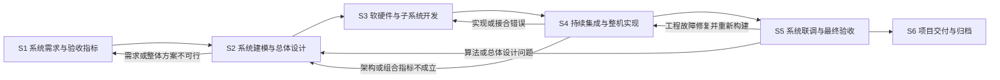

# 项目开发流程

状态：活动指导，2026-10-13 经用户明确授权统一启用。用于后续任务和安全断点接续；不倒填历史验收，不热换在途候选。

2026-10-12整理的项目主线为：系统需求 → 系统建模与总体设计 → 软硬件及子系统开发 → 持续集成与整机实现 → 系统联调与最终验收 → 项目交付与归档。流程、必要技术产出和完成标准与参与人数无关；人数只影响职责分配和并行度。

本文是项目级活动流程，配合[项目约定](../AGENTS.md)、[团队工作流](team-workflow.md)、[Git与发布规则](git-workflow.md)和既有验收合同使用。[总体任务分配指导](team-tasks.md)说明如何沿项目流程确定工程成果、任务、依赖和结果责任；[模块实施方法](module-development-flow.md)用于落实项目目标分解后的子系统/模块任务，其局部结果汇入本项目主线。项目阶段仍由GitHub Milestone/Issue/PR和真实结果记录，本文不另建状态台账，也不表示任何阶段已通过。

重新组织项目时，先从系统需求、端到端方案及工程成果形成任务，再按能力、工作量和真实依赖配置工作人员与AI，不让旧成员布局、聊天或总工程执行人决定新流程。历史指导仅用于复盘；直接交接、组合预算、独立判断、单写入方及真实证据的教训保留，仍适用成果复用。人机职责见[协作指导](team-workflow.md#human-ai-collaboration)，实际交接沿任务记录落实。

## 项目主线

图表示技术依赖和反馈，不要求整个项目按六个大批次串行等待。子系统可按已明确的需求与接口先行开发，S3～S5随可测链路持续交错推进；首条独立可测链路满足必要时序和安全检查后及时有界上板。最小链路按限定判据推进，最终系统目标仍在S5完整验收。

## 各阶段做什么、产出什么

| 项目阶段 | 主要工作与最小技术产出 | 推进或完成条件 |
|---|---|---|
| S1 系统需求与验收指标 | 定义项目用途、适用场景/环境、系统边界、外部输入输出、正常/异常/停止重启行为；明确整机功能、精度、吞吐、端到端延迟、持续运行及适用故障检测/恢复指标、测量起止点、真值和测试方法；关联要求与验证用例，区分本轮交付与后续目标 | 必要系统要求可检查，适用场景和验收范围明确，关键事实及方案取舍按授权确认；必要要求无已知矛盾 |
| S2 系统建模与总体设计 | 对端到端算法链优先用MATLAB或现有等效浮点/定点模型联合探索；比较算法/数制与硬件调度、存储及资源成本；确定PL/PS/外设职责、完整数据/控制流、时钟复位、多维组合预算与误差依据、事务安全恢复；将系统目标分配到子系统及模块，规划权威接口源、软件提前验证、板上观测和构建身份 | 整体方案有可实现依据，关键假设经适当有界检查，分配能容纳公共底座和组合开销；关键选择已定，未知项有负责人和验证节点，已知不可行路径先调整 |
| S3 软硬件与子系统开发 | 按总体设计并行实现适用子系统、算法、软硬件控制及固件；落实接口同源生成、适用定点模型对齐、软件协议/异常提前验证、必要约束与关键自测；实现所规划的恢复、观测及构建标识；依据实际IP/局部报告校正预测，交付准确可用候选、原件及未测范围 | 本批实现符合所分配功能/接口/数值要求，必要自测通过且无已知重大阻断；可用端点直接交任务指定的接合/集成执行者接入权威组合工程，不等所有子系统齐全。板上故障返修按本文例外执行 |
| S4 持续集成与整机实现 | 持续接入权威集成基线及总工程，执行者按任务安排，必要隔离构建或独立复现保留准确输入；核端到端数据/控制时序、配置生效、共享存储/互连/IRQ/DMA/PS并行干扰；核同候选层级和全板资源、预算差异、约束覆盖、CDC/RDC/DRC及布局布线后的setup/hold；采用相称自动检查，核报告和产物身份；加入/复用所需观测，准备匹配加载产物 | 当前链路组合行为正确，实际资源容纳，受影响时序/安全和接口兼容检查满足；有明确输入、观察、停止恢复条件即可安排限定上板；重要模块/阶段非作者判断结合接入结果 |
| S5 系统联调与最终验收 | 核实际加载文件、板上构建标识与软件/配置，先跑通当前范围的持续输入→算法结果→输出响应→停止/重启闭环；再按冻结场景验证整机精度、端到端延迟、吞吐、连续运行、适用压力工况及故障恢复；记录输入/真值、环境、样本数/时长及成功/错误/拒绝/超时/缺失，回填要求对应结果 | 限定试验只能声明对应范围；项目最终通过须满足完整交付范围的系统验收条件，原始结果可追溯，未知和未测如实保留。子系统分别通过不能代替整机组合验收 |
| S6 项目交付与归档 | 形成整个交付范围的完整可搬移Vivado/Vitis工程、必要源/IP/BD/约束/平台/BSP/依赖和匹配产物，配套适用模型/数据/硬件接口及验收原件入口；保存源码/配置/工具/构建标识与产物对应清单，记录接口兼容、打开/运行/恢复步骤、已测与未测 | 准确候选、有效非作者结论和发布权限明确；依赖与完整性已核，实际打开/运行才声明对应验证；阶段交付、代码合并、项目发布与整机验收分别按真实条件完成 |

既有核心V1、声源联动/完整外设效果及六麦后续目标的验收边界保持；新流程不合并这些范围或自动更改原目标、日期和授权。具体原任务与技术合同直接引用。

## 前期从整个系统考虑，再分配到模块

S2必须先看端到端系统如何满足目标，随后细化子系统/模块上限。算法链的精度不能只靠单个FFT/PHAT局部误差解释；资源不能只加业务逻辑而漏掉公共IP、互连、缓存、CDC和ILA；延迟不能只算PL计算而漏掉适用的采集窗口、排队、PS服务和输出响应。

数值探索固定适用输入、真值/独立预期、场景及评价口径；浮点、定点、真实录音、合成及边界数据分别说明用途。按需要比较算法、帧长/步长、位宽/缩放、舍入/饱和、近似及并行/共享策略；控制和外设路径用状态机、协议、所有权及恢复分析补齐。先验证最可能推翻整体方案的关键假设，已有可行选择直接复用，不为凑方案数量重复研究。

全板资源按类别核组合、带宽按实际访问/仲裁估算、延迟按串行/并行依赖及服务停顿计算，精度按实际误差传播与场景验证。模块指标来自这份系统分配，沿原任务记录“系统目标及条件 → 分配及设计依据 → 检查方法 → 同候选结果 → 差异和动作”。MATLAB运行时间、运算次数及离线资源估算不能直接成为FPGA周期或实际LUT/DSP/BRAM结果；综合、实现及板测分别反馈校正。

关键算法、接口、精度、时钟、器件/IP和资源取舍由人依现有权限选择；未变方案与普通等价修复继续。超出所分配指标时提出优化或有依据的系统重分配，核上下游与整机影响后选择，保留原值和变更依据；不直接把上限改为实耗，不自行放宽验收目标。

前期联合探索聚焦已授权交付和本批路径，允许带着明确剩余未知做有界集成/实测；不把全套声学研究、性能优化或资料齐全变成最小闭环的前置。已知必要容量、实时性或安全条件不成立时先处理受影响方案，独立工程继续。

## 工程落实要求

以下要求纳入对应项目阶段和原任务，不增加独立审批链。尚未实现的生成、检查或观测机制，在原任务说明负责人和落实节点；本文不代表现工程已具备这些能力，也不授权重写既有接口或更换关键架构。在途任务在下一安全断点衔接，必要技术条件和原验收边界保持。

### 系统指标与多维预算，S1～S2

系统要求、分配依据、验证用例和同候选结果沿原合同/Issue关联，最终能从要求找到测试条件与原件。预算分别覆盖适用的LUT、FF、DSP、BRAM/URAM、时钟发生器与全局时钟网络、IO和公共互连/调试开销；共享DDR/DMA按访问模式、持续/峰值流量、仲裁与效率估算有效带宽，结合缓存容量、PS服务及截止时间核组合余量。使用器件实际容量和实现风险确定各类余量，不统一规定全板75%或调试预留比例。早期估算的不确定范围与批准的硬上限分开；超出批准硬上限就处理方案，不能默认容许再超出10%。引脚、时钟和存储接口提前规划，Pblock按器件结构或真实拥塞/时序问题选用，不在立项时强制为所有模块划区。

### 权威接口源与同源生成，S2～S3

跨RTL、固件和文档共同使用的CSR地址、字段及数据格式采用一份权威机器可读定义，派生译码/声明、软件头文件和接口文档按需要生成，禁止多份独立手改。可选择SystemRDL或现有等效生成方式；记录源定义和生成入口/版本，必要检查确认派生物未过期。生成不代替语义验证：复位值、访问权限、字节使能、读写副作用、中断清除、原子提交、兼容版本和buffer所有权仍要明确并检查。稳定接口复用，修改范围及寄存器位置遵守既有合同和关键选择权限。

### 软件提前验证与真实接合，S2～S5

接口明确后，软件与PL并行开展协议、寄存器访问、驱动状态机、DMA/缓冲所有权、超时及错误处理；依据具体缺口选择模拟后端、总线模型、最小PL测试壳或环回链路，不等完整比特流才开始。SystemC/虚拟平台仅在系统复杂度及预期收益支持时选用，不规定统一覆盖百分比。模型用于提前排错，实际ARM缓存一致性、IRQ/DMA、并发实时性和物理接口行为仍在匹配候选的真实链路验证；接口明确且两端可运行就接合，第一条可测链路满足必要时序/安全条件后及时上板。

### 数值对齐与完整实现检查，S3～S4

确定数制的数字算法用独立定点Golden Model检查适用输入下的bit-exact对应，覆盖缩放、舍入、饱和和边界；模型对齐还须满足所支撑的系统精度，不能因共同错误而自证。控制、接口和恢复逻辑检查协议、状态与事务预期，不强制数值模型或UVM。时序检查使用正确内部时钟、生成时钟及边界IO约束，核未约束路径和例外依据；综合/OOC综合时序是估算，WNS非负不能当物理收敛。完整组合设计在布局布线后核受影响setup/hold及相关违规，模块间路径不能由局部通过推定通过；CDC/RDC结构检查与握手、数据一致性和复位协议验证分别完成。

### 事务安全与有界故障恢复，S2～S5

按系统要求明确故障触发、检测上界、恢复范围/时限、执行器安全状态及恢复失败动作。AXI挂起、FIFO溢出、DMA异常和停止路径需处理新请求隔离、未完成事务、缓冲/中断/缓存所有权、陈旧数据与重启条件；按协议收尾，或按已设计的隔离/协调复位策略恢复，不能只加看门狗后直接局部复位。局部恢复不能保证安全时，明确升级恢复范围和安全停止条件。选择超时监视、局部复位、隔离或其他机制取决于真实故障模型，不强制特定IP或自动局部自愈；适用异常在验证和授权板测中核恢复效果及时间。

### 构建组织与相称自动检查，S3～S4

总工程统一指权威组合入口，接合及构建执行者按任务安排，不要求每次全量重编，也不排斥源码与OOC DCP混合。稳定模块按实际重复构建成本评估OOC，增量实现核准确参考候选、复用程度、耗时和时序效果；两者不保证物理隔离或加速。统计全板资源时包含已经装入的全部OOC模块和公共实例，不能把黑盒缺项当剩余容量。

必要的接口生成一致性、源码/约束检查、预算比较及报告解析逐步形成可重复命令，可按需要纳入CI；耗时总工程构建按重要增量和集成节点安排，不为每个PR强制全量运行。用于判断的报告绑定源码、器件、配置、约束、工具、构建阶段与原始结果，同时核setup/hold、约束覆盖及适用违规，不能只匹配WNS一项。检查启用后，报告缺失、陈旧、身份不符或解析失败应显式返回未完成/失败及原因，不能默认零违规；区分检查器故障和产品故障。自动检查不替代重要模块非作者判断或真实板测，未部署的CI不得声称已强制执行。

### 调试观测与开销控制，S2～S5

总工程负责人统一规划必要状态、计数器、构建标识和ILA，明确探针、同步采样时钟、宽度/深度、触发及观察窗口，计入资源与时序预算。按时钟域及同时观察需求选择共享调试通道、Debug Mux或专用ILA，不随意叠加深采样，也不统一禁止专用探针。Mux本身的逻辑、扇出、布线及跨域影响必须核对，不能保证布局不变；加入或实质修改调试逻辑后检查对应候选的受影响资源与实现时序，探针文件与加载产物匹配。

### 板上身份与可复现交付，S2～S6

在S2规划、S3实现板上可读的接口版本及构建/配置标识，按现有寄存器合同分配地址；S5保存实际读回值与加载文件、软件和运行配置。构建标识关联清单中的准确源码提交/快照、未提交差异及实际用到的未跟踪输入、器件、IP/BD/XDC、初始化数据/宏、工具和构建参数，清单绑定对应产物哈希与原始报告。Git SHA和日期用于追溯，不能单独证明运行版本与交付完全匹配；不得把存在未提交修改的构建标成干净提交结果。

Git管理必要源码、约束、IP配置、生成/构建入口和可维护工程描述；临时输出、可再生成缓存与正式发布产物按各自用途保存，不采用所有工程只能纯文本的禁令。支持脚本重建与完整可打开工程交付，保留必要.xpr/Vitis入口及外部依赖；厂商产物由正式工具生成，不手改。完整工程ZIP、加载产物、模型/数据与报告在S6绑定同一候选，实际打开或运行过才声明相应能力；不为包装重复构建，也不倒填旧验收。

### 适用压力与环境验证，S1、S5

连续运行、满载/突发、背压、并发干扰和故障恢复用例来自实际系统场景，明确负载、时长、预期与失败统计。温度范围、温升、EMC及特定可靠性试验由真实运行/装配风险或交付要求决定，不因“大型FPGA”标签自动增加全套高低温鉴定。选用OOC、Pblock、SystemRDL、SystemC、UVM或Debug Mux的理由沿原任务记录，方法本身不构成完成或通过证据。

## 项目全过程的检查与反馈

- **功能、接口和所有权：** 整机及端点输入输出、格式/顺序/ID/时间戳、握手、配置原子提交、buffer/DMA交还和不可反压采集源的溢出策略明确；跨语言或寄存器定义按需要同源生成。
- **时钟、复位和物理实现：** 时钟来源、各目的域复位释放、启动顺序、CDC/RDC结构及外部IO约束进入设计；约束覆盖、实现时序和相关协议分别检查，不靠仿真或单份CDC报告包揽结论。
- **验证与观测：** 从系统目标和接口独立列预期，再实现；正常、边界、连续/突发、背压及相关故障/恢复用例按风险选择。数值参考与实现独立，状态计数和ILA按观察需求提前规划，原始波形/日志/样本与准确候选对应。
- **组合实时性与恢复：** 同时工作时核共享资源、排队和软件服务影响；停止/重启、超时及部分事务收尾有界，陈旧数据/命令不误用。设计上界、仿真周期和实测最大值分开，失败/拒绝事实及统计口径保留；失败留档按[总结为主、必要原件为辅](git-workflow.md#failure-retention)，适用定量复核所需源数据仍保留，不要求全量失败现场。
- **兼容、变更与优化：** 变更先核系统影响，复验受影响的精度/功能/接口/延迟/时序/资源/软件/观察点；复用仍适用的结果。适用指标同时达标并有必要余量就结束本轮优化；方案不可行返回总体设计，不无限局部返修或靠修改比较规则消除失败。
- **其他适用要求：** 功耗、温升、环境适应性、EMC或特定可靠性等级在真实任务指标、装配/运行风险或发布要求需要时纳入，说明依据；已知电源、电平、针脚冲突、短路和实际装配风险按现行安全边界处理。

板上具体工程故障返修沿现行例外：修复后跳过仿真，保留新加载产物必需构建、受影响时序/CDC和电气/执行器安全检查，由获授权现场人员优先回板，复用原复现输入与观察点。算法或总体方案不成立则返回相应设计。`UNKNOWN`、`NOT_RUN`、`UNVERIFIED`保持真实含义；同一问题保留原ID及最多三轮自动返修、连续两轮无进展停止等累计边界。

## 执行、交接与现有项目衔接

沿[总体任务分配指导](team-tasks.md)明确系统目标、总体方案、组合指标、接口接合、集成节点及结果责任，随后按任务需要配置承担者。集成、构建、现场、分析、独立判断和发布权限分别明确，不按人数或固定成员切分项目阶段。具体人员及在途授权依有效配置和原Issue接续，实际转派以原Issue的2026-10-13接续记录为准。

Codex按工作包授权设计、实现、自测和分析；首次运行、综合/实现、集成/上板及实物动作遵守[现行授权](../AGENTS.md)。做完必要自测直接交下一责任人，收到可用候选即接入测试。合格非作者判断集中于重要模块/整机阶段并入接入结果，不逐阶段或小项增加签字链，不由作者换角色自签。

各类指导重构完成并确定衔接安排后，现有项目在安全断点按实际项目阶段接续，复用未变设计与证据，不重新从S1全套开工、不打断在途任务。届时根据实际需要补齐系统配置及有效总工程报告、尚未接入部分的组合依据、新机制缺口、剩余系统验收项与下一集成/上板节点，沿原任务记录。2026-10-13按用户授权衔接这些规则；工程完成状态仍由实际报告证明。

## 技术依据

上述要求结合当前项目约定及用户采纳决定；实现机制的能力边界参考[Accellera SystemRDL](https://www.accellera.org/downloads/standards/systemrdl)、[AMD OOC流程](https://docs.amd.com/r/en-US/ug892-vivado-design-flows-overview/Out-of-Context-Design-Flow)、[综合与实际时序分析](https://docs.amd.com/r/2022.2-English/ug901-vivado-synthesis/Running-Timing-Analysis)、[增量实现影响因素](https://docs.amd.com/r/en-US/ug904-vivado-implementation/Factors-Affecting-Compile-Time-Improvement)、[按需布局规划](https://docs.amd.com/r/en-US/ug949-vivado-design-methodology/Address-Floorplanning-Considerations)、[AXI Firewall恢复机制](https://docs.amd.com/r/en-US/pg293-axi-firewall/Recovery)及[ILA时序与资源影响](https://docs.amd.com/r/2025.2-English/ug908-vivado-programming-debugging/ILA-Core-and-Timing-Considerations)。引用不新增工具、许可证或特定IP依赖，不证明本项目已实现或验证相应能力。
