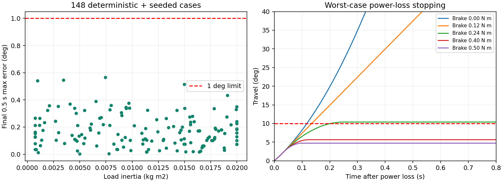

# 声源跟随转台成品方案与仿真报告

返工说明：本报告保留原物理方案快照；当前上层门控已增加整组三帧新鲜度、严格时间顺序及数值有效性校验，当前556项通过，详见 `rework_notes.md`。文中15项为历史检查数，原检查记录单独保存；不改变物理模型结论。

2026-09-12 · 离线方案验证交付

## 1. 方案结论与范围

采用水平单轴成品转台，承载摄像头或其他确实需要朝向声源的器件。优先让麦克风阵列和开发板固定，只转动朝向载荷，减小转动惯量并简化坐标转换。

推荐基线为：独立承重的成品转台机构＋4:1 减速步进驱动＋输出轴位置反馈。软件以“获取可信方向 → 平滑转动 → 稳定保持 → 重新获取方向”为主流程，配备限位、通信超时和故障停止。

用户自行购买成品，本交付不要求自制机械件或电路。只购买一只电机时，还需配套成品承重转台/支架；电机轴不能自动等同于整套承重机构。也可以直接购买集成电机、驱动和反馈的成品转台。

当前结果属于带非线性因素的低阶动力学数值模拟，不是实体样机验收、三维有限元或电机电磁仿真。现有脚本可复现结果；具体商品的参数仍需资料或实测对应。

## 2. 可直接用于成品筛选的条件

| 项目 | 选购或配置条件 | 与仿真的关系 |
|---|---|---|
| 载荷 | 几十克至 1 kg；尽量靠轴安装 | 用户确认质量范围，尺寸与重心尚未知 |
| 输出轴负载惯量 | 含随动台面及附件，≤0.02 kg·m² | 正常扫描范围 0.00075～0.02；更小也需重核轻载动态 |
| 转角 | 可用范围至少 270°，基线为 ±160° | 全行程测试为 −160°→+160° |
| 承重 | 独立轴承/成品转台承担重量，供应商说明偏心负载能力 | 本次未仿真承重结构强度 |
| 减速 | 已验证基线 4:1；传动效率按 0.9 | 不同减速比、蜗轮或直驱不能直接套用结果 |
| 速度 | 指令上限 60°/s；首调从 20°/s 开始 | 扫描中实际输出峰值约 63.70°/s，不能称严格不超过 60°/s |
| 定位 | 最终角度误差目标 ≤1°，需校准后的整机指标 | 编码器分辨率与微步数均不等于定位精度 |
| 传动间隙 | 输出等效总间隙 ≤0.3° | 已建模 0～0.3°；更大需重跑 |
| 有效扭转刚度 | 基线范围 8～40 N·m/rad | 未测假设范围，不是某款皮带或商品的认证值 |
| 电机动态能力 | 基线要求电机端在 ≤40 rpm 有效扭矩包络≥0.18 N·m；更高转速按 0.18×40/rpm 下界评估 | 这是待验证的运行条件，不是从保持扭矩直接推导的保证 |
| 驱动接口 | STEP/DIR/ENABLE，或公开的位置/速度命令接口，具有状态回读 | 已模拟微步命令；采用智能位置驱动时需核对其内部控制行为 |
| 反馈 | 输出轴绝对位置优先，14 bit 为本次基线；反馈延迟 ≤10 ms | 电机端编码器无法单独观测传动间隙和输出端松动 |
| 零位/限位 | 零位、两侧限位及可独立触发的故障停止 | 建议软目标 ±160°、硬件限位 ±165°、最终止挡 ±175°；实际成品需保留等效余量 |
| 失电停止 | 若采用下述 10°停止余量，输出等效动态制动扭矩≥0.40 N·m，完整动作延迟≤30 ms | 必须为可动态制动的失电抱闸/制动器；静态保持额定值不能替代 |
| 电源与接口电平 | 使用成品驱动配套独立电源；确认控制接口电平和隔离方式 | 不假定成品驱动的“脉冲输入”可直接接 3.3 V FPGA |

失电制动器不是所有产品都必须额外加装：若成品厂家能提供包含负载条件的等效失电停止保证，可按其机制验证。没有上述制动能力时，本方案的“10°内停止”结论不适用；可以降低速度或选更大停止余量，并重新计算。

对于几十克载荷，也可选更小的成品一体转台。此时应以整机速度、定位、反馈和停止指标选型，而不是强制购买同一只 NEMA17 电机。现有参数扫描不能证明任意微型舵机或直驱台都可替换。

## 3. 参考器件与证据等级

17HS15-1504S1 可作为本模型的电机参数参考：厂商资料列出 1.8°步距、1.5 A/相、0.45 N·m 保持扭矩和 54 g·cm² 转子惯量。模型采用该转子惯量；**0.18 N·m 运行扭矩下界是额外的工程假设**，未取得当前驱动、电流及温升条件下的实测曲线。[厂商数据表](https://www.omc-stepperonline.com/download/17HS15-1504S1.pdf)

TMC2209 提供 STEP/DIR、微步及 UART 配置，可作为配套驱动功能参考。应购买明确标出连续电流、电压及散热要求的成品模块；芯片峰值额定值不代表任意小板的连续能力。本次没有模拟其斩波电路或验证静音效果。[ADI 产品资料](https://www.analog.com/en/products/TMC2209.html)

AS5048 系列提供 14 bit 绝对角度检测，作为反馈分辨率参考。模型额外假设校准后偏置不超过 ±0.25°、周期误差幅值不超过 0.15°；这些是装配后需要确认的边界，不能由 14 bit 自动推出。[厂家资料](https://look.ams-osram.com/m/287d7ad97d1ca22e/original/AS5048-DS000298.pdf)

厂家确有用于惯性停止的弹簧施加、通电释放制动产品；应选择动态制动用途，核对最小扭矩、延迟及容许制动能量。本报告不指定未经完整适配的制动器型号。[Miki Pulley 动态制动产品说明](https://www.mikipulley.co.jp/en/electromagnetic-clutches-brakes/offbrakes/braking)

以上是参考路线，不是已购买或已确认适配的 BOM。

## 4. 控制方案

### 数据与职责

链路为：DOA 方向/置信度/帧时间戳 → 目标选择与运动规划 → 成品驱动 → 转台；输出位置、零位、限位和故障反向反馈。

PS 处理声源目标策略和状态；精确定时脉冲、快速位置修正和超时保护应由确定时序的底层控制器承担，可用 PL、实时固件或具有相应功能的成品运动控制器。**本次 1 ms 控制模型不等于 PYNQ/Python 能在 Linux 下可靠地每毫秒执行。** 本交付没有生成或运行 Vivado 工程、XDC、板上固件。

固定阵列时，目标轴角为阵列坐标下方向加标定偏置。若阵列跟着转台一起动，则用音频帧中心时刻的位置计算世界方向，不能用接收消息时的当前位置替代。正常动作不跨越 ±180°盲目选择最短路；所有目标转换到 ±160°可达区间，不可达目标进入保持并报告。

### 状态与触发条件

| 状态 | 行为 | 下一步 |
|---|---|---|
| INIT | 驱动保持禁用，检查反馈、零位、限位和通信 | 校准与状态正常后进入 ACQUIRE |
| ACQUIRE | 连续 3 个不同帧时间戳；置信度≥0.7；角度跨度≤3°；帧龄≤100 ms | 与当前位置差>2°才生成动作，否则 HOLD |
| MOVE | 执行已生成平滑轨迹，不因每一帧 DOA 噪声反复改变目标 | 完成后 SETTLE；低置信度/过期时 DECEL |
| SETTLE | 误差≤1°、速度≤1°/s 并持续至少 250 ms | 进入 HOLD，并重新获取可信方向 |
| HOLD | 保持角度；使用 2°目标死区避免频繁动作 | 新目标可信且越过死区后再动 |
| DECEL | 驱动和反馈有效时受控减速，不瞬间把运行速度归零 | 稳定后 HOLD/ACQUIRE |
| BRAKE/FAULT | 急停、硬限位、编码器过期>20 ms、心跳过期>100 ms触发制动并锁存 | 必须显式复位并重新检查；不自动重启 |

以上置信度和时间阈值是初始配置，不代表真实 DOA 已完成标定。运动中的新方向不用于改写当前轨迹；若运动噪声导致置信度失效，保守减速，稳定后再捕获。由此可能降低连续跟随速度，需要真实录音验证；不能声称合成控制检查证明了声学闭环效果。

`validate_control.py` 只验证其中的目标门控与故障触发示例，不包含完整 INIT/归零/SETTLE 硬件实现。低阶物理模型、上层示例和真实硬件尚未连成可上板系统。

### 运动参数

使用五次多项式 q=q0+Δq(10s³−15s⁴+6s⁵)，s=t/T。起止速度和加速度为零。90°采用 T=3 s：参考峰值速度 56.25°/s，参考峰值加速度约 57.74°/s²。320°采用 T=10 s。

任意动作可按 T≥max(1.875|Δq|/60，sqrt(5.774|Δq|/90)) 选择持续时间，再给短动作设置合理最短时间；角度使用度。新动作只在当前动作停止后重规划，避免不连续反向指令。此公式的任意角度扩展未穷举测试。

模型每 1 ms 更新位置修正，偏置积分增益 1.5/s、修正速度限幅 2°/s、修正角度限幅 ±2°；命令跟随增益 20/s。命令速度/加速度限幅为 60°/s 和 90°/s²。到位后，测量误差<0.4°且命令速度<0.5°/s进入保持；误差达到0.5°退出保持。这样避免持续追逐编码器细小误差。保持策略经过本次复跑，但驱动器必须支持对应行为或采用经验证的等效控制。

1.8°电机、16 微步、4:1减速的输出命令步长为0.028125°；60°/s对应约2133个STEP/s。14 bit编码器量化步长约0.02197°。两者均不代表最终精度。

## 5. 物理模型与输入边界

不是只画预定角度轨迹：实际输出由力矩驱动微分方程求解。设 x 为电机机械角除以减速比后的角度，q 为负载角：

```text
Jm_eq*x'' = Tdrive - Tbelt - bm*x'
Jload*q'' = Tbelt - Tf*tanh(q'/0.002) - bq*q' - kc*q - T0 - Tg*sin(q+phi)
Tbelt = k*deadzone(x-q, gap/2) + c*(x'-q') [只在接触区施加阻尼]
Tdrive = eta*N*Tcap(rpm)*sin(50*N*(command-x))
Jm_eq = 5.4e-6*4^2 + 2e-5 = 0.0001064 kg·m²
```

磁转矩的正弦负载角关系允许出现欠扭矩失步；不是无限刚性理想位置源。电机运行转矩通过速度包络限幅。皮带使用间隙、弹簧和接触阻尼模型。库仑摩擦在零速附近平滑化，没有独立静摩擦粘着求解或齿接触冲击模型。

| 参数 | 使用值或范围 | 来源 |
|---|---|---|
| 负载惯量 | 0.00075～0.02 kg·m²；代表值0.00662 | 假设与扫描，不是1 kg实物测量 |
| 减速比/效率 | 4 / 0.9 | 候选配置/工程假设 |
| 转子惯量 | 5.4×10⁻⁶ kg·m² | 参考电机数据表 |
| 输出折算附加惯量 | 2×10⁻⁵ kg·m² | 假设 |
| 扭转刚度/阻尼 | 8～40 N·m/rad；0.01～0.05 N·m·s/rad | 假设与扫描 |
| 总间隙 | 0～0.3° | 选购目标与扫描 |
| 库仑摩擦 | 0.005～0.04 N·m | 假设与扫描 |
| 负载粘性阻尼 | 0.003～0.015 N·m·s/rad | 假设与扫描 |
| 线缆等效刚度 | 0.002～0.02 N·m/rad | 假设与扫描 |
| 恒定偏置转矩 | ±0.015 N·m | 假设与扫描 |
| 倾斜/偏心扰动力矩幅值 | 0～0.0343 N·m | 约对应1 kg、偏心0.1 m、轴倾斜2°，不是竖直轴上直接加mge |
| 电机等效阻尼 | 0.003～0.015 N·m·s/rad | 折算到输出侧，未辨识 |
| 电机有效运行扭矩 | ≤40 rpm时0.18～0.27 N·m；超过后按40/rpm下降 | 未实测的包络模型 |
| 反馈误差 | 偏置±0.25°，周期幅值≤0.15°，噪声幅值0.015°，14 bit量化 | 校准后适用假设 |
| 反馈延迟 | 2/5/10 ms | 扫描 |

总惯量可粗估为 J=J自身重心+m·e²，再加台面、支架和其他随动部件。例：1 kg、等效圆盘半径0.12 m、偏心0.1 m，载荷惯量约0.0172 kg·m²，留约0.0028给台面附件。长杆或远离转轴的1 kg载荷可能超限。

以最大90°/s²指令加速度、阻尼及外力预算估算，电机与负载总惯量对应的输出准静态需求约0.208 N·m；基线输出可用包络为0.9×4×0.18=0.648 N·m，约3.11倍。非线性仿真的最大电气负载角为24.80°，正弦模型对应瞬态电磁转矩余量约2.38倍；不能称全程满足3倍推荐值。运行中的转子振荡可使瞬时电机转速超过40 rpm，模型已按包络下降处理。

## 6. 实际运行的测试及结果

求解器为固定步长四阶Runge–Kutta；物理步长0.2 ms、控制与数据保存间隔1 ms。固定参数种子20260912。149项包括5项代表/全行程工况、16项组合边界和128项随机参数扫描；不是全部参数空间穷举，也不是产品可靠性百分比。

| 验证项 | 实际结果 | 判定含义 |
|---|---|---|
| 149项最终定位 | 149通过；最大误差0.564745° | 仿真最后0.5秒的最大误差≤1° |
| 149项稳定时间 | 149通过；90°最慢3.135 s | 误差≤1°且速度≤1°/s，持续至仿真结束且至少250 ms；动作结束后0.5 s内达到 |
| 同步裕量 | 149通过；最大电气负载角24.799° | 模型未越过90°阈值；不等于实机绝不会失步 |
| 最大皮带传递转矩 | 0.170629 N·m | 这不是电机输出包络或轴承承载能力 |
| 实际输出峰值速度 | 约63.70°/s | 物理系统有振荡，指令限速不保证实际严格限速 |
| 轻载往返0→90→−90→0 | 最后0.5秒最大误差0.002711° | 一个合成往返序列，不是长时间重复定位统计 |
| 重载往返 | 最后0.5秒最大误差0.073331° | 同上 |
| 重载受控停止 | 最后误差≤0.179733°，从动作起2.148 s稳定 | 在1.5 s发出停止，最终目标为62.578125° |
| 欠扭矩反例 | 0.015 N·m电机包络时，误差约89.93°且失同步 | 预期失败被识别，不混入149项正常通过数 |
| 步长减半 | 三项代表工况最大角度差0.010186° | 支持这些工况的数值稳定性，不等于整个空间收敛证明 |
| 独立积分检查 | 振子误差约6.94×10⁻⁸，匀加速误差约5.34×10⁻¹⁴ | 与解析解交叉核对 |
| 控制逻辑示例 | 15项通过 | 帧新鲜度、重复帧、死区、限位、超时、故障锁存等合成检查 |

最终误差指标只针对到位后的角度。运动中偏差可能超过1°，本次没有证明运动中始终保持1°指向精度。




## 7. 停止策略与计算

正常失去目标时，反馈和驱动仍正常则受控减速。65°/s初速、90°/s²净减速度、10 ms检测延迟的简单运动学距离为24.122°；因此不能到±160°边缘才从全速开始正常停车。工程规划应按剩余距离约束速度，至少预留约27°供制动及误差预算，或直接生成起止速度为零的整段轨迹。90°/s²是命令限值，真实净减速度仍需确认。

急停、反馈失效和整机失电采用独立制动。按最不利条件建立单轴能量模型：

- 总等效惯量0.0201064 kg·m²，初速度65°/s，覆盖本次输出峰值。
- 顺运动方向的外部助推力矩0.12 N·m，不计有利摩擦。
- 从触发到建立制动力矩最多30 ms，包含检测、驱动释放和制动器动作的总延迟。
- 输出端动态制动力矩下界0.40 N·m。

求得刚性模型滑行距离5.653°、停止时间0.1243 s；数值积分与解析式差约6.7×10⁻⁷°。再按0.006 J额外弹性/未计小量动能预算增加1.228°，加1.5°位置与安装余量，总预算8.381°，低于±165°至±175°之间的10°空间。

0.24 N·m制动在同一最不利条件下，未计弹性和安装误差已需10.385°，因此不满足该空间预算。完全无制动的最坏助推模型没有停止保证。图中无制动曲线超过止挡后的部分只是自由运动反例，未模拟实物撞击。

该制动计算是独立简化模型，并未将真实制动器电磁建立过程接入完整两惯量模型；0.006 J是保守分配项，不是全工况结构能量认证。商品的制动扭矩、完整延迟、剩余空间或初速度不同，就必须重新计算。成品只有“断使能”但没有制动时，不能认为断使能就是立刻停车。

## 8. 买到成品后的最短实施顺序

1. 向供应商索取减速比、动态扭矩/速度曲线、输出反馈位置、协议、限位和失电停止说明；确认总负载惯量在范围内。只给“载重1 kg”“保持力矩大”不足以核对动态行为。
2. 使用原厂配套控制器先做手动±10°及±90°动作，速度20°/s；确认方向、反馈读数和零位。直接使用成品配套电源、线束与说明，不要求自行设计PCB。
3. 在真实载荷下逐步测30/45/60°/s，记录目标角、反馈角、起止时间、故障和限位。只有位置传感器已标定，才能判断≤1°真实角度误差；独立角度基准优先。
4. 测两方向重复到位、低速至高速停车；先低速验证急停和限位，再验证最大工况。失电停车距离与模型边界对应后，才使用完整行程。
5. 接入PS目标角，先手动角度命令，再接可信DOA。记录帧时间戳、置信度、目标角、输出角和状态，保留原始日志。
6. 分别采集电机断电、保持、匀速、加减速、停止后五种音频，检查DOA有效率与错误指向。真实声学效果没有通过前，保留“停稳后重新定位”的工作模式。

换型号时先改 `simulate.py` 中参数生成函数，或依据成品控制接口建立等效模型，再复跑。齿轮/舵机内部位置闭环、摩擦和采样延迟与当前模型不同，不应只把电机名称替换后声称验证完成。

## 9. 交付完成情况与剩余边界

本次已交付成品选购条件、控制策略、物理模型源码、实际运行日志、149项结果、附加反例与停止测试、15项逻辑检查、可复跑入口和曲线。无需再进行机械加工图或自制电路设计才能阅读和使用本方案。

未完成且不能由本次数值结果替代：具体商品选定、实物惯量与摩擦辨识、厂家动态能力核对、真实编码器校准、热/声学/电磁实测、长时间寿命、成品驱动协议适配和板上闭环验收。它们是购买与接入后的步骤；当前方案完成度不应表述为硬件已验收。

仿真只覆盖已列出的低阶参数与测试。没有做三维结构有限元、详细相电流/电磁仿真、完整噪声仿真或全参数形式证明。

原始依据为仓库中2026-09-11转台报告、采购指标第5节及架构第9节。本次工作按用户授权开展独立方案完善，未改动原仓库计划、共享源码、任务安排或Git分支。
