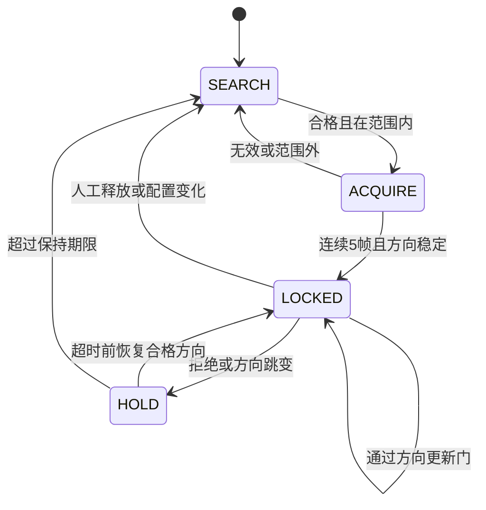

# 策略与接口：实验版 v0.1

用户确定策略：先指定允许范围，再锁定其中的稳定方向。范围采用三维向量圆锥，当前中心 +x，半角 30°，包含边界；不是方位±30°和俯仰±30°矩形。全部实验前固定参数，不按实验结果调参。

| 参数 | 实验值 | 含义 |
|---|---:|---|
| acquire_frames | 5 | 连续 5 个候选均通过原基线质量门和范围门才允许锁定 |
| acquire_spread_deg | 8° | 捕获窗口内任意两候选的球面夹角不超过 8° |
| track_step_deg | 20° | 锁定后，新候选与上次新有效方向夹角不超过 20° |
| hold_ms | 200 ms | 自最后新有效方向起保持显示；超过才释放 |
| max_input_gap_ms | 30 ms | 相邻更新超过此间隔，视为输入中断，清除状态并重新捕获 |
| 帧 / hop / fs | 1024 / 512 / 48 kHz | 候选更新间隔约 10.667 ms，帧长约 21.333 ms |

状态流：

补充语义：捕获时方向不稳定，当前帧成为新捕获窗口的第一帧。超时后的当前帧若合格，可立即作为新捕获第一帧；仍需完整 5 帧。范围外候选不能证明原目标已经离开，故锁定态先 HOLD 再超时释放，不随单个范围外候选立即换目标。输入中断清状态的规则优先于 HOLD。无抢占切换机制。

## 接口

`Tracker.update(timestamp_ms, estimate, baseline_valid)`：输入只有时间、原始估计单位方向（接受非零向量后归一化）及原基线 valid。估计器不接收真值、干扰方向、目标是否发声或场景标签。非法估计向量按无效输入处理；时间必须有限、非负、严格递增，非法时间抛错且保留状态。

输出包含：state、fresh_valid、direction、display_direction、stale、reason、acquire_count、last_fresh_ms、display_expires_at_ms。

- direction 仅在 fresh_valid=true 时提供，不能从 display_direction 回填评价方向。
- HOLD 的 display_direction 仅供显示，stale=true、fresh_valid=false。SEARCH/ACQUIRE 不输出假定目标方向。
- 不输出概率置信度；fresh_valid 表示通过本规则，不保证角度正确。
- 时间推进由 update 驱动。若输入停止，UI 应按 display_expires_at_ms 自行使旧显示过期，不能等待下一次 update 后才撤销有效显示。本包不实现 UI 或硬件时钟服务。
- configure 改中心/范围/参数会清除锁定；reset 人工释放保持输入时间单调约束。单元测试验证跨±180°和极点行为，实际实验只使用当前 +x 圆锥。

五帧相邻且全部可靠的情况下，从第一候选到捕获约 42.667 ms；完整输入覆盖约 64 ms。实际延迟还受候选拒绝、窗口对齐与启动音量影响，必须实测。重叠帧不是独立重复；20°每次更新仅是实验门槛，不是已经推导的真实目标角速度限制。

## 无法解决的身份问题

圆锥指定了“去哪里找”，没有指定说话人身份。若锥内两个声源都稳定，本规则可能锁定先出现的竞争者；目标消失时也不能仅凭方向区分锥内另一个声源。因此只能宣称范围和方向连续性门控，不能宣称“始终跟踪用户想听的人”。

低 SNR 下连续 5 帧稳定可能过严，必须保留无锁定结果；未来可另包研究 N-of-M 捕获或候选改善，不能在本轮事后改变冻结条件。
